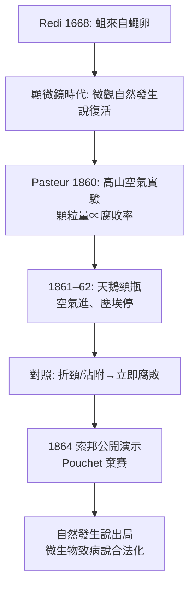

## 1862 - 巴斯德天鵝頸瓶（給自然發生說釘上棺材釘）

## 案件摘要

**本案要抓的不是一個兇手，而是一個替所有兇手作偽證的理論——「生命可以自然發生」。**

1862 年，Louis Pasteur 向法國科學院報告了「天鵝頸瓶」實驗：把肉湯裝進瓶頸拉成鵝頸狀的燒瓶，煮沸滅菌後敞口放置——空氣可以自由進出，肉湯卻長年不腐。只要把瓶頸折斷或傾斜讓液體接觸瓶頸內壁的塵粒，肉湯立即腐敗。結論：**腐敗不是液體自己「生」出來的，而是空氣中的塵埃顆粒把微生物帶進來的**。這個看似簡單的實驗終結了延續兩千年的自然發生說（spontaneous generation），為「看不見的微生物是疾病與腐敗的原因」鋪平了道路——瘴氣論的最後一個哲學庇護所就此拆除，微生物致病說（germ theory）獲得了出生證明。

## 前因 -- 為什麼會有這個案子

- **自然發生說的兩千年壽命**：從亞里士多德（腐肉生蛆、泥沼生蛙）到 17 世紀的 van Helmont（小麥襯衫生老鼠），「生命自發湧現」是常識。1668 年義大利的 Francesco Redi 用紗網罩肉實驗證明**蛆來自蒼蠅產卵**，擊退了宏觀版本；但顯微鏡發現微生物後（列文虎克，1676），微觀版本死灰復燃——「肉湯裡的微生物是自然發生的」。
- **18 世紀的拉鋸**：1748 年 Needham 的實驗（加熱封瓶後仍有微生物）支持自然發生說；Spallanzani 反駁（加熱不夠或封瓶漏氣）。兩派實驗結論互相矛盾，癥結在**空氣**：支持者認為空氣是「生命要素」，破壞空氣的加熱才是殺死生命力的兇手。
- **法國的產業背景**：19 世紀中葉，法國的釀酒、蠶絲、奶業被「變質」問題困擾——酒變酸、蠶大量死亡（pébrine）、牛羊炭疽。Pasteur 是化學家出身（分子對稱性研究成名），1857 年起接手里爾大學的釀酒問題，發現**發酵是活酵母的代謝，變酸是乳酸桿菌污染**——發酵與腐敗自此與特定微生物綁定。
- **1859 年科學院懸賞**：法國科學院設獎徵求「以精巧實驗澄清自然發生問題」的研究——本案的法庭就是這場公開競賽。對手是魯昂的博物學家 Félix Pouchet，堅定的自然發生論者。

## 線索與推理 -- 數學式、程式、理論

Pasteur 的關鍵洞察是**把爭議變數（空氣）拆成兩個獨立因素：化學性（氣體本身）與顆粒性（塵埃）**。前人吵了兩百年，是因為把兩者混為一談。

**實驗一：排除「空氣的化學本質」**——他用各種方式處理空氣後通入滅菌肉湯：高山頂的空氣（顆粒少）、平原空氣（顆粒多）、甚至用棉塞過濾的空氣。結果：**顆粒越少，腐敗越慢**；棉塞上的塵埃洗入肉湯即長菌。空氣的「化學性」無關，**顆粒性**才是關鍵。

**實驗二：天鵝頸瓶——讓空氣進、讓顆粒停**——鵝頸的彎管讓空氣對流暢通、塵埃沉積在彎管底部：

```python
# 天鵝頸瓶的邏輯
def swan_neck(flat_cervix):
    air = "自由進出"          # 滿足對手「需要空氣」的主張
    dust = settled_in_bend(air)  # 但顆粒被重力攔截
    broth = sterile()
    if not dust.reaches(broth):
        return f"腐敗: {flat_cervix(air)} → 無菌永存"
    return "折斷瓶頸/傾斜沾附 → 立即腐敗"  # 對照組
```

**對照組的致命一擊**：同樣的瓶子，只要傾斜讓肉湯流過瓶頸再流回，或直接折斷瓶頸——數小時內腐敗。**唯一的差異是塵埃是否抵達液體。**

$$ P(\text{腐敗}) = 1 - e^{-\lambda \cdot \text{塵埃量} \cdot t} \quad \Rightarrow \quad \text{塵埃量} \to 0 \text{ 時腐敗不發生} $$

（這是現代微生物學「隨機滅菌曲線」的直觀雛形：污染機率與引入的微生物載量成正比。）

**機率論的助攻**：Pasteur 還用統計回答「為什麼偶爾還是會污染」——塵埃落到瓶頸是隨機事件，樣本數夠大時必然出現漏網。他同時證明煮沸 100°C 未必殺光芽孢（後由 Tyndall 於 1876 年確立「間歇滅菌」tyndallization 對付芽孢），預先拆解了對手的實驗失誤來源。

**證據鏈**：



## 結案 -- 後果與影響

- **1864 年索邦的公開講座**：Pasteur 面對巴黎的科學名流現場演示，Pouchet 拒絕複驗並退出競賽。科學院的裁決：自然發生說出局。Pasteur 獲獎，同年當選法國科學院終身秘書之一。
- **微生物致病說的合法性**：本案之前，「看不見的東西致病」只是異端猜想；本案之後，「腐敗/發酵/疾病都有特定微生物原因」成為可檢驗的工作假說——十四年後 Koch 的炭疽實驗（`1876-科赫炭疽桿菌.md`）與 1882 年的結核桿菌（`1882-科赫結核桿菌.md`）是這條路的果實。
- **消毒與滅菌工業的誕生**：低溫巴氏殺菌（1864–65，用於酒與醋）、Lister 的石炭酸消毒外科（1865–67）、無菌手術室、罐頭工業、後來的奶品法規——全部以本案為理論起點。「無菌操作」成為醫學與實驗科學的通用語法。
- **神學與哲學的餘波**：自然發生說出局後，「生命只能來自生命」（Omne vivum ex vivo）成為生物學公理——這直接影響了遺傳學的哲學基礎，也讓「生命起源」研究轉入化學演化軌道。
- **一句話結案**：他用一個彎曲的瓶頸證明：空氣裡飄著的不是「生命力」，而是無數微小的乘客——兩千年哲學爭論，輸給了一段玻璃彎管。

## 關鍵人物與文獻

- **Louis Pasteur（1822–1895）**——化學家、微生物學奠基人；後續代表作：蠶病研究（1865–70）、炭疽疫苗（`../性病的歷史/` 系列外的 1881）、狂犬病疫苗（`1885-巴斯德狂犬病疫苗.md`）。
- **Félix Pouchet（1800–1872）**——魯昂自然史博物館館長，自然發生說的最後主將；1864 年棄賽。
- **John Tyndall**——1876 年確立芽孢與間歇滅菌，並把 Pasteur 的結果帶進英語世界。
- René Dubos, *Louis Pasteur: Free Lance of Science*（1950）。
- Gérald Geison, *The Private Science of Louis Pasteur*（1995）——依據實驗室筆記的批判性研究。
