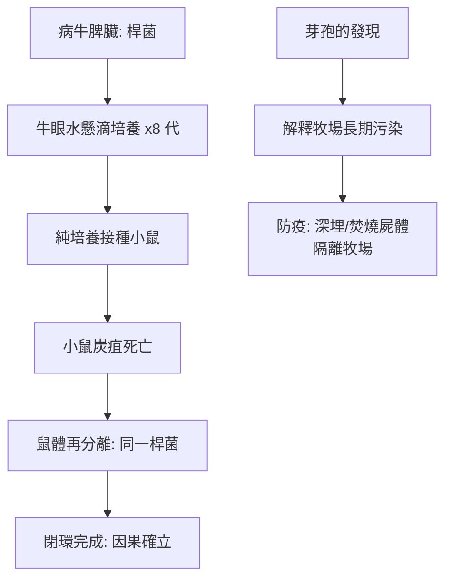

## 1876 - 科赫炭疽桿菌（第一次把桿菌與疾病綁成因果）

## 案件摘要

**本案是第一起被完整偵破的微生物謀殺案——偵查者是一位鄉下醫生，實驗室是他太太送的顯微鏡和自家客廳。**

1876 年，普魯士西里西亞小鎮 Wollstein 的開業醫師 Robert Koch 向布雷斯勞大學的植物學家 Ferdinand Cohn 與病理學家 Julius Cohnheim 展示了一組實驗：他從患炭疽死亡的牛脾臟中分離出桿狀微生物、在牛眼水溶液中連續純培養八代、把第 N 代的培養物接種到小鼠體內、小鼠出現典型炭疽而死亡、再從死鼠體內分離出**同一種桿菌**。這個閉環是醫學史上第一次有傳染病被證明由特定微生物引起——後來被凝練為「Koch 法則」（Koch's postulates）的四步推理標準。病原微生物學（bacteriology）的紀元，從這個客廳實驗開始。

## 前因 -- 為什麼會有這個案子

- **炭疽的農村災難**：19 世紀的歐洲農村，炭疽（脾瘟）定期摧毀牛群並感染農民（毛工的「羊毛工病」）。1830 年代已有醫生注意到病畜血液中的「微小桿狀體」（Pollender、Davaine、Rayer，1849–50）；Davaine 在 1863–70 年提出這些桿菌就是病因——但他無法回應兩個致命反駁：**桿菌是病因還是死亡後的旁觀者？為什麼有動物體內有桿菌卻不發病？**
- **巴斯德的前哨戰**：Pasteur 團隊 1860 年代已證明發酵與腐敗由特定微生物引起（`1862-巴斯德天鵝頸瓶.md`），但他沒有動物模型可以證明「特定病—特定菌」。瘴氣論者的最後堡壘正是動物傳染病：**「病畜的毒素讓血液腐敗，桿菌只是乘機繁殖」**——因果方向懸而未決。
- **Koch 的資源劣勢與優勢**：他是鎮上唯一醫生，沒有大學資源，但有：其一，碳絲顯微鏡與油鏡（當時最先進的觀察工具）；其二，一個閉環的實驗生態——病人是農民、樣本是牛羊、實驗動物是自購的小鼠。他沒有「科學圈」的包袱，只有一個問題：**桿菌到底是兇手還是目擊者？**
- **1875 年的突破觀察**：Koch 在懸滴培養中連續追蹤桿菌的生活史，發現了**芽孢**（spore）——桿菌在不利環境下縮成橢圓形休眠體、可存活多年，遇合適條件復活。這一發現同時解釋了炭疽的流行病學：牧場被病畜污染後，芽孢在土壤中埋伏，數年後仍能發動下一輪疫情（「被詛咒的牧場」的民間傳說獲得了解釋）。

## 線索與推理 -- 數學式、程式、理論

Koch 的證據鏈就是後來 Koch 法則的原型，每一步都在堵住反方的一條退路：

| 步驟 | Koch 的操作 | 堵住的反駁 |
|---|---|---|
| 1. 關聯 | 病畜體內恆見桿菌，健畜沒有 | 「隨機污染」說 |
| 2. 分離純培養 | 牛眼水溶液懸滴培養，傳 8 代 | 「雜菌/屍體產物」說 |
| 3. 接種重現 | 純培養接種小鼠→典型炭疽死亡 | 「毒素旁觀」說（因果方向確立） |
| 4. 再分離 | 死鼠體內重獲同一桿菌 | 「實驗室污染」說 |

$$ \text{病因證明} = \text{恆定關聯} \land \text{純培養} \land \text{再現疾病} \land \text{再分離} $$

這個四段論把「誰是兇手」從哲學辯論變成實驗程序——**任何醫學生都能照著做**。這是它比 Davaine 的觀察強大百倍的原因：可複製性就是法庭上可重複取證。

**芽孢發現的推理價值**：Koch 注意到桿菌在培養液乾燥過程中形成折射性強的橢圓小體，且加熱 80°C 仍可存活——這解釋了為什麼「屍體埋了幾年的牧場仍發病」、為什麼 Davaine 的同類實驗有時失敗（芽孢耐受性造成變異）。**流行病學之謎（牧場詛咒）被微生物生活史解開**——這是「傳播鏈」概念第一次落到一個具體的微觀機制上。

**Koch 對 Cohnheim 的經典展示**：1876 年 4 月 30 日，Cohnheim 的實驗室。Koch 自帶全部器材，三天內完成全套演示。Cohnheim 當場說出那句名言：「這是一個完整的、無懈可擊的發現。我不知道還有什麼可挑剔的。」——一個鄉下醫生，用一個假期改寫了病理學。

## 結案 -- 後果與影響

- **個人軌跡**：Koch 獲得帝國衛生局職位（1880），1882 年發現結核桿菌（`1882-科赫結核桿菌.md`）、1883 年率隊分離霍亂弧菌，1905 年獲諾貝爾獎。從客廳到斯德哥爾摩只用了 29 年。
- **Koch 法則的制度化**：1884 年由他的學生 Friedrich Loeffler 正式條文化（「Friedrich Loeffler 條款」），1890 年 Koch 本人在結核演說中引用。此後三十年，法則被套用到白喉、破傷風、肺炎鏈球菌、梅毒螺旋體……**細菌學黃金時代（1880–1900）的每一樁病原學破案都走了這條程序**。
- **獸醫公共衛生的誕生**：芽孢理論催生了屍體無害化處理、牧場封鎖、皮革與羊毛的消毒法規——人畜共通傳染病（zoonosis）防治體系的起點。
- **法則的邊界也要記錄**：無症狀帶原者（Koch 自己在霍亂研究中發現）、無法純培養的病原（梅毒螺旋體 1905 年才培養成功、麻風桿菌至今、病毒全數不適用）、僅感染人類的病原無動物模型——法則是黃金標準，不是萬能鑰匙。HIV 的確認（1983–84）即以「法則的精神」而非「字面」完成。
- **一句話結案**：他證明的不只是一種桿菌殺死一頭牛，而是**「看不見的東西可以被起訴」**——從此，傳染病偵查有了法定的取證程序。

## 關鍵人物與文獻

- **Robert Koch（1843–1910）**——西里西亞 Clausthal 碩山礦區出身、哥廷根大學醫學博士；1905 年諾貝爾生理學或醫學獎。
- **Ferdinand Cohn（1828–1898）**——布雷斯勞植物學家、細菌學期刊創辦人，本案的「科學界入口」；他對芽孢的研究也早於 Koch。
- **Julius Cohnheim（1839–1884）**——病理學家，Koch 的伯樂與終身盟友。
- **Aloys-Antoine Pollender、Casimir Davaine**——炭疽桿菌的早期觀察者，本案的「前案卷」。
- Thomas D. Brock, *Robert Koch: A Life in Medicine and Bacteria*（1988）——標準傳記。
- Koch, *Die Ätiologie der Milzbrand-Krankheit*（《炭疽病的病因學》，1876）——原文重刊於 *Medical Classics*, 1938。
