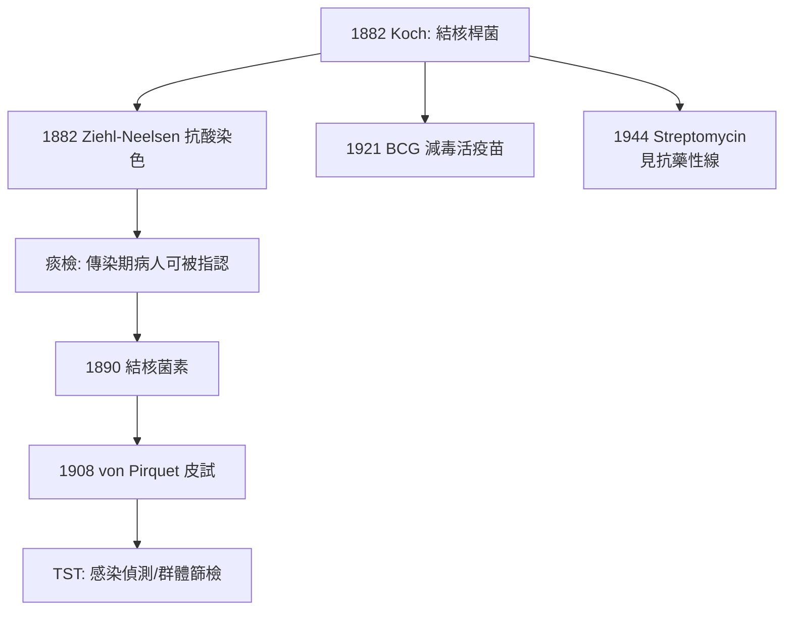

## 1882 - 科赫結核桿菌（Koch 法則的加冕禮）

## 案件摘要

**本案追捕的是人類史上殺人最多的單一病原體——牠在骨骼化石裡留下的案底超過九千年。**

1882 年 3 月 24 日晚，柏林生理學會。Robert Koch 上台展示：他從結核病人的痰與病灶中，以特殊的抗酸染色法在顯微鏡下找到一種細長桿菌；用凝固血清培養基純培養；接種豚鼠重現結核；再從病灶分離同一桿菌。**肺結核——當時歐洲每七個死者就有一人死於它的「白色瘟疫」——的病因被證明了。**更震撼的是他在演講中提出的驗證邏輯，日後被稱為「Koch 法則」（Koch's postulates）：分離、純培養、接種、再分離。本案使傳染病病原學有了憲法，也使結核成為人類第一個被系統性圍剿的慢性傳染病。世界衛生組織至今把 3 月 24 日定為「世界結核病日」。

## 前因 -- 為什麼會有這個案子

- **白色瘟疫的世紀重量**：19 世紀的肺結核（癆病）是歐洲頭號死因之一，死亡集中在 15–45 歲的勞動人口。文學史被它浸透——濟慈、雪萊、契訶夫、肖邦、卡夫卡都死於結核；「纖弱美人」的浪漫化背後是都市貧民窟的通風不良與過勞。
- **病因學的羅生門**：主流解釋有遺傳說（「癆病家族」現象）、瘴氣說、營養不良說。Pettenkofer 的慕尼黑學派堅持「土壤—地下水」的瘴氣變體。**一個會傳染但不一定發病的病原，恰好是所有理論都能各說各話的完美懸案。**
- **Koch 的技術儲備**：1876 年炭疽案（`1876-科赫炭疽桿菌.md`）後，他在帝國衛生局發明了三項通用工具——凝固血清固體培養基（純培養的分離利器）、懸氣培養技術、油鏡攝影。結核桿菌難培養、難染色，正好檢驗這些工具的極限。
- **染色攻防**：結核桿菌蠟質胞壁讓一般苯胺染料滑落。Koch 試了上百種組合，最後用亞甲藍加鹼性溶液染 24 小時、再用 Vesuvine（Bismarck brown）複染——桿菌在棕色背景上現出藍色細絲。**1882 年 8 月 Ziehl 與 Neelsen 把這個方法標準化為 Ziehl-Neelsen 抗酸染色，沿用至今。**

## 線索與推理 -- 數學式、程式、理論

**Koch 法則的正式提出**——1882 年演講與 1890 年《細菌學研究》中的經典表述：

1. 病原體應在所有該病患者體內恆定存在，且與病灶相關；
2. 應能從病體分離並在純培養中生長；
3. 純培養接種健康動物應重現該病；
4. 再從實驗動物分離出同一病原。

$$ \text{病因} = \underbrace{A}_{\text{恆定關聯}} \Rightarrow \underbrace{B}_{\text{純培養}} \Rightarrow \underbrace{C}_{\text{重現疾病}} \Rightarrow \underbrace{D}_{\text{再分離}} $$

**本案的每一步都是攻堅**：

```python
def koch_postulates(tb):
    assert tb.bacilli_in_all_patients()      # 1. 抗酸染色: 痰/病灶恆見桿菌
    culture = tb.pure_culture("coagulated_serum", weeks=6)  # 2. 結核菌 2–6 週才成落
    animal = infect(guinea_pig, culture)     # 3. 豚鼠 6 週內現典型結核
    assert reisolate(animal.lesions) == culture  # 4. 再分離
    return "結核桿菌 = 結核病之因 ✓"

# 難點: 結核菌生長極慢(倍增 15–20 小時, 大腸桿菌 20 分鐘)
#      且蠟質胞壁染色困難 → 全案耗時 1876–1882 共 6 年
```

**流行病學旁證**：Koch 同時回應遺傳說——結核的「家族聚集」不是血緣而是**長期密切接觸於不通風居室**的結果；痰中的桿菌經飛沫與塵埃傳播。這把「傳播鏈」從水（Snow）擴展到空氣（airborne transmission 的第一次系統論證）。

**1890 年的結核菌素插曲（本案的敗訴章）**：Koch 發現結核菌素（結核桿菌培養濾液）能讓感染豚鼠出現劇烈反應，宣布它可治癒結核——柏林一度陷入「菌素狂熱」。臨床失敗後聲譽受損。但敗訴章意外孕育了後代：**結核菌素的遲發過敏反應成為檢測感染的試金石**——von Pirquet（1908）的皮膚試驗演變為今天的結核菌素測驗（TST），成為血清/皮試流行病學（用免疫反應回溯暴露歷史）的經典工具。



## 結案 -- 後果與影響

- **療養院運動的科學化**：病因確認後，「新鮮空氣、休息、營養」的療養院從經驗變成公衛策略（隔離傳染源、降低接觸密度）；各國展開痰檢通報、消毒、禁止隨地吐痰運動——**結核防治成為第一個國家級慢性傳染病防控體系**。
- **細菌學的黃金三十年**：本案之後，白喉（1883 Loeffler）、傷寒（1884 Gaffky）、破傷風（1889 北里）、白喉抗毒素（1890 Behring/北里）、鼠疫桿菌（1894 Yersin/北里）……Koch 法則成為全世界的破案模板。
- **諾貝爾獎與遺產**：Koch 1905 年諾貝爾獎。他的柏林研究所成為細菌學的世界首都，學生涵蓋半個細菌學名錄。
- **抗藥性時代的伏筆**：1944 年鏈黴素（Waksman 與 Schatz）首次有效治療結核，數月內即出現耐藥菌——**單藥治療的選擇壓力教訓**（詳見 `2006-XDR結核.md`）。
- **一句話結案**：他把「誰是兇手」寫成了一部取證法典——此後一百四十年，全球每一樁新病原案（含 COVID）的起訴書，第一段都是 Koch 法則。

## 關鍵人物與文獻

- **Robert Koch**——1882 年 3 月 24 日〈Die Ätiologie der Tuberculose〉演講；1890 年《Deutsche Medizinische Wochenschrift》結核菌素論文。
- **Franz Ziehl 與 Friedrich Neelsen**——1882–83 年標準化抗酸染色。
- **Clemens von Pirquet**——1908 年結核菌素皮試；同年提出「變態反應」（allergy）一詞。
- **Albert Calmette 與 Camille Guérin**——1921 年 BCG 減毒活疫苗（牛型結核桿菌連續傳代減毒）。
- Thomas D. Brock, *Robert Koch: A Life in Medicine and Bacteria*（1988）。
- WHO, *Global Tuberculosis Report*（年度）——Koch 案件的未結餘波：結核至今仍是單一病原致死人數最高的傳染病之一。
