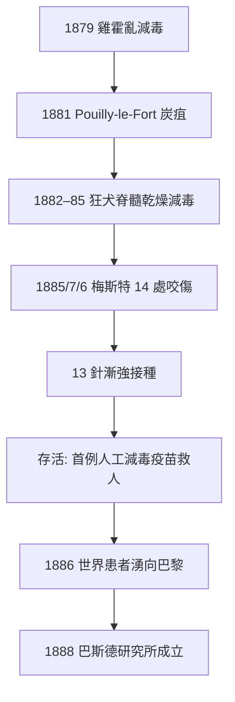

## 1885 - 巴斯德狂犬病疫苗（減毒原理的首次人體豪賭）

## 案件摘要

**本案的偵查者面對一種 100% 致死、100% 發作即無救的疾病——他押上一個 9 歲男孩的性命和自己的名譽。**

1885 年 7 月 6 日，來自阿爾薩斯的約瑟夫·梅斯特（Joseph Meister）——兩天前被瘋犬咬傷 14 處的 9 歲男孩——被母親帶到巴黎高等師範學院巴斯德的實驗室。當時狂犬病一旦發病必死無疑；巴斯德手上有的是一套尚未在人體驗證過的「減毒脊髓疫苗」。在兩位醫生評估後，他決定接種。**梅斯特存活，狂犬病沒有發作。**同年 10 月第二例（牧童 Jupille）成功；到 1886 年底，來自世界各地的咬傷患者湧向巴黎，逾 2,000 人接種，僅約 0.5% 發病（多為延誤就醫的頭面部重傷者）。本案是**人工減毒疫苗第一次用於人類的致死性傳染病**，也是「實驗室製造的免疫」取代「碰運氣的自然感染」的歷史起點。

## 前因 -- 為什麼會有這個案子

- **狂犬病的特殊難度**：病原（狂犬病毒，1903 年才被 Negri 氏體與後續研究逐漸確認其病毒性質——巴斯德時代連「病毒」概念都尚未建立）沿神經逆行至中樞，潛伏期數週至數月（與咬傷部位距離成反比），發病即死。**「發病後治療」不可能，「發病前阻斷」窗口漫長**——這個流行病學特徵使狂犬病成為疫苗後暴露預防（post-exposure prophylaxis）的完美對象。
- **巴斯德的疫苗學譜系**：1879 年他注意到雞霍亂菌株在培養中放置老化後毒力減弱、接種後雞獲得免疫（Chicken cholera vaccine，實際發現者是助手 Toussaint 之外的前例與 Chamberland/Roux 的偶然疏忽）；1881 年他用高溫培養的減毒炭疽桿菌完成 Pouilly-le-Fort 公開實驗——25 隻接種羊在毒攻後全部存活、25 隻對照羊全死。**「減毒—接種—攻毒」的免疫學範式已經成熟，只差一種人類疾病。**
- **狂犬病脊髓的「乾燥減毒法」**：巴斯德與 Roux、Chamberland、Théodore Vulpian 等發現：把病犬/病兔的脊髓懸掛在氫氧化鉀乾燥器中，**毒力隨乾燥天數遞減**，12–14 天後接種犬隻不再發病但獲得免疫。他們設計的療法是**逐日接種毒力遞增的乾燥脊髓 13 針**——在人體發病窗口期內，用漸強的免疫刺激跑贏病毒沿神經的爬行。
- **倫理困境的先置**：巴斯德本人不是醫生（化學家），依法不得行醫；他計畫先在自己身上試驗，再於死刑犯身上試——都還沒執行，梅斯特就被送到了門口。**理論上動物實驗已充分（數十隻犬免疫成功），臨床上卻無任何人體先例。**

## 線索與推理 -- 數學式、程式、理論

**推理的核心：與病毒賽跑的免疫動力學。**狂犬病毒從咬傷處沿周邊神經以每天約 5–100 mm 向中樞爬行（現代數據），免疫抗體的產生需要約 7–10 天。治療的數學目標是：

$$ t_{\text{抗體足量}} < t_{\text{病毒抵達 CNS}} + \text{潛伏期餘量} $$

漸強接種的設計正是為此：第一針（弱毒）啟動免疫，後續針次毒力遞增以把抗體滴度推到高位——**在 13 天內把免疫拉滿，同時讓前幾針的弱毒不致引爆疾病**。

```python
def rabies_pep(bite, spinal_cords):
    # spinal_cords[0..12] 乾燥天數遞減 → 毒力遞增
    for day, cord in enumerate(spinal_cords):
        inject(cord.dose)          # 第 day+1 針
        if antibody_titer() > threshold:
            break                  # 免疫跑贏病毒
    return survived
# 現代 PEP 已改為組織培養疫苗 4–5 針 + 免疫球蛋白被動免疫
# 但「跑贏潛伏期」的數學結構完全相同
```

**減毒的機制側寫**（後世補證）：乾燥使病毒對毒力相關的複製優勢產生隨機突變累積（以及神經外的複製損耗）——這是經驗式減毒（empirical attenuation），與詹納的牛痘（借用動物病原，`../感染科的歷史/1980-天花根除.md`）不同路線：**巴斯德是第一個在實驗室裡「親手造出」疫苗株的人。**

**成功後的統計檢驗**：1886 年巴斯德向科學院報告 1,835 例（多為頭面重傷），發病 36 例（約 2%）；而歷史對照組中，頭部咬傷未處理者的發病率高達 40%–60%。用相對風險的語言：

$$ RR = \frac{P(\text{接種後發病})}{P(\text{未接種發病})} \approx \frac{0.02}{0.5} = \frac{1}{25} $$

——在沒有隨機對照試驗概念的年代，這個自然對照已足以說服世界。



## 結案 -- 後果與影響

- **巴斯德研究所（1888）**：全球捐款湧入建成的私營醫學研究所，成為疫苗學與微生物學的世界重鎮；此後巴黎之外在全球建立 30 餘所巴斯德研究所網絡（河內、西貢、金邊、塞內加爾……），其中河內的 Yersin 就是從這裡走向香港抓到鼠疫桿菌的。
- **梅斯特的餘生**：他成年後在巴斯德研究所當門房直到 1940 年去世——德軍占領巴黎時，據傳他因拒絕讓納粹進入巴斯德墓室而自殺（史實有爭議，但已成傳說）。他終身未發病，是本案最長的後續觀察。
- **疫苗學的三條路線確立**：減毒活疫苗（巴斯德/BCG/沙賓）、滅活疫苗（沙克，`1955-沙克小兒麻痺疫苗.md`）、亞單位與重組（現代）。**本案是路線一的出生證明。**
- **倫理範式的先聲**：本案是「實驗性治療用於無其他選擇的危重患者」的先例——compassionate use 的遠祖；其倫理張力（未經人體試驗直接用於兒童）至今仍是臨床試驗倫理學的討論案例。對照 1932 年 Tuskegee（`../性病的歷史/1932-塔斯基吉梅毒實驗.md`）與瓜地馬拉實驗，疫苗史的道德答卷同樣參差。
- **全球狂犬病防治**：今天 WHO 估計每年仍有約 5.9 萬人死於狂犬病（多為亞非農村的犬傳播）——「零狂犬病」（Zero by 30）計畫是本案 140 年後的未竟工程。
- **一句話結案**：他賭贏的不是運氣，是動力學——用 13 天的免疫爬坡，跑贏一條沿神經爬行的病毒；這場賽跑的賽道，至今每一針狂犬病疫苗都還在用。

## 關鍵人物與文獻

- **Louis Pasteur**——1885 年 10 月 26 日向科學院的報告；「咬傷後接種」自此被稱為巴斯德療法。
- **Émile Roux、Charles Chamberland**——實驗核心助手；Roux 後來主持白喉抗毒素（1894）。
- **Joseph Meister 與 Jean-Baptiste Jupille**——第一、二位接種者。
- Gerald Geison, *The Private Science of Louis Pasteur*（1995）——依實驗室筆記重構本案，包括未公開的動物實驗細節與倫理爭議。
- Hervé Bazin, *Vaccination: A History*（2011）。
- WHO, *Rabies: Key Facts* 與 Zero by 30 全球計畫（2018）。
