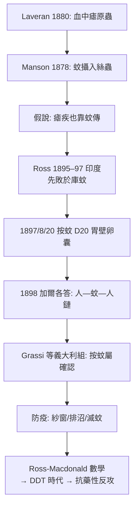

## 1897 - 羅斯瘧疾蚊媒（蟲媒病的破案，與一場二十年的榮譽訴訟）

## 案件摘要

**本案的兇手不是人、不是空氣、不是污水——是一種全世界都沒想過會背命案的昆蟲。**

1897 年 8 月 20 日，印度 Secunderabad 駐軍醫院的英國軍醫 Ronald Ross 解剖了一隻「暗斑按蚊」（*Anopheles*，他編號 D20）的胃壁，在顯微鏡下看到了瘧原蟲的卵囊——**蚊子體內的瘧原蟲發育週期被完整目擊**。人類傳播最廣、殺人最多的傳染病（瘧疾，至今每年仍致 60 萬人死亡）的傳播機制就此揭曉：**瘧疾不在瘴氣裡，在按蚊的唾液腺裡**（「malaria」= 壞空氣，這個名字本身記錄了舊理論的敗訴）。本案同時是一場長達二十年的榮譽官司：Ross 與義大利學者、以及與他的上司 Patrick Manson 之間的發明權之爭，成為科學史上的著名公案。

## 前因 -- 為什麼會有這個案子

- **瘧疾的世界重量**：19 世紀末，瘧疾橫行於全球熱帶與溫帶（包括英國沼地、義大利羅馬平原、美國南部）。「羅馬熱」每年擊倒訪客，美國內戰南北兩軍約半數病假是瘧疾。「miasma」理論以「沼氣/壞空氣」解釋——沼澤確實與瘧疾相關（這個「相關」是真的），只是因果鏈中間站著一隻蚊子。
- **Laveran 的前案**：1880 年，法國軍醫 Alphonse Laveran 在阿爾及利亞君士坦丁的病人血液中看到瘧原蟲（*Plasmodium*）——瘧疾是原蟲病而非「壞空氣病」。1885 年 Golgi 區分間日瘧與惡性瘧。1907 年 Laveran 獲諾貝爾獎。**病原已現形，傳播鏈仍成謎：原蟲如何從一個人進入另一個人？**
- **Manson 的「蚊—絲蟲」先例與大膽假說**：熱帶醫學之父 Patrick Manson 1878 年在中國廈門證明象皮病的絲蟲幼蟲會被庫蚊攝入（雖然他對傳播方式的推論錯了——他以為蚊子落水後幼蟲經水感染人）。1880 年代末他向 Ross 提出**蚊子—瘧疾假說**：瘧原蟲也靠蚊子傳播。Manson 沒有熱帶現場，把問題交給了駐印的 Ross。
- **印度現場的地獄條件**：Ross 起初是自學的顯微鏡新手，在印度各站輾轉，缺乏文獻與同伴；印度瘧疾研究者尚有其他候選理論（土壤水、飲水污染）。他花了兩年多、解剖了成千上萬隻蚊子，屢屢失敗——因為他最初用的是**庫蚊與家蚊**（不吸瘧疾患者血的正確蚊種不在手上），直到 1897 年轉向當地隨處可見的按蚊。

## 線索與推理 -- 數學式、程式、理論

**第一階段（1895–1897）：鳥瘧模型破案。**人體實驗受限（用病人餵蚊涉及倫理與行政阻礙），Ross 轉向鳥瘧（*Proteosoma*，今 *Plasmodium relictum*）——以麻雀為模型。1897 年 8 月 20 日，D20 號按蚊（吸過病鳥血、培育 7 天）的胃壁出現圓形卵囊；8 月 21 日卵囊破裂、子孢子湧入體腔。**鳥—蚊—鳥的完整循環被建立。**

**第二階段（1898）：人類鏈條的補全。**Ross 在加爾各答用病人血餵按蚊、再讓蚊子叮咬志願者（他的助手 Mohammed Bux 與 Sonaram）與實驗鳥，成功引發瘧疾。同年，義大利學者 **Giovanni Grassi、Amico Bignami、Giuseppe Bastianelli** 以人瘧原蟲（*P. falciparum*/*vivax*）與按蚊完成了更完整的人類傳播證明，並確認**只有按蚊屬**是病媒（解釋了為什麼「沼澤有關但非所有蚊子」）。

**羅斯瘧疾數學（本案的意外副產品）**：Ross 不滿足於生物學證明，他要解釋**為什麼同一片沼澤有時流行有時平息**。他發展出瘧疾傳播的數學模型（1910–11 年成書《The Prevention of Malaria》），核心不等式：

$$ R_0 = \underbrace{\frac{ma^2bp^n}{-r \ln p}}_{\text{Ross-Macdonald 模型前身的參數}} \quad \begin{cases} m = \text{蚊子/人比} \\ a = \text{叮咬頻率} \\ b = \text{感染效率} \\ p = \text{蚊子日存活率} \\ n = \text{胞子增殖期} \\ r = \text{恢復率} \end{cases} $$

**關鍵洞察：$R_0$ 對 $m$（蚊密度）是線性、但對 $p^k$（蚊壽命的指數項）是超敏感的。**因此**殺成蚊比降低蚊密度更有效**——這解釋了為什麼少量殺蟲劑（後來的 DDT）能崩解疫情，也解釋了為什麼排水（減少孳生地）常常不夠。**這是傳染病數學第一次直接指導公共衛生戰術**，是 $R_0$、群體免疫閾值這套語言的史前史。

**榮譽官司的判決**：1902 年諾貝爾生理學或醫學獎「因其對瘧疾的研究，顯示瘧原蟲如何進入生物體」頒給 Ross 獨享；Grassi 團隊全軍盡墨（Grassi 至死不平，多次提名未中）。史學界的平衡判決：**鳥瘧模型屬 Ross，人類傳播鏈的關鍵一環屬 Grassi**——這是科學史「單一英雄敘事」的著名反例。

## 結案 -- 後果與影響

- **熱帶醫學的誕生**：蚊子—瘧疾、蚊子—黃熱（1900 年 Reed 團隊在哈瓦那的志願者實驗）、采采蠅—昏睡病（1903）、白蛉—黑熱病（1903–08）……十年間蟲媒病逐一破案。殖民地的經濟學動機（橡膠園、鐵路、運河）與科學在此交織——巴拿馬運河工程（1904–14）的成功，一半靠 Gorgas 滅蚊。
- **滅蚊運動的第一黃金期**：義大利羅馬平原的排水與油膜覆水、馬來亞錫礦區的孳生地管理（Malcolm Watson 的「種族瘧疾學」）、美國南部的篩窗運動。**瘧疾在 20 世紀中葉的溫帶世界基本消失**——本案的直接果實。
- **數學流行病學的誕生**：Ross-Macdonald 模型是後來一切傳染病數學（Kermack-McKendrick 1927 的 SIR、Anderson-May 的 HIV 模型、COVID 的 SEIR）的直系祖先。**瘧疾的研究教會人類：傳播是一個可以計算、從而可以干預的過程。**
- **抗藥性的長影**：氯喹抗性（1950 年代末泰柬邊境出現）與蚊蟲殺蟲劑抗性催生青蒿素（屠呦呦 1972，2015 諾獎），而青蒿素緩效抗性 2008 年再度出現（`2008-青蒿素抗藥性.md`）——本案開啟的戰爭至今未結束。
- **一句話結案**：兇手最終被起訴的不是一隻蚊子，而是**一個生態位**——人類學會了對付的不是個體，而是「蚊子—人—原蟲」這條三環鏈；以及，用數學算出鏈條最脆弱的一環。

## 關鍵人物與文獻

- **Ronald Ross（1857–1932）**——英屬印度軍醫；1902 年首屆諾貝爾生理學或醫學獎（第二屆）得主；自傳《Memoirs》詳載其訴訟與偏執。
- **Patrick Manson（1844–1922）**——熱帶醫學之父，倫敦熱帶醫學院創辦人；本案的假說提供者與資源調度者。
- **Giovanni Grassi（1854–1925）、Bignami、Bastianelli**——人類傳播鏈的完成者。
- **Alphonse Laveran（1845–1922）**——1880 年瘧原蟲發現者，1907 年諾貝爾獎。
- W. D. Foster 與 Gordon Harrison, *Mosquitoes, Malaria, and Man*（1978）。
- Ross, *The Prevention of Malaria*（1910/1911）；Smith et al. 對 Ross-Macdonald 模型史的系統回顧（*Am. J. Trop. Med. Hyg.*, 2012）。
