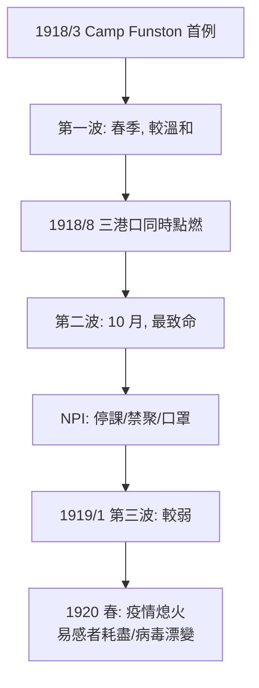

## 1918 - 西班牙流感（R₀ 不到 2 卻殺死五千萬人的空氣殺手）

## 案件摘要

**本案是傳染病史上殺人最多的一樁——而兇手的「攻擊力」（$R_0 \approx 1.5\text{–}2.5$）在所有大瘟疫中幾乎墊底。**

1918 年 1 月至 1920 年 12 月，「西班牙流感」（H1N1 甲型流感）分三波席捲全球，感染約 5 億人（當時世界人口三分之一）、死亡 5,000 萬（WHO 與多數估計）至 1 億人（Taubenberger 較高估計）——**超過同期第一次世界大戰死亡總數，超過黑死病在歐洲的絕對死亡數**。本案最令人不安的細節：它殺的主要不是老人與幼兒，而是 20–40 歲的青壯年（死亡率曲線呈現反常的 W 形）；它只需要咳嗽——一種經空氣飛沫傳播、基本再生數不到 3 的病毒，就完成了黑死病用跳蚤與老鼠做不到的事。病原體本身直到 1933 年才被分離（英國 Smith、Andrewes、Laidlaw 分離出甲型流感病毒），2005 年 Taubenberger 與 Tumpey 團隊從阿拉斯加凍土遺骸中完成全基因組測序與復活實驗，才把「為什麼 1918 年特別毒」的問題推進到分子層面。

## 前因 -- 為什麼會有這個案子

- **戰爭是超級放大器**：一戰把數百萬年輕人塞進戰壕、軍營、運兵船。1918 年 3 月，堪薩斯 Funston 軍營報告首批病例（Camp Funston，開戰首日 100 人發病）；美軍此後 18 個月內運送 200 萬士兵橫渡大西洋——**每一次運兵船都是一艘瘟疫船**。1918 年 8 月第二波在非洲塞拉利昂 Freetown、法國 Brest、美國 Boston 三個港口城市幾乎同步點燃。
- **審查制度與「西班牙」的冤案**：交戰國（美英法德）實施新聞管制，疫情被遮蔽；**中立的西班牙媒體自由報導其國王 Alfonso XIII 染病**，於是世界把疫名扣給了無辜的西班牙——「西班牙流感」是媒體管製造成的命名事故（今日公衛界已棄用地名命名，COVID 時代 WHO 明文規定）。
- **病理學的困惑**：1918 年屍檢顯示肺部變化異於典型細菌性肺炎——但當時沒有「病毒」的培養技術（細菌學黃金時代的工具全部失靈，Koch 法則的字面程序無法起訴）。主流解釋是「Pfeiffer 氏流感桿菌」（*Haemophilus influenzae*，1892 年得名，實為錯誤定罪）——本案的錯誤嫌疑人掛牌 40 年。
- **1918 年秋天 W 形死亡的謎**：為什麼青壯年死亡最多？「細胞因子風暴」假說（強免疫反應反噬宿主，故免疫旺盛者受害）與「繼發細菌感染」說（20–40 歲肺結核/戰壕肺背景）至今並存——2005 年復活實驗證實 1918 病毒在小鼠與獼猴引發失控的肺泡免疫風暴，支持前者的分子基礎。

## 線索與推理 -- 數學式、程式、理論

**第一重推理：傳播動力學。**流感經飛沫與接觸傳播，潛伏期 1–4 天、可無症狀傳播——這使它成為最難圍堵的病原。1918 年數據反推的 $R_0$ 約 1.5–2.5：

$$ R_0 = \beta \cdot c \cdot d \approx 2 \quad \Rightarrow \quad \text{群體免疫閾值} = 1 - \frac{1}{2} = 50\% $$

——**它不需要像天花那樣燒掉 80% 人口，只需要感染一半人口**，而全世界沒有任何城市的醫療與殯葬系統能承受這個速度。波士頓、費城的死亡曲線（1918 年 9 月底到 10 月初，費城一天埋 759 人、木棺脫銷）是這條式子的社會代價。

```python
# 1918 vs 天花: 為什麼 R0=2 殺的人比 R0=4 還多
killers = {
    "天花":   {"R0": 4, "死亡率": 0.30, "傳播途徑": "接觸/飛沫(可隔離)"},
    "鼠疫":   {"R0": 3, "死亡率": 0.60, "傳播途徑": "蚤/接觸(可檢疫)"},
    "1918流感": {"R0": 2, "死亡率": 0.025, "傳播途徑": "空氣(無法隔離咳嗽)"},
}
# 殺傷總數 = R0 × 死亡率 × 傳播難度⁻¹ × 人口基數
# 空氣傳播讓「隔離」這個 1348 年以來的主力武器失效
# 低 R0 但無法切斷的傳播, 勝過高 R0 但可圍堵的傳播
```

**第二重推理：非藥物干預（NPI）的先驗證。**1918 年美國各城市採取了學校停課、禁聚、口罩令（舊金山 1918 年 10 月起強制口罩，違者罰款入監）；Markel 等人（*JAMA*, 2007）對 43 個城市的回溯分析顯示：**早期（疫情指數期前）實施且持續維持 NPI 的城市，死亡峰值顯著更低、曲線被「壓平」**——但措施一旦過早解除，疫情反彈。**「壓平曲線」（flatten the curve）這個 2020 年 COVID 的核心詞彙（`2020-COVID19大流行.md`），語法完全來自 1918。**



**第三重推理：病毒的本體確認。**1933 年，倫敦國家醫學研究所的 Smith、Andrewes、Laidlaw 用雪貂實驗分離出甲型流感病毒（雪貂至今仍是流感研究模式動物）；1936 年瘋卵培養法（Burnet）使疫苗量產成為可能。2005 年，Taubenberger（病理）與 Tumpey（復活）從 1918 年 Brevig Mission 凍土遺骸（72 名死者中的遺體保存者）與福爾馬林石蠟塊完成全基因組：H1N1，其 HA、PB1-F2 與聚合酶基因被指認為毒力相關——**Koch 法則在病毒時代的精神續審：核酸序列 + 反向遺傳學重建 + 動物模型重現**。

## 結案 -- 後果與影響

- **人口與政治**：印度死亡 1,700 萬（最重災區）、美國 67.5 萬；挪威、斐濟、薩摩亞的社會結構被重創（西薩摩亞 22% 人口死亡，而紐西蘭管制的斐濟死 5%——檢疫差異的天然對照）。一戰談判因疫情延宕；威爾遜總統在巴黎和會期間感染（有史家論證其認知受損影響凡爾賽條約的嚴苛度——未證實但被廣泛討論）。
- **衛生體系的制度遺產**：各國建立常設的流感監測；1923 年蘇聯早期即建公共衛生體系；WHO 的全球流感監測網絡（GISRS, 1952）與 1947 年倫敦「世界流感中心」直接承襲 1918 的教訓——**「下一次大流行」從此成為公衛的永久議程**。
- **疫苗與抗病毒藥**：1944 年美軍流感疫苗問世；奧司他韋（1999）。但每年的抗原漂變（antigenic drift）使流感疫苗必須每年重打——**1918 教會人類：RNA 病毒的演化速度就是防疫的倒計時**。
- **2005 年復活實驗的倫理爭議**：重建一個殺死五千萬人的病原體是否應該？這場辯論（连同 2011 年 H5N1 ferret 氣溶膠實驗風波）直接催生了生物安全的「兩用性研究」（dual-use research）治理規則——**本案的偵查技術本身成為新的風險**。
- **一句話結案**：本案證明殺人最多的不一定是 $R_0$ 最高的病原，而是**與全球交通網絡、社會擁擠與資訊封鎖配合得最好的那個**——1918 年是運兵船與審查，2020 年是航班與算法。

## 關鍵人物與文獻

- **John Barry**, *The Great Influenza*（2004）——本案的標準敘事史，記載費城醫官 Wilmer Krusen 拒絕早期警示的決策悲劇。
- **Jeffery Taubenberger**——AFIP 病理學家，1997 年起重構 1918 基因組；2005 年 *Nature*/*Science* 三篇系列。
- **Terrence Tumpey**——CDC，2005 年以反向遺傳學復活 1918 病毒（僅限 BSL-3-enhanced）。
- **William H. McNeill**, *Plagues and Peoples*（1976）。
- **Markel et al.**, "Nonpharmaceutical Interventions Implemented by US Cities During the 1918–1919 Influenza Pandemic" (*JAMA*, 2007)。
- Taubenberger & Morens, "1918 Influenza: the Mother of All Pandemics" (*Emerg. Infect. Dis.*, 2006)。
