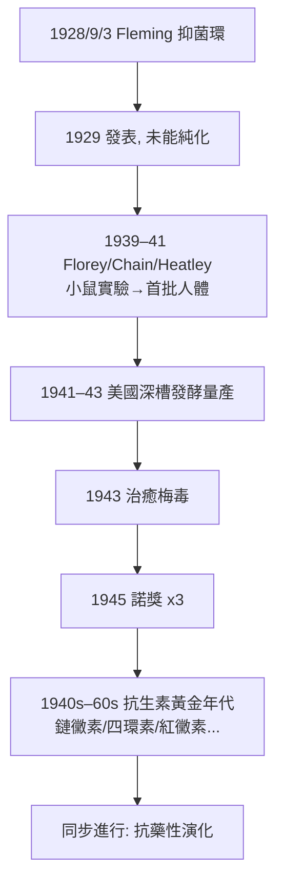

## 1928 - 弗萊明青黴素（抗生素革命的起點）

## 案件摘要

**本案的關鍵物證，是一枚被忘在培養皿角落、且恰好被一顆黴菌孢子擊中的培養皿。**

1928 年 9 月 3 日，倫敦 St Mary's 醫院的 Alexander Fleming 度假返任，發現一枚棄置在洗手槽邊的金黃色葡萄球菌培養皿被黴菌污染——黴落周圍出現一圈透明的抑菌環，環外的細菌照常生長。他鑑定這黴菌為 *Penicillium notatum*（今 *P. rubens*），把其分泌物命名為「青黴素」（penicillin），並於 1929 年發表論文。此後十年無人量產；1940–41 年牛津的 Florey、Chain、Heatley 團隊完成純化、動物實驗與首批人體試驗；1943 年青黴素治癒梅毒（`../性病的歷史/1943-青黴素治癒梅毒.md`）；1945 年三人獲諾貝爾獎。**人類第一次擁有能系統性殺滅細菌而不傷自身的化學武器——抗生素時代自此開始，而抗藥性的倒計時也自此開始。**

## 前因 -- 為什麼會有這個案子

- **細菌感染的無解時代**：1920 年代的醫院，肺炎、敗血症、腦膜炎、心內膜炎幾乎等於死刑；傷口感染靠截肢與祈禱。磺胺要到 1935 年 Domagk 才登場（Prontosil，1939 諾獎）。**醫學對細菌病只有支持療法與血清療法。**
- **Fleming 的職業敏感**：他本人是一戰的戰地軍醫，親眼見過傷口感染的浩劫；他在 1922 年已發現溶菌酶（lysozyme，淚液唾液中的天然抗菌酶）——**他一直在找「殺菌不傷細胞」的物質**。這個前史讓他看到抑菌環時沒有把它當失敗扔掉。
- **偶然的鏈條**（史學界對「純運氣說」的修正）：那枚培養皿為何沒被消毒處理？Fleming 當時正好在度假、實驗室的菌落觀察習慣、倫敦 1928 年 7–8 月的異常低溫（適合 *Penicillium* 生長而葡萄球菌暫停分裂）、樓下 Barry 的黴菌培養室——運氣與習慣共同完成作案。**科學史名句在此：Chance favours the prepared mind.**
- **量產的十年空白**：Fleming 的團隊無法穩定提純（青黴素化學不穩定、水溶性高），臨床試驗僅限外用防腐與少數局部病例，且 1930 年後他幾乎放棄。**發現者不是完成者，是本案的第一課。**

## 線索與推理 -- 數學式、程式、理論

**第一重推理：為什麼青黴素能殺菌不傷人？**目標是細菌細胞壁的肽聚醣交聯——一條人類細胞完全沒有的代謝途徑：

$$ \text{肽聚醣交聯}: G - L - Ala - D - Ala \xrightarrow{\text{轉肽酶（PBP）}} \text{交聯完成的細胞壁} $$

$$ \beta\text{-內醯胺環} \; \approx \; D\text{-Ala}-D\text{-Ala 的結構類似物} \;\Rightarrow\; \text{轉肽酶被共價誘捕} \;\Rightarrow\; \text{壁崩解、細胞溶解} $$

**選擇性毒性**（selective toxicity）——Ehrlich 的「魔法子彈」理想（`../性病的歷史/1910-埃爾利希洒爾佛散606.md`）在此第一次以天然物實現。這條式子也預言了抗藥性的主戰場：細菌只要造出 β-內醯胺酶切開這個環，青黴素即失效。

**第二重推理：從培養皿到病床的量產方程。**牛津團隊 1940 年的關鍵小鼠實驗（8 隻感染鏈球菌小鼠：未治療 4 隻全死、治療 4 隻全活）與 1941 年首位人體病患 Albert Alexander（警察，被玫瑰刺傷後敗血症）——用盡全部存量後病情回頭死亡。**量產突破在美國**：深槽發酵（submerged fermentation）、玉米浸液（corn steep liquor）、菌株改良（Peoria 實驗室從甜瓜上找到的 *P. chrysogenum*，NRRL 1951，產量提升數十倍）與 X 射線誘變。

```python
# 抗生素的量產曲線（1943–45 美國戰時生產體系）
production = {1943: 21e9, 1944: 1.7e12, 1945: 6.8e12}  # 單位: 活性單位
price_per_dose = {1943: 20.0, 1945: 0.55}              # 美元
# 戰爭把「實驗室化合物」變成「工業品」——
# D-Day 登陸前盟軍已儲備 2.3 萬磅青黴素
```



**第三重推理：抗藥性的先見**——Fleming 在 1945 年諾獎演說中的預警：

> 「無知之人可能容易透過用量不足，讓微生物對青黴素產生抗性。」

選擇壓力的數學：藥物濃度低於最小抑菌濃度（MIC）時，殺死敏感菌、放走耐藥菌——**這是達爾文選擇在培養皿裡的實時上演**：

$$ \frac{dN_{\text{res}}}{dt} = r_{\text{res}} N_{\text{res}} \cdot \left(1 - \frac{N_{\text{res}}}{K}\right) \quad \text{當} \; \text{濃度} < \text{MIC}_{\text{res}} $$

1940 年 Abraham 與 Chain 就已從大腸桿菌分離出青黴素酶（β-內醯胺酶）——**在青黴素量產之前，耐藥酶已經存在於自然界**。這是本案最深刻的附卷：抗藥性不是被發明出來的，是被選擇出來的。

## 結案 -- 後果與影響

- **抗生素黃金年代（1940–1965）**：鏈黴素（1943，Waksman，結核的第一藥）、氯黴素（1947）、四環素（1948）、頭孢菌素（1945 發現/1960s 應用）、紅黴素（1952）、萬古黴素（1956）……**人類平均壽命的躍升，抗生素與疫苗並列兩大支柱**。結核、梅毒、肺炎、傷寒——五十年前的不治之症變成門診處方。
- **外科革命**：心臟手術、器官移植、化療患者的「無菌保護傘」全部以抗生素為前提——**沒有青黴素就沒有現代手術科**（`../手術的歷史/`）。
- **抗藥性的同步反攻**：1940s 淋病耐藥、1950s 金葡菌 80% 帶青黴素酶、1960s MRSA 出現（1961）、1980s 萬古黴素耐藥腸球菌（VRE）、2000s CA-MRSA、2010s CRE 與 MCR-1 多黏菌素耐藥——**每一代新藥上市的平均耐藥年限在縮短**（詳見 `2025-噬菌體與超級細菌.md`）。
- **公共衛生的自滿陷阱**：1950–60 年代，外科教科書宣稱「感染問題已被解決」；感染科作為獨立學科的建立（1960s末–70s）正是對這份自滿的專業反擊。
- **一句話結案**：本案的偵查者找到了史上最強的兇器，卻同時打開了演化這個無限彈藥庫——**抗生素的每一次勝利，都是給細菌的上課鈴**。

## 關鍵人物與文獻

- **Alexander Fleming（1881–1955）**——St Mary's 醫院細菌學家；1929 年 *Br. J. Exp. Pathol.* 論文。
- **Howard Florey（1898–1968）、Ernst Chain（1906–1979）**——牛津 Dunn 病理學院，1940 年 *Lancet* 動物實驗、1941 年首批人體試驗。
- **Norman Heatley（1911–2004）**——量產工程天才，從尿液回收青黴素；諾獎遺珠，1990 年牛津首度頒授榮譽醫學博士補償。
- **Mary Hunt**——Peoria 實驗室的實驗助理，甜瓜黴菌（挖到 *P. chrysogenum*）的採購者。
- Gwyn Macfarlane, *Alexander Fleming: The Man and the Myth*（1984）；Eric Lax, *The Mold in Dr. Florey's Coat*（2004）。
- Brown, *Penicillin Man*（2004）；WHO, *Global Antimicrobial Resistance Surveillance System Report*（年度）。
