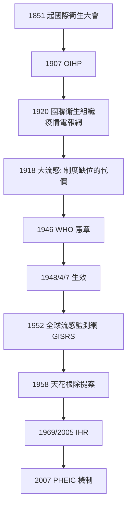

## 1948 - 世界衛生組織成立（防疫從國家責任變成全球制度）

## 案件摘要

**本案的兇手不是某種病原，而是「每個國家各自為戰」這個結構本身。**

1948 年 4 月 7 日，世界衛生組織（WHO）憲章正式生效——這一天後來被定為「世界衛生日」。WHO 是聯合國體系中第一個、也是至今唯一的全球衛生主管機構，憲章第一條開宗明義：「享受最高而能獲致之健康標準，為人人基本權利之一。」它整合了此前近百年的碎片化國際衛生體系（1907 年巴黎國際公共衛生局 OIHP、1920 年國際聯盟衛生組織 LNHO、泛美衛生局），並把「傳染病偵查」制度化為**全球常設任務**：流行病學情報交換、國際衛生條例（IHR）、標準化命名與診斷、根除計畫。此後的每一場全球疫情——天花根除、SARS、COVID——都是在這個制度框架內（或與其摩擦中）上演的。

## 前因 -- 為什麼會有這個案子

- **霍亂會議的百年傳統**：1851 年起，歐洲各國輪流召開「國際衛生大會」（至 1894 年共 8 次），為的是**保護歐洲不受亞洲霍亂侵襲**——本質是貿易保護主義的檢疫協調。1907 年巴黎 OIHP 是第一個常設機構；1920 年 LNHO 把情報交換制度化，1930 年代建立了全球流行病學通報電報網（Weekly Epidemiological Record 的前身）。
- **制度的失敗樣本**：1918 年大流感期間，交戰國審查疫情、國聯衛生組織無權介入（戰時且美國未加入國聯）——**全球最需要情報共享的時刻，制度完全缺位**。本案的偵查者（John Barry 稱之為「史上最偉大的流行病學災難」）證明：**沒有制度，單個天才（Snow、Ross）的破案無法複製到全球尺度**。
- **戰後的重建理想**：1945 年舊金山會議上，中國代表團（施思明）與巴西代表（Geraldo de Paula Souza）聯合提案設立專門衛生組織；1946 年紐約國際衛生會議通過 WHO 憲章，195 個國家簽署。「Health for all」的理想主義與冷戰現實並行起步。
- **根除主義的先聲**：國聯時代已提出瘧疾與天花根除的構想；蘇聯 1958 年在 WHO 大會正式提案全球天花根除——制度（WHO）與科學（疫苗、噴霧滅蚊、實驗室網絡）的結合，使「消滅一種人類傳染病」第一次成為可操作的政治目標。

## 線索與推理 -- 數學式、程式、理論

**第一重推理：為什麼傳染病防治必須是全球制度？**答案在傳播動力學——病原不看國界：

$$ R_{\text{全球}} = \sum_{i} R_{0,i} \cdot \frac{S_i}{N_i} \quad \text{而} \quad S_i \text{ 由最低防護水準的國家決定} $$

只要有一個國家存在未阻斷的傳播鏈，全球就有再引入風險。**這是「最薄弱環節模型」**：任何國家的防疫缺口都會輸出到全世界。天花根除（`1980-天花根除.md`）與 COVID（`2020-COVID19大流行.md`）分別是這個模型的正例與反例。

**第二重推理：情報的時間差就是死亡率。**國聯時代的電報通報網把疫情情報從數月縮短到數天；WHO 時代的 Weekly Epidemiological Record、後來的 GOARN（全球疫情警報與反應網絡，2000）與 OpenWHO 平台，把「情報—行動」延遲繼續壓縮：

```python
def outbreak_death_toll(detection_delay_days, growth_rate_r):
    # 指數增長下, 偵測延遲每多一天, 累積病例多乘 (1+r)
    delay_penalty = (1 + growth_rate_r) ** detection_delay_days
    return f"每延遲 {detection_delay_days} 天, 病例規模 × {delay_penalty:.2f}"

print(outbreak_death_toll(30, 0.2))   # 1918 式延遲: ×237
print(outbreak_death_toll(7, 0.2))    # 2020 式延遲: ×3.6
# 制度的價值 = 把這個乘數壓到最小
```

**第三重推理：國際衛生條例（IHR）的法律進化**——

| 版本 | 年份 | 核心機制 |
|---|---|---|
| IHR 1969 | 1969 | 通報六種檢疫疾病（鼠疫、霍亂、黃熱、天花、斑疹傷寒、回歸熱） |
| IHR 2005 | 2005 | 「不論原因的公共衛生緊急事件」+ PHEIC（國際關注公共衛生緊急事件）宣告機制 |
| IHR 修訂 | 2024 | 強化資金與透明（疫情後改革，仍待各國落實） |

**PHEIC 機制（2007 年首次施行）是本案的關鍵發明**：讓 WHO 總幹事可以在「沒有國家同意」的情況下宣告全球緊急狀態——這是對 1918 式資訊封鎖的法律對沖。SARS（2003）是 IHR 2005 改革的直接動機，COVID（2020）是 PHEIC 的第一次大型實戰（也暴露了其非強制性缺陷）。



## 結案 -- 後果與影響

- **根除計畫的執行平台**：天花根除（1959 提案/1967 強化計畫/1980 驗收）、小兒麻痺根除計畫（GPEI, 1988 至今）、麥地那龍線蟲、瘧疾根除（1955–69 失敗案例）、被忽視熱帶病（NTD）計畫——**WHO 是人類「消滅疾病」野心的唯一全球載體**。
- **標準化的權力**：疾病分類 ICD（起源於 1893 Bertillon 分類，WHO 接管至 ICD-11）、藥典、疫苗預認證（PQ）、生物參考品——**全球衛生的「度量衡局」**。
- **冷戰中的中立性**：1948–2026 年，WHO 在政治夾縫中維持技術中立（天花根除是美蘇罕見的合作專案）；美國的會員資格波動（2020–21 退出又返回）顯示其政治脆弱性。
- **COVID 的雙重教訓**：2020 年 PHEIC 宣告（1 月 30 日）與「pandemic」宣告（3 月 11 日）被批評延遲；但 WHO 同時協調了 COVAX 疫苗分配與變異株追蹤——**制度有用但不夠快、不夠硬**，2024 年 IHR 修訂與「大流行協定」即為補丁。
- **一句話結案**：人類花了近一百年學會一件事——**瘟疫是一個網路問題，而網路問題需要網路級的偵探社**；WHO 就是那個偵探社，儘管它的傳票至今仍然沒有強制力。

## 關鍵人物與文獻

- **施思明（Szeming Sze, 1908–1998）**——中國代表團成員、WHO 憲章的關鍵起草者之一。
- **Brock Chisholm（1896–1971）**——WHO 首任總幹事，倡導「沒有世界和平就沒有世界健康」。
- **Halfdan Mahler**——總幹事（1973–88），推動「Health for All by 2000」與初級衛生保健（阿拉木圖宣言 1978）。
- Norman Howard-Jones, *The Scientific Background of the International Sanitary Conferences 1851–1938*（WHO, 1975）。
- Kelley Lee, *The World Health Organization (WHO)*（2009）；John Barry 對 1918 資訊封鎖的分析（《The Great Influenza》）。
