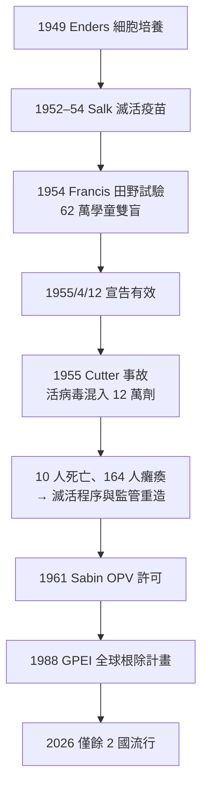

## 1955 - 沙克小兒麻痺疫苗（史上最大規模的雙盲試驗）

## 案件摘要

**本案的臨床試驗規模至今未被超越——62 萬名學童、44 個州、20 萬名志願者，只用了一個夏天。**

1955 年 4 月 12 日，密西根大學的記者會宣布：Jonas Salk 的滅活脊髓灰質炎疫苗（IPV）在 Francis 田野試驗中「安全、有效、有力」——有效率約 60%–70%（對麻痹型；對 I 型病毒約 60%，II/III 型逾 90%）。消息傳出，教堂鳴鐘、學校放假、紐約時報頭版——**這是美國醫學史上唯一一次疫苗試驗結果以「勝利日」的方式公布**。小兒麻痺（poliomyelitis）——20 世紀上半葉最令人恐懼的兒童傳染病（鐵肺、夏天的泳池關閉令、「兒童癱瘓」的年度恐慌）——自此進入倒數計時：1988 年 WHO 啟動全球根除計畫，2026 年野生病毒僅餘阿富汗與巴基斯坦兩個疫源地。本案同時是疫苗科學的雙峰並峙：**沙克的滅活路線 vs 沙賓的減毒活疫苗路線**，這場技術路線之爭塑造了此後七十年的疫苗學。

## 前因 -- 為什麼會有這個案子

- **小兒麻痺的流行病學悖論**：20 世紀初，衛生條件改善反而使麻痹病例**上升**——舊時代嬰兒在仍受母親抗體保護期內被輕症感染獲得免疫；衛生改善使感染年齡推遲到幼兒期之後，此時感染更易麻痹。**這是「衛生悖論」**（hygiene hypothesis 的經典前案）：社會進步製造了新的易感人群池。
- **1916 年紐約大流行**：9,000 例、2,343 人死亡，恐慌深植美國社會記憶；1940–50 年代每年仍有數萬例。**FDR 總統本人 1921 年 39 歲時染病致殘**——1938 年他創立「國家小兒麻痺基金會」（March of Dimes，募款口號「一毛錢行進」），成為本案的資金引擎：民間慈善資助了整個疫苗工程，幾乎不用納稅人的錢。
- **病原學的基礎**：1908 年 Landsteiner 與 Popper 以猴實驗確認病原為病毒；1931 年 Burnet 與 Macnamara 確認多血清型（I、II、III）；1949 年 Enders、Weller、Robbins 以**非神經組織（人胚成纖維細胞）培養脊髓灰質炎病毒**成功——三位 1954 年諾獎得主。**沒有這項細胞培養技術，就沒有任何疫苗**：疫苗的原料是可以在培養瓶裡大量繁殖的病毒。
- **兩條路線的對峙**：滅活疫苗（Salk：甲醛殺死的三型混合病毒，安全但需多次注射、主要誘導體液免疫）vs 減毒活疫苗（Sabin：口服、誘導腸道黏膜免疫、阻斷傳播、可自體排出疫苗株造成接觸免疫，但有極低機率恢復毒力——疫苗衍生病毒 VDPV）。1950 年代美國國會與學界多數押注 Sabin，March of Dimes 押注 Salk——**本案的賭局先於試驗就已開始**。

## 線索與推理 -- 數學式、程式、理論

**第一重推理：疫苗要證明什麼？**1954 年的 Francis 田野試驗設計（Thomas Francis, 密西根大學）：

| 項目 | 規模 |
|---|---|
| 參與學童 | 約 182.9 萬人觀察，其中 44.1 萬人接種疫苗或安慰劑 |
| 安慰劑 | 對照組 21.4 萬人 |
| 觀察者盲 | 雙盲（學童/家長/評估者均不知分組） |
| 結果 | 接種組麻痹病例 33/10萬 vs 安慰劑組 57/10萬；疫苗效力對 II、III 型逾 90% |

$$ \text{疫苗效力 VE} = \frac{AR_{\text{對照}} - AR_{\text{疫苗}}}{AR_{\text{對照}}} \times 100\% $$

這是人類史上第一個如此大規模的**隨機對照雙盲試驗**（RCT 的社會動員極限測試），也確立了「疫苗效力」的標準計算式——此後每一支疫苗的註冊試驗都用同一條式子。

**第二重推理：群體免疫的數學。**脊髓灰質炎的 $R_0 \approx 5\text{–}7$（糞口傳播），群體免疫閾值：

$$ 1 - \frac{1}{R_0} \approx 1 - \frac{1}{6} \approx 83\% $$

**這就是為什麼本案之後需要「全國接種日」**——散點式接種無法阻斷傳播，只有超過 83% 的覆蓋率才能讓病毒無處可去。1955 年後美國病例從 35,000 例/年（1953）降至 1961 年的 161 例。**沙賓的口服活疫苗（OPV，1961 年美國許可）因為能把免疫擴散到未接種的接觸者，在發展中國家的覆蓋率劣勢下更有效**——兩種疫苗各取所長，成為全球根除計畫的雙引擎。

**Cutter 事故（1955 年 4–5 月）**——本案的黑暗章節：加州 Cutter 實驗室的滅活程序有缺陷，12 萬劑含活病毒的疫苗造成約 16 萬人暴露、164 人麻痹、10 人死亡。**美國政府的反應是再造監管**：NIH 生物標準司重組、批次檢驗強制化、責任訴訟制度（Gottsdanker 案）確立「嚴格責任」——現代疫苗監管體系（批簽發 lot release）由這場事故催生。

## 結案 -- 後果與影響

- **流行病學的斷崖**：美國 1953 年 35,000 例 → 1965 年 61 例 → 1979 年本土絕跡；西半球 1991 年最後一例；全球 1988 年 35 萬例 → 2024 年約數百例（野毒）。**這是僅次於天花的第二場「消滅戰爭」**（GPEI 至今每年仍在執行）。
- **疫苗學的路線遺產**：滅活（Salk/IPV，今 polio 滅活疫苗、流感滅活疫苗、狂犬病疫苗）與減毒活疫苗（Sabin/OPV，今 MMR、水痘、輪狀、黃熱）兩大技術家族；mRNA（`2020-mRNA疫苗.md`）是第三條路的登場。
- **RCT 的社會史**：本案證明「把數十萬人隨機分組」在社會層面可行（透過家長同意書、學校系統與 March of Dimes 的動員），使 RCT 成為 1960 年代後醫學的證據金標準——**臨床流行病學的制度化，一半功勞屬於這個夏天**。
- **科普與科學的混合體**：Salk 成為國民英雄（「你會為疫苗申請專利嗎？——你會為太陽申請專利嗎？」）；但也留下爭議：Sabin 團隊與學界的路線之爭、諾獎的缺席、以及 Enders 技術壟斷的學術政治。
- **未竟之業**：OPV 的 VDPV（疫苗衍生病毒）在免疫覆蓋率下降的地區循環（2016 年後敘利亞、剛果、馬拉威、莫三比克、加薩等地的 cVDPV 爆發）——**本案的武器本身成為新的敵人**，GPEI 的「停用 OPV」戰略（2016 年 II 型撤出、2025 年 III 型）是應對。
- **一句話結案**：這是史上最壯觀的對照實驗——62 萬個孩子替所有人回答了「疫苗能不能贏」，而答案生效的那一天，美國的教堂鐘聲證明了流行病學也可以是慶典。

## 關鍵人物與文獻

- **Jonas Salk（1914–1995）**——匹茲堡大學病毒學家，滅活路線；1963 年創立 Salk 研究所。
- **Albert Sabin（1906–1993）**——辛辛那提大學，減毒活疫苗路線；蘇聯 1959 年大規模試驗（千萬級人口）為 OPV 的全球採用奠定基礎。
- **Thomas Francis Jr.**——密西根大學，田野試驗總設計師；Salk 的導師。
- **John Enders、Thomas Weller、Frederick Robbins**——1949 年細胞培養突破，1954 年諾貝爾獎。
- **Basil O'Connor**——March of Dimes 總裁，本案的資金與動員總指揮。
- David M. Oshinsky, *Polio: An American Story*（2005，普立茲獎）。
- Francis et al., "An Evaluation of the 1954 Poliomyelitis Vaccine Trials" (*Am. J. Public Health*, 1955)。
