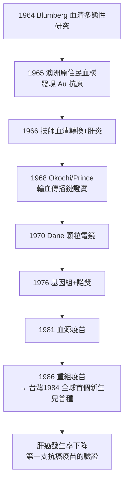

## 1965 - 布倫伯格B型肝炎抗原（血清流行病學的經典破案）

## 案件摘要

**本案的偵查者原本在研究人類的種族多樣性，卻意外抓到了史上最廣布的病毒之一——而線索來自一位澳洲原住民的一管血。**

1965 年，費城 Fox Chase 癌症研究所的遺傳學家 Baruch Blumberg（巴魯克·布倫伯格）與助手 Harvey Alter 在研究血清蛋白多態性時，發現一種新抗原：它出現在一位澳洲原住民（Yolngu 人）的血樣中，且**只出現於部分人群**——他們命名為「澳洲抗原」（Australia antigen, Au）。1966–68 年的關鍵對照：一名在實驗室工作的生化技師在轉為 Au 陽性的同時出現肝炎——**Au 抗原與「長潛伏期肝炎」綁定**；1968 年日本學者大河內（Okochi）與 Prince 證明 Au 陽性血輸入後引發肝炎，1970 年 Dane 顆粒（完整病毒體）在電鏡下現形，1976 年基因組測序。**B 型肝炎病毒（HBV）——全球慢性感染者曾達 3.5 億、至今仍有 2.5 億，每年致死約 80 萬至 100 萬人的沉默殺手——被一項與肝炎無關的多態性研究破案。**Blumberg 獲 1976 年諾貝爾獎，並隨即用抗原開發出第一代血源疫苗（1981 年許可），成為人類第一支「抗癌疫苗」（預防乙肝→預防肝癌）。

## 前因 -- 為什麼會有這個案子

- **「長潛伏期肝炎」的懸案**：戰後的大規模接種與輸血計畫製造了系統性的肝炎爆發——黃熱病疫苗（1942 年美軍 28 萬人接種後 5 萬例肝炎）、性病治療的共用針頭、二戰與朝鮮戰爭的傷後輸血。醫界只知道兩種肝炎：A（短潛伏、糞口）與「血清性肝炎」（長潛伏 2–6 個月、經血傳播、可轉慢性）——後者病原不明，**只能靠排除法描繪兇手輪廓**。
- **Blumberg 的原始問題**：他研究的是「為什麼不同人群對同一疾病的易感性不同」——蒐集全球各族群的血清，用電泳與免疫擴散尋找蛋白多態性。這是一個純遺傳學問題，與傳染病無關。**本案的第一課：基礎研究的意外收穫。**
- **血清庫的技術條件**：1950–60 年代建立的跨國血清庫（國家衛生研究院資助、NIH 血清參考庫、冷凍運輸）與免疫擴散技術（Ouchterlony）——**沒有這個「基礎設施」，多態性研究無法展開**。
- **臨床流行病學的背景**：輸血後肝炎的發生率當時高達 10%–30%，血液製品（尤其血漿、凝血因子）是重災區——血友病患者幾乎 100% 感染 HBV（後來更慘烈的是 HIV 污染血液製品，見 `../性病的歷史/1981-CDC報告與愛滋降臨.md`）。

## 線索與推理 -- 數學式、程式、理論

**第一重線索：抗原的「選擇性分布」。**Blumberg 檢測數千份血清：Au 抗原在澳洲原住民、南島民族、部分地中海人群陽性率高，在歐美低——起初他以為是遺傳標記（命名「澳洲抗原」時的原始假設）。**但流行病學的矛盾出現了：陽性者集中於肝炎、白血病、唐氏症候群患者**——多態性理論解釋不了這種疾病關聯。

**第二重線索：實驗室技師的血清轉換。**1966 年，Fox Chase 的技師在常規檢測中 Au 陽性，數週前出現無黃疸肝炎——**「接觸 Au 抗原 → 肝炎」的前瞻性觀察**，第一次把 Au 與疾病因果相連。Blumberg 隨即用「血清流行病學」邏輯反推：

$$ P(\text{肝炎} \mid \text{Au 陽性暴露}) \gg P(\text{肝炎} \mid \text{Au 陰性暴露}) \quad \Rightarrow \quad \text{Au 是病原的組成部分，而非遺傳標記} $$

**第三重推理：傳播鏈的流行病學確認**（1968–1970）：

```python
def serum_epidemiology(transfusion_pairs):
    # 輸血前後配對追蹤: 供血者 Au 狀態 vs 受血者肝炎
    pos_to_hepatitis = count(transfusion_pairs, donor="Au+", recipient="hepatitis")
    neg_to_hepatitis = count(transfusion_pairs, donor="Au-", recipient="hepatitis")
    rr = pos_to_hepatitis / neg_to_hepatitis
    return f"相對風險 RR = {rr:.1f}"   # Okochi/Prince 的數據: RR 遠大於 1

# 1970 Dane 顆粒(42nm 完整病毒體)電鏡確認
# 1976 基因組測序: 3.2kb 部分雙鏈環狀 DNA
# → 兒手正式定罪: 乙肝病毒 HBV
```

**第四重推理：血清學譜系的建立。**HBV 的標誌物被逐一破解——HBsAg（表面抗原，即澳洲抗原）、HBcAg（核心抗原）、HBeAg（傳染性標記）、抗-HBs（保護性抗體）、抗-HBc（既往感染標記）。**這套血清學譜系使「血清流行病學」成為獨立方法論：用一管血回答「誰被感染、何時感染、是否傳染、是否免疫」四個問題**——此後 HIV、HCV、瘧疾、梅毒的流行病學調查全部沿用這套語法。



## 結案 -- 後果與影響

- **輸血安全的重造**：1972 年起美國對捐血者強制 HBsAg 篩檢，輸血後肝炎驟降——**這是「病原體篩檢」成為血液製品法定標準的起點**，HIV 時代（1985 年抗-HIV 篩檢）直接沿用。
- **疫苗的革命**：1981 年血源疫苗（從無症狀帶原者血漿純化 HBsAg）許可——人類第一支用「病原組分」而非滅活病原製成的疫苗；1986 年酵母重組疫苗（Valenzuela/Merck）登場，安全且可無限量產。**台灣 1984 年成為全球第一個對全體新生兒普種的國家**，其後三十年追蹤顯示兒童肝癌發生率下降約 70%——**「疫苗預防癌症」的史上首例驗證**。
- **「隱形流行病」的命名**：全球 HBsAg 攜帶率 5%–15% 的地區（東亞、撒哈拉以南非洲、太平洋島嶼）形成數億人的慢性池；母子垂直傳播（分娩時）與幼兒期水平傳播是主要途徑——**這解釋了為什麼新生兒接種是唯一有效策略**（成人感染 90% 自癒、新生兒感染 90% 慢性化的年齡依賴現象）。
- **抗病毒治療的接力**：干擾素（1986）、拉米夫定（1998）、恩替卡韋與替諾福韋（2000s）——慢性 HBV 從「觀察等待」變成可壓制的慢性病（雖然 cccDNA 庫使根治仍難）。
- **多態性研究的教訓**：Blumberg 的原始問題（人群遺傳差異）最終指向了傳染病——他晚年以此論證基礎研究的價值：「你永遠不知道哪一塊拼圖會補上哪一幅畫。」
- **一句話結案**：本案的偵查者拿著「人群差異」的放大鏡，卻在鏡下看到了「人群共享」的病毒——**血清流行病學的第一課：抗體不只記錄個人的病史，也記錄整個族群的暴露史**。

## 關鍵人物與文獻

- **Baruch Blumberg（1925–2011）**——Fox Chase 癌症研究所；1976 年諾貝爾生理學或醫學獎；《Hepatitis B: The Hunt for a Killer Virus》(2002) 是本人自述。
- **Harvey Alter（1929– ）**——共同發現者；2020 年再獲諾貝爾獎（C 型肝炎病毒的發現，與 Houghton、Rice）——**同一人兩次獲獎於兩種肝炎病毒的破案**。
- **David Dane**——1970 年電鏡確認 Dane 顆粒（完整病毒體）。
- **大河內（Kazuo Okochi）與 Alfred Prince**——1968 年輸血傳播鏈的獨立證實。
- **R. Palmer Beasley**——台灣研究，1981 年確立 HBsAg 攜帶與肝癌的因果（前瞻性佇列），2000 年拉斯克獎。
- Blumberg, *Hepatitis B: The Hunt for a Killer Virus*（Princeton, 2002）。
