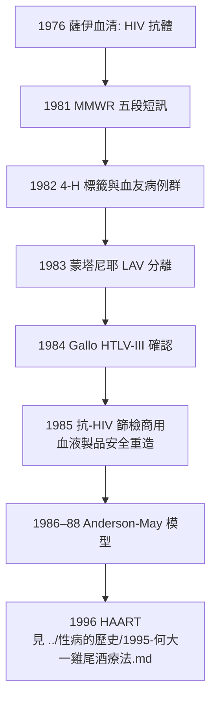

## 1981 - 愛滋降臨（感染科視角：一場沒有兇手照片的流行病）

## 案件摘要

**本案是傳染病偵查史上最特殊的一件——在病原體缺席的狀態下，流行病學獨自撐起整個案件的前兩年。**

1981 年 6 月 5 日，CDC 的 MMWR 刊出五段短訊：洛杉磯 5 名年輕男同性戀者罹患罕見的肺囊蟲肺炎（PCP），2 人已死，全部呈細胞免疫缺陷。此後兩年，在病原體完全未知的狀態下，CDC 調查員用病例對照與傳播鏈推理鎖定了性傳播與血液傳播兩條路徑；1983 年法國巴斯德研究所的蒙塔尼耶團隊分離出反轉錄病毒（後命名 HIV），1984 年美國 Gallo 團隊完成血清學與流行病學確認。**本案展示了一門古老學科的現代威力：當顯微鏡看不到、培養基養不出、Koch 法則的字面程序無法執行時，統計與推理仍然可以指認傳播鏈**——細節（污名、4-H 標籤、血友病悲劇、ACT UP）另見 `../性病的歷史/1981-CDC報告與愛滋降臨.md`，本篇聚焦感染科方法論。

## 前因 -- 為什麼會有這個案子

- **免疫學的新地圖**：1970–80 年代，CD4/T 細胞亞群技術（1970s 末單株抗體與流式細胞術）讓醫界第一次能「看見」免疫缺陷——這是本案能被指認的技術前提（三十年前同樣的病例只會被寫成「不明的肺部感染」）。
- **罕見疾病的哨兵功能**：PCP（肺囊蟲肺炎）原本幾乎只見於化療與移植的醫源性免疫抑制病人；卡波西氏肉瘤（KS）原本是老年地中海裔男性的惰性腫瘤。**當「罕見病出現在年輕人身上」，哨兵就響了**——Michael Gottlieb 與 Alvin Friedman-Kien 的警報是本案的第一塊骨牌。
- **病毒學的方法轉型**：1970 年代反轉錄酶（Temin & Baltimore, 1975 諾獎）與人類 T 細胞白血病病毒 HTLV（Gallo, 1980）的發現，使「人類反轉錄病毒」從異端變成可行的工作假說——**本案的兇手照片能被拍下，是因為相機剛被發明**。
- **社會結構的放大器**：1970 年代美國男同性戀社群的性解放（網絡密度高、伴侶數高）、靜脈吸毒、血漿經濟（付費供血）——三條獨立的傳播鏈在都市網絡中交織。流行病學的難題：**這三條鏈表面上無關，卻共享同一個免疫崩潰終點。**

## 線索與推理 -- 數學式、程式、理論

**第一重推理：在沒有病原時鎖定傳播模式。**1981–82 年的關鍵調查：

| 調查 | 方法 | 結論 |
|---|---|---|
| 洛杉磯/紐約病例訪談 | 病例對照 | 患者性伴侶數中位數遠高對照組 |
| 嬰兒與血友病病例群（1982） | 傳播途徑分析 | 血液製品可傳播 → 非性途徑存在 |
| 「Patient O」叢集研究（Auerbach 1982） | 社會網絡訪談 | 40 例中 35 例連入同一性網絡 |
| 非洲病例回溯（Rask 1977 等血清庫） | 血清流行病學 | 疾病早於美國疫情，演化史更長 |

**這是流行病學的「無指紋偵查」**：只憑網絡結構與時間序列，就足以排除「毒品」「壯陽藥」（poppers）等競爭假說，鎖定「一種經血與性的慢病毒」。

**第二重推理：反轉錄病毒的長潛伏動力學。**HIV 的流行病學特徵（潛伏期 8–10 年、傳染期長、初期無症狀）使其 $R_0$ 與急性傳染病完全不同：

$$ R_0 = \underbrace{\beta}_{\text{傳染效率}} \times \underbrace{c}_{\text{伴侶更換率}} \times \underbrace{D}_{\text{傳染期} \approx 8\text{–}10 \text{ 年}} $$

——**$D$ 超長，抵消了較低的 $\beta$**，使 HIV 能在數十年間緩慢而不可逆地擴散。這也是為什麼本案前兩年「看不見疫情」：**感染的指數增長被潛伏期藏起來**。Anderson 與 May 在 1986–88 年建立的 HIV 傳播數學模型（$\frac{dI}{dt}$ 分期建模、傳染力隨病程起伏的「傳染力—病程曲線」），是本案方法論的結晶，也成為後世所有慢性傳染病模型的模板。

**第三重推理：血清流行病學的回溯**——1983–85 年抗-HIV 檢測問世後，研究者在 1959 年剛果（Kinshasa 的一位死者血樣，Zhu/Korber 1998 年測序）、1976 年薩伊血液樣本中找到 HIV 抗體/序列；跨物種傳播的黑猩猩 SIV（*Pan troglodytes troglodytes*，喀麥隆東南部）在 1999 年由 Hahn 團隊確認。**用「血清與核酸的時間膠囊」重建整場疫情的起源史——這是分子流行病學（molecular epidemiology）的成年禮**，其方法論後來用於 SARS（2003）、伊波拉（2014）、COVID（2020）的溯源。

**Koch 法則的病毒版改寫**：HIV 無法像細菌那樣「純培養—接種—再分離」，本案的起訴證據是：**從所有病例分離出同一種反轉錄病毒（LAV/HTLV-III）→ 抗體與病程相關（血清轉換先於免疫崩潰）→ 病毒複製量與 CD4 下降同步 → 動物模型（黑猩猩）可重現感染**。這是「法則的精神而非字面」——**分子 Koch 法則**（Falkow 1988：病原相關基因的缺失突變株應喪失毒力、補回後恢復）為病毒與胞內病原時代的新憲法。

## 結案 -- 後果與影響

- **感染科的定形**：1980 年代，感染科（infectious diseases）從內科的一個分支正式獨立為專科——因為本案證明**新興傳染病需要跨科整合的專業**（流行病學+病毒學+免疫學+公共衛生+倫理）。
- **監測體系的升級**：MMWR 的哨兵角色被制度化——此後 CDC 的 EIP（Emerging Infections Programs, 1994）、WHO 的 GOARN（2000）、EU ECDC（2005）都是本案的制度後代。**「罕見病的異常聚集」成為全球監測的法定觸發器。**
- **污名與偵查的糾纏**：本案展示了流行病學分類（4-H）如何被社會武器化；也展示了患者社群（ACT UP）如何反過來改變臨床試驗規則（compassionate use、加速審批）——**現代臨床試驗倫理的參與式轉向，一半來自本案**。
- **全球公衛的分水嶺**：UNAIDS（1996）、PEPFAR（2003）、全球基金（2002）——愛滋把「全球衛生」從 WHO 的技術問題升級為國際政治與資金體系。
- **一句話結案**：本案的兇手遲到了兩年才被拍到照片——但流行病學證明：**只要傳播鏈存在，指紋可以由統計自己畫出來**。

## 關鍵人物與文檔

- **Michael Gottlieb**——洛杉磯免疫學家，1981 年 MMWR 首篇的作者。
- **James Curran**——CDC 性病與愛滋部主任，1981–85 年流行病學偵查的總指揮。
- **Luc Montagnier、Françoise Barré-Sinoussi**——巴斯德研究所，1983 年 *Science* 分離 LAV；2008 年諾獎。
- **Robert Gallo**——NCI，HTLV-III 與血清學檢測；與蒙塔尼耶的發明權之爭（1985–87 訴訟與和解）。
- **Roy Anderson 與 Robert May**——HIV 傳播數學模型的奠基者（*Phil. Trans. R. Soc. B*, 1988 等）。
- Randy Shilts, *And the Band Played On*（1987）；Jacques Pépin, *The Origins of AIDS*（2011）——溯源史的權威研究。
