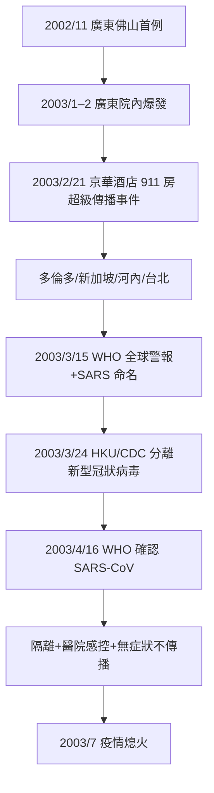

## 2003 - SARS（二十一世紀第一場全球警報）

## 案件摘要

**本案的兇手從現形到被起訴只用了一個月——比 1918 流感快了 15 年，比 HIV 快了 2 年。**

2002 年 11 月 16 日，廣東佛山出現首例不明肺炎；2003 年 2 月疫情進入香港，3 月 15 日 WHO 首次使用「SARS」（Severe Acute Respiratory Syndrome）一詞並發布全球旅行警報；3 月 24 日香港大學 Peiris/Malik Peiris 團隊與美國 CDC 同時宣布發現新型冠狀病毒（SARS-CoV）；4 月 16 日 WHO 正式確認。**從首例報告到病原體定案約 5 個月，從全球警報到定案僅 1 個月**——這是分子流行病學時代（PCR 測序+電鏡+Koch 法則精神驗證）的新速度。疫情於 2003 年 7 月被控制，全球 8,096 例、774 死——**一場「小而快」的瘟疫，卻徹底改寫了二十一世紀的防疫法律與（十七年後的）COVID 劇本**。

## 前因 -- 為什麼會有這個案子

- **廣東的生態條件**：1990 年代廣東的野味市場（果子狸、狸貓、蝙蝠等多物種密集籠飼）是冠狀病毒重組與跨種傳播的完美實驗場——SARS-CoV 的自然儲存宿主後來（2005 年 Li/Lau 團隊）被確認為**中華菊頭蝠**（*Rhinolophus sinicus*），果子狸是中間放大宿主。**這是「人畜共通溢出」（zoonotic spillover）的標準劇本**：儲存宿主→中間宿主→人類。
- **廣州中山二院（2003 年 2 月）的院內爆炸**：超級傳播者（SSE，64 歲腎科教授 Zhong 之外的另一例，年輕醫師 Liu Jianlun 參加香港京華酒店婚宴）入住香港京華酒店 911 房——**該酒店的 16 位訪客把病毒帶往香港、多倫多、新加坡、河內、台北**，全球疫情由這一晚引爆。傳播數學的詮釋：SARS 的 $R_0 \approx 2\text{–}4$，但分布高度不均（**過度離散，dispersion parameter $k \approx 0.16$**）——80% 的繼發感染來自 20%（甚至更少）的超級傳播事件。
- **廣州—北京—多倫多的資訊封鎖期**：2003 年 1–2 月廣東疫情被地方壓制資訊；北京解放軍 309 醫院的退休軍醫 **Jiang Yanyong** 於 4 月披露北京真實病例數——**本案的「審查—吹哨」結構是 1918 流感的重演**（`1918-西班牙流感.md`）。
- **河內的哨兵死亡**：WHO 傳染病主任 **Carlo Urbani** 於 2 月 28 日在河內法國醫院辨識出「非典型肺炎」的嚴重性、即時通報 WHO 觸發全球警報，3 月 29 日自己死於 SARS——**本案的第一位殉職偵探，他的通報拯救了河內**（越南因此成為第一個被 WHO 解除疫區的國家）。

## 線索與推理 -- 數學式、程式、理論

**第一重推理：超級傳播者與過度離散分布。**SARS 的關鍵流行病學特徵是 $R_0$ 的分布極度不均（負二項分布，$k \approx 0.16$）：

$$ P(\text{個體傳染 } n \text{ 人}) \sim \text{NegBin}(R_0, k), \quad k \to 0 \Rightarrow \text{少數人製造多數傳播} $$

**戰術含義**：SARS 的傳播鏈極度脆弱——**切斷超級傳播事件（醫院、酒店、航班）就切斷了疫情**。這是為什麼本案「僅」8,096 例就結束：高過度離散 + 無症狀期不傳播（SARS 只在發病後具傳染性）+ 醫院隔離，三個條件使 $R_{\text{有效}} < 1$。

**第二重推理：醫院是主戰場。**多倫多（2003 年 3–6 月）的疫情延燒暴露了院感防控的致命漏洞——一名從香港返境的老年婦女（Kwan Sui-chu）感染其子、其子進入急診引爆多倫多醫院群聚（44 死、2.5 萬人隔離）。**台灣和平醫院封院（2003 年 4 月 24 日，1,300 人封鎖 14 天）**是本案最具爭議的干預（詳見當代台灣防疫史的討論）。**SARS 是「院內感染」作為疫情主引擎的教科書案例**——2020 年 COVID 前期的鑽石公主號、養老院、醫院群聚，完全重演。



**第三重推理：病原體的極速定罪。**2003 年 3 月的兩週內，全球 11 個實驗室網絡（WHO 倡議的 **multicenter collaborative network**，史上第一次）平行競賽：

```python
def identify_sars(samples):
    # 1. 排除已知: 流感A/B, 副流感, RSV, 腺病毒, HMPV, 肺炎黴漿菌...
    # 2. 細胞培養: Vero E6 細胞出現 CPE(細胞病變)
    # 3. 電鏡: 冠狀病毒樣顆粒(刺突皇冠)
    # 4. 隨機引物擴增(DDRT-PCR) → 序列比對: 新型冠狀病毒
    # 5. 滿足 Koch 法則精神: 病人全體可檢出, 抗體隨病程上升
    return "SARS-CoV ✓"
```

**冠狀病毒（Coronaviridae）是 RNA 病毒中基因組最大（~30kb）的一族**，且有「基因重組」（recombination）與「跨種跳躍」的歷史（1990s 已知豬流行性腹瀉病毒 PEDV、雞傳染性支氣管炎病毒 IBV 的重組）——本案使「新型冠狀病毒」成為全球公衛的**常設懸案類別**。

## 結案 -- 後果與影響

- **IHR 2005 的誕生**：SARS 暴露了 IHR 1969 的過時（只通報六種檢疫病、無權介入非國家確認事件）——2005 年新條例確立「不論原因的 PHEIC」機制（`1948-世界衛生組織成立.md`）。**SARS 的法律遺產，是全球防疫憲法的改版。**
- **中國公共衛生系統的重造**：疫情直報系統（2004 上線，5 小時內到達中央）、傳染病防治法修訂（2004）、發熱門診網絡——2003 年後中國的「疾控體系 2.0」。
- **超級傳播者與過度離散的概念普及**：$k$ 值成為新興呼吸道病的核心參數；COVID-19 的 $k \approx 0.1$（比 SARS 更離散）——**SARS 教會的數學，2020 年成為「泡泡防疫」的理論基礎。**
- **溯源與生態學**：蝙蝠冠狀病毒庫的系統研究（石正麗等，2005–2017）揭示「數千種待命冠狀病毒」——**One Health（人—動物—環境一體健康）從概念變成紀律**。
- **對 COVID 的伏筆**：SARS 的快速結案造成「新型冠狀病毒可以被控制」的樂觀記憶；同時留下了「封院、封城、隔離」的劇本——2020 年的武漢封城、方艙、網格化，語法全來自 2003。
- **一句話結案**：SARS 是一場「來得快、走得也快」的疫情——它證明了現代偵查速度（1 個月定罪），也留下了「下一次可能沒那麼好運」的預言，17 年後精準應驗。

## 關鍵人物與文獻

- **Carlo Urbani（1956–2003）**——WHO 傳染病專家，河內警報人，殉職；WHO 以其名設置紀念獎。
- **Malik Peiris 與香港大學團隊**——2003 年 3 月分離 SARS-CoV；其後對果子狸與蝙蝠宿主的追蹤。
- **Jiang Yanyong（蔣彥永，1931–2023）**——披露北京真實病例數的吹哨軍醫。
- **Zhong Nanshan（鍾南山）**——廣州呼吸病研究所，反駁「衣原體說」、確認病毒性病因的中國權威。
- WHO, *Consensus Document on the Epidemiology of Severe Acute Respiratory Syndrome (SARS)*（2003）。
- Lloyd-Smith et al., "Superspreading and the effect of individual variation on disease emergence" (*Nature*, 2005)——$k$ 值經典文獻。
- Li et al., "Bats are natural reservoirs of SARS-like coronaviruses" (*Science*, 2005)。
