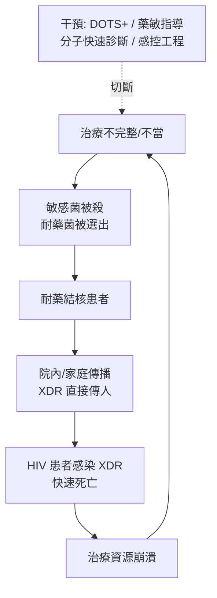

## 2006 - XDR結核（抗藥性選擇壓力的終極形態）

## 案件摘要

**本案的兇手還是 1882 年那個桿菌——但牠已經進化了六代。**

2006 年 3 月，CDC 的 MMWR 報告：在 HIV 高流行的南非 KwaZulu-Natal 圖蓋拉河谷（Tugela Ferry）農村，一種「廣泛耐藥結核」（Extensively Drug-Resistant TB, XDR-TB）爆發——53 名住院患者中 52 人在平均 16 天內死亡，**死亡率 98%**。這些分離株同時耐異菸鹼肼（INH）、利福平（RIF）、任何氟喹諾酮類與至少一種二線注射藥（阿米卡星/卡那黴素/捲曲黴素）——**一線四藥全部失效、二線也幾乎失效**。本案是「抗藥性選擇壓力」理論的最極端示範：人類 1944 年（鏈黴素）開始用單藥轟炸結核桿菌，六十年的每一次治療失誤都在替這株終極細菌進行淘汰賽。

## 前因 -- 為什麼會有這個案子

- **1944–1970 年代的單藥教訓**：鏈黴素（1944）上市數月即出現耐藥；對氨基水楊酸（PAS，1946）、異菸鹼肼（INH，1952）、利福平（RIF，1966）逐一登場。**英國 MRC 的臨床試驗（1950s–70s）確立了金科玉律：單藥治療必然失敗、複方（3–4 藥）是唯一生路**——這是選擇壓力的第一代教訓：

$$ \text{突變率} \approx 10^{-8}/\text{bp/代}, \quad P(\text{同時耐兩藥}) \approx 10^{-16} \Rightarrow \text{複方使耐藥概率趨零} $$

- **治療方案的執行漏洞**：結核的標準療程長達 6 個月以上（數百劑藥），患者一感覺好轉即停藥——**不完整療程 = 只殺掉敏感菌、留下耐藥菌**。俄羅斯監獄系統、東歐、南非礦區的「治療依從性崩潰」持續製造耐多藥株。
- **MDR-TB（1990s）的先戰**：1990 年代初紐約市監獄與醫院爆發 MDR-TB（耐 INH+RIF，死亡率 40%–80%，HIV 患者更高）；WHO 1993 年宣布結核「全球緊急狀態」、1994 年推行 DOTS（Directly Observed Treatment, Short-course，直接觀察下短程化療）——**把「吞藥」變成有人監督的儀式，是人類對付「依從性」這個流行病學變數的工程手段**。
- **二線藥的黑暗森林**：MDR-TB 的治療需要二線藥（氟喹諾酮、阿米卡星、乙硫異菸胺等）18–24 個月，昂貴、毒性大、且**無藥敏指導的經驗用藥直接選出 XDR**——圖蓋拉河谷的患者在獲得確診前已暴露於低品質的二線方案。
- **HIV 的共謀**：南非 KwaZulu-Natal 的 HIV 感染率逾 30%，免疫低下使結核進展極快（潛伏感染年進展率 5%–15% vs 一般人群 0.01%）、病程更致命——**兩種病原的流行病學互鎖（syndemic）是本案死亡率的放大器**。

## 線索與推理 -- 數學式、程式、理論

**第一重推理：選擇壓力的演化學。**耐藥的每一階段都是一次定向選擇：

$$ \text{敏感菌} \xrightarrow{\text{單藥/低劑量/短療程}} \text{耐一藥} \xrightarrow{\text{另一藥單用}} \text{MDR} \xrightarrow{\text{二線濫用}} \text{XDR} $$

圖蓋拉河谷的流行病學現場：**87% 的 XDR 病例此前接受過抗結核治療**——治療史本身就是「耐藥的履歷表」。分子流行病學（IS6110 RFLP 與 spoligotyping）顯示當地 XDR 株與 1990s 的 MDR 株同源——**同一條傳播鏈在十年內被逐步升級成最終形態**。

**第二重推理：耐藥機制的分子偵查。**結核耐藥的遺傳基礎（1990s–2000s 逐一破解）：

```python
resistance_map = {
    "INH":      "katG S315T / inhA 啟動子",      # 過氧化氫酶-過氧化物酶失活
    "RIF":      "rpoB S531L/H526Y",              # RNA 聚合酶 β 次單元
    "氟喹諾酮":  "gyrA D94N/A90V",                # DNA 旋轉酶
    "阿米卡星":  "rrs 1401A>G",                   # 16S rRNA
    "乙胺丁醇":  "embB M306V",
}
# 分子藥敏的誕生: 直接從痰核酸檢測耐藥突變
# Xpert MTB/RIF (2009, Cepheid) → 2 小時診斷 + 同時測 RIF 耐藥
```

**這是「病原基因組學」直接進入臨床決策的轉折**——傳統培養藥敏需 2–6 週（患者早已死於混亂的經驗用藥），分子檢測把耐藥偵查縮短到 2 小時。**診斷速度本身就是防疫武器**（Xpert 獲 2011 年《Science》年度突破之一）。

**第三重推理：流行病學的「治療—傳播」回饋環。**



**干預的演化**：1994 DOTS → 1998 DOTS-Plus（MDR 專案）→ 2006 Green Light Committee（認證 MDR 藥物採購）→ 2012 bedaquiline（40 年來第一個新機制抗結核藥）→ 2019 BPaLM/BPaL 短程全口服方案（6 個月，成功率 90%）——**抗藥性戰爭逼出了 60 年來第一次「新藥+新方案」的雙重革命**。

## 結案 -- 後果與影響

- **定義與監測制度化**：WHO 2006 年正式定義 XDR-TB；全球耐藥監測網（1994 年起）成為年度報告制度。MDR/XDR 病例數至今每年仍逾 40 萬。
- **藥物管制的重生**：本案推動了抗生素管理（antimicrobial stewardship）的全球制度化——2000s 末起，各國建立處方審核、藥敏先行的規範；**「抗生素是公共財而非個人商品」的倫理框架成形**。
- **診斷革命**：Xpert MTB/RIF（2009）→ Truenat（印度）→ 分子 POCT 普及——**「在治療開始前知道耐什麼藥」成為可達成的標準**。
- **HIV-TB 整合**：本案使「結核是 HIV 患者的頭號死因」成為全球共識，PEPFAR 與全球基金把兩病治療整合——**合併感染（syndemic）的防治從此成為標準思維**。
- **結核的未結案卷宗**：2023 年結核仍造成約 125 萬人死亡，是單一傳染病致死人數最高者之一；BCG 疫苗對成人肺結核效果有限、耐藥持續演化——**Koch 的 1882 年案件，至今仍是感染科的未結重案**。
- **一句話結案**：XDR-TB 是人類替細菌做的六十年定向演化實驗——**每一片被亂吃的抗生素，都是選票；選出來的，是 1882 年那個兇手的第六代傳人**。

## 關鍵人物與文獻

- **N. Sarita Shah 與 Nesri Padayatchi、Gandhi 等團隊**——2006 年 MMWR 圖蓋拉河谷 XDR 爆發報告及其後的 *Lancet* 長期佇列。
- **Paul Farmer 與 Jim Yong Kim**——Partners In Health 在秘魯與俄羅斯監獄的 MDR-TB 治療示範，證明「貧窮地區也能治 MDR」。
- WHO, *Guidelines for the Programmatic Management of Drug-Resistant Tuberculosis*（2006 起，逐年更新）。
- Gandhi NR et al., "Extensively drug-resistant tuberculosis as a cause of death in patients co-infected with tuberculosis and HIV in a rural area of South Africa" (*Lancet*, 2006)。
- WHO, *Global Tuberculosis Report*（年度）。
