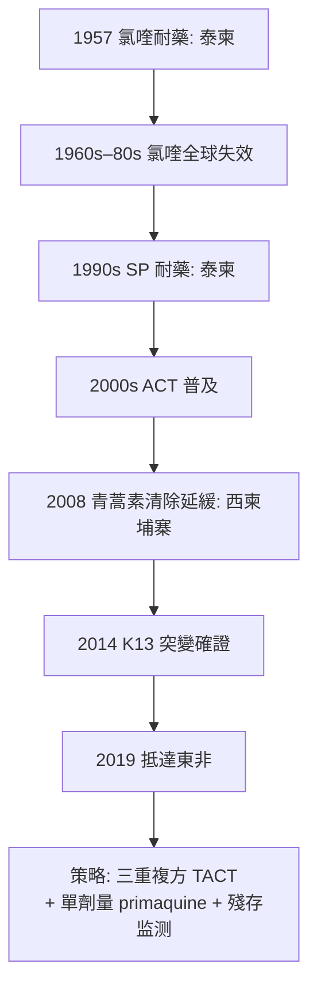

## 2008 - 青蒿素抗藥性（瘧疾反攻的號角）

## 案件摘要

**本案的兇手是人類對付了四千年的老對手——牠這次學會的，是對付人類最強武器的耐力。**

2008 年，泰柬邊境的 Arjen Dondorp 與 Nick White 團隊（Mahidol-Oxford 熱帶醫學研究單位 MORU）在《New England Journal of Medicine》報告：西柬埔寨的惡性瘧患者對青蒿素（artemisinin）的**清除寄生蟲速度顯著變慢**——寄生蟲清除半衰期從典型的 2 小時延長到 5–7 小時，治療失敗率上升。**青蒿素耐藥性（artemisinin resistance）在「歷史上抗藥性每次都先出現」的泰柬邊境首次實證。**這個「耐藥溫床」的地理規律（氯喹 1957 年先於此、磺胺多辛-乙胺嘧啶 1960s 先於此）已經成為瘧疾流行病學的定律——本案是人類與瘧原蟲四千年戰爭中的最新一次敗退警報，其分子機制（*kelch13* 基因突變，2014 年確證）與地理擴散（2019 年抵達東非）直接威脅著全球唯一的抗瘧主藥。

## 前因 -- 為什麼會有這個案子

- **氯喹時代的興衰**：氯喹（chloroquine，1940s 德國 Resochin、二戰後盟軍普及）是 20 世紀最成功的抗瘧藥——便宜、安全、口服有效。1957 年泰柬邊境首次報告耐藥，1960s 擴散至非洲，1980s 全球失效——**瘧疾死亡反彈**（撒哈拉以南非洲兒童死亡率上升）。這是選擇壓力理論的瘧疾版：**用藥越廣、選擇越強、失效越快**。
- **泰柬邊境為何是耐藥溫床**（本案的核心地理謎題）：
  1. **低傳播強度**：傳播不密集，多數感染是單株——**沒有競爭性感染稀釋耐藥株**（高傳播區的多重感染會讓耐藥株被「沖淡」）。
  2. **單藥長期使用**：1960s–80s 的單藥政策。
  3. **邊境流動人口**：伐木工、礦工、難民跨境移動，攜帶耐藥株。
  4. **藥物可及但監管弱**：部分治療、假藥、藥品市場混亂——**選擇壓力的完美配方**。
- **青蒿素的登場**：1972 年屠呦呦（中國中醫研究院，523 專案）從青蒿（*Artemisia annua*）分離出青蒿素（2015 年諾貝爾獎），其衍生物（artesunate）在 1990s 證明是**迄今最快的瘧疾殺手**——血中寄生蟲數小時內崩降。2000s 起 WHO 推動「青蒿素複合療法」（ACT, artemisinin-based combination therapy）：青蒿素快攻+長效搭檔藥（lumefantrine、piperaquine 等）壓住復燃。**ACT 是「複方抗耐藥」理論在瘧疾的實現**——但它的前提是青蒿素本身不能失效。
- **2001 年的前瞻警報**：White 與 Nosten 已在 *Lancet* 提出理論擔憂：泰柬邊境的低傳播+單藥青蒿素使用（部分地區用青蒿素單藥）將選出耐藥。**2005–06 年臨床觀察證實了預言。**

## 線索與推理 -- 數學式、程式、理論

**第一重推理：如何「測量」耐藥？**青蒿素耐藥沒有傳統的體外 MIC 對應（牠作用於寄生蟲的早期環狀體，殺傷動力學特殊），偵查的關鍵是**寄生蟲清除率**（parasite clearance rate）：

$$ \text{PC}_{1/2} = \frac{\ln 2}{k} \quad \text{（寄生蟲血症對數直線下降的半衰期）} $$

正常株 $\text{PC}_{1/2} \approx 2$ 小時；耐藥株 $\geq 5$ 小時。**Dondorp 2008 年的論文把這個動力學指標變成了耐藥的臨床定義**——用「殺蟲速度」而非「治癒率」偵測耐藥，因為 ACT 的搭檔藥仍在掩護治癒率（**治癒率是滯後指標，清除率是即時指標**）。

**第二重推理：分子機制的定罪（2014）。**2013–14 年，Ariey、Witkowski（Pasteur 研究所）與 Mok、Fairhurst（NUS/德州生醫）團隊透過全基因組關聯分析（GWAS）鎖定 ***kelch13*（K13）基因的螺旋槳結構域突變**（C469Y、R539T、Y493H 等）：

```python
def artemisinin_resistance(parasite):
    if parasite.K13_mutation in ["C469Y", "R539T", "Y493H", "F446I", "P574L"]:
        # K13 蛋白影響寄生蟲「環狀體期」的泛素-蛋白酶體應激反應
        # 耐藥株把「早期環狀體」延長存活(在體內潛伏於紅血球)
        return f"PC_half_life: {parasite.clearance():.1f} h (耐藥)"
    return "敏感"

# 耐藥的代價: K13 突變株體外生長劣勢 → 高傳播區被競爭淘汰
# 這就是為什麼耐藥只在「低傳播」的泰柬/泰緬邊境立足
```

**耐藥的生態學代價**：K13 突變株在**體外培養中競爭力較低**——這解釋了為什麼耐藥只在低傳播強度區域立足（高傳播區的多重感染與競爭把耐藥株稀釋掉），也提供了**恢復策略：把傳播壓低到接近根除，反而讓耐藥株失去生態位**。

**第三重推理：地理擴散的追蹤。**WOTRO/TRAC II 與全球 K13 調查網絡（2016–2021）追蹤耐藥的遷徙路線：西柬埔寨 → 泰緬邊境 → 印度東北部（2019 報告）→ **東非（2019–2021 盧安達、烏干達、衣索比亞、厄利垂亞）**——**非洲承擔全球 95% 的瘧疾死亡，耐藥抵達非洲意味著主戰場的武器失效**。



## 結案 -- 後果與影響

- **WHO 的應對升級**：2014 年《Strategy for Malaria Elimination in the Greater Mekong Subregion》、2018 年呼籲全球**停售青蒿素單藥**、推動「多重第一線療法」（MFT, multiple first-line therapies，多藥輪換稀釋選擇壓力）與三重複方（triple ACT：青蒿素+兩種長效藥）。
- **根除論戰的回歸**：2015 年 Bill Gates 與 WHO 聯合呼籲「Rethinking Malaria」、2018 年 Malaria Eradication Research Agenda——**青蒿素耐藥的倒計時把「根除」從遠景變成時限任務**。
- **疫苗的最後一道防線**：RTS,S（Mosquirix，2015/2021 WHO 建議）與 R21/Matrix-M（2023）——史上第一批瘧疾疫苗（效力約 30%–75%，針對兒童）；**單靠藥物打不死瘧疾，疫苗+藥物+病媒控制的三角戰略成為定局**。
- **抗藥性地理學的通用教訓**：泰柬邊境作為「耐藥前哨」的定律（氯喹、SP、青蒿素三度驗證）成為全球抗藥性監測的哨兵點——**mRNA 疫苗時代之前，人類第一次承認：抗藥性的擴散路線可以被預測，因此必須被提前佈防**。
- **一句話結案**：瘧原蟲用四千年學會了對付人類的一切武器——**而人類唯一不變的優勢，是能在牠進化前先算出牠會在哪裡進化**。

## 關鍵人物與文獻

- **屠呦呦（1930– ）**——523 專案，1972 年分離青蒿素；2015 年諾貝爾生理學或醫學獎（與 Campbell、Ōmura）。
- **Arjen Dondorp 與 Nicholas White**——MORU，2008 年 NEJM 青蒿素清除率論文；White 的《decision making in malaria》系列是臨床瘧疾學的現代經典。
- **Didier Menard、Françoise Nosten、Rick Fairhurst**——K13 突變與擴散追蹤的關鍵研究者。
- Dondorp AM et al., "Artemisinin resistance in *Plasmodium falciparum* malaria" (*NEJM*, 2009)。
- Ariey F et al., "A molecular marker of artemisinin-resistant *Plasmodium falciparum* malaria" (*Nature*, 2014)。
- WHO, *World Malaria Report*（年度）。
