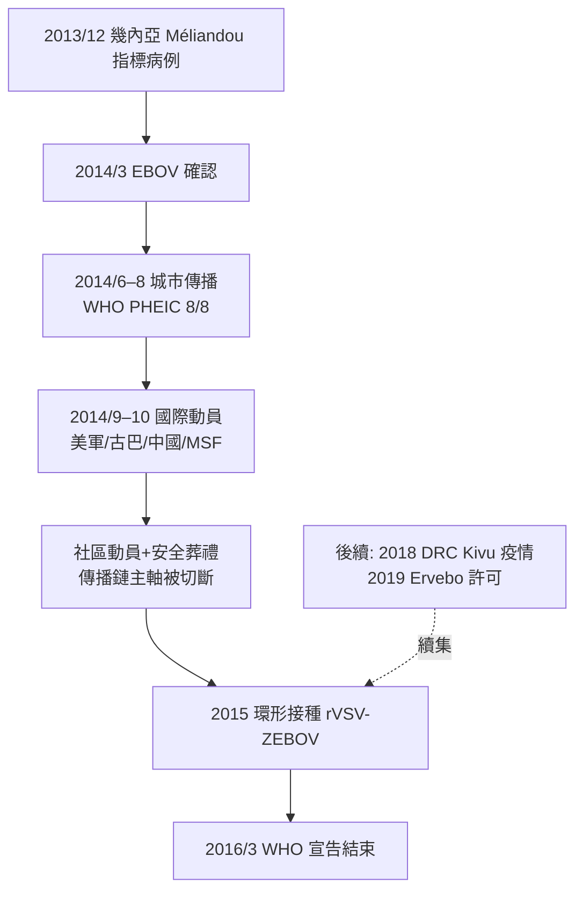

## 2014 - 西非伊波拉（不信任比病毒傳得更快）

## 案件摘要

**本案的病毒並不新——1976 年就已經被起訴過；真正新的，是這一次牠終於在城市裡引爆。**

2013 年 12 月，幾內亞東南部 Méliandou 村一名兩歲男童（後被推定為疫情指標病例，2014 年 12 月病故的 Emile Ouamouno）死於不明出血熱；2014 年 3 月，幾內亞官方與巴斯德研究所（達喀爾/里昂）確認病原為**薩伊型伊波拉病毒（EBOV）**——一種 1976 年已在薩伊（剛果）與蘇丹被描述、此前歷次爆發都在數月內被撲滅的絲狀病毒（filovirus）。但這一次不同：**疫情從鄉村跨入首都科納克里、馬西塞（Monrovia）、佛里敦三大城市**，感染 28,600+ 人、死亡 11,300+ 人——**比之前 40 年所有伊波拉爆發的總和還多一個量級**。WHO 於 2014 年 8 月 8 日宣布 PHEIC（國際關注公共衛生緊急事件，其歷史性首次用於伊波拉，且被批評晚了三個月）。本案是「世紀病毒遇上崩壞衛生體系」的教科書案例，也留下史上最血腥的教訓：**在醫療資源不足與社會不信任的環境下，隔離本身會成為暴力目標**。

## 前因 -- 為什麼會有這個案子

- **病毒的原始設定**：伊波拉病毒（*Zaire ebolavirus*）的人類致死率在歷次爆發為 25%–90%（本案約 40%）；人畜共通溢出（自然宿主推定為果蝠）、經體液（血液、嘔吐物、屍體）傳播、**屍體的病毒量最高**——這使葬禮成為超級傳播事件（傳統葬儀的洗屍、撫屍習俗是疫情放大器）。
- **為什麼 40 年來第一次失控**（本案的核心流行病學謎題）：
  1. **脆弱衛生體系**：幾內亞、賴比瑞亞、獅子山三國的人均醫生數為 0.1–0.3/萬，內戰後衛生系統剛重建。
  2. **城市傳播首次發生**：歷次爆發都在偏遠鄉村、人口密度低；本案病毒抵達了數百萬人口的城市。
  3. **跨境流動**：三國交界（Mano River Union）邊境漏洞。
  4. **初期誤判**：2014 年 1–3 月被誤判為霍亂/拉沙熱；3 月確認後，WHO 4 月的內部文件已警告「失控風險」，**8 月 8 日才宣告 PHEIC**——獨立專家小組事後批評延遲。
  5. **社會不信任**：地方謠言（「政府製造病毒」「醫院在殺人」）導致患者藏匿、隔離中心被攻擊、衛生工作者被殺（2014 年 9 月幾內亞 Womey 村八名宣導隊員被殺）。
- **國際反應的失速**：無國界醫生（MSF）2014 年 6 月即警告「失控」、9 月呼籲「全球動員」；美國總統歐巴馬 9 月中旬宣布派遣 3,000 名美軍建設治療單位（Operation United Assistance）、古巴派出 400 餘名醫生、中國派出 1,000+ 人醫療隊——**「全球衛生安全」在 2014 年被重新定義為「與本國利益相關的事」**。

## 線索與推理 -- 數學式、程式、理論

**第一重推理：$R_0$ 為什麼會破 1？**伊波拉歷史爆發的 $R_0$ 通常 1.5–2.5（可被隔離壓制）；本案在部分城區 $R_0$ 一度達 2–3。但更關鍵的是**過度離散（$k \approx 0.2$–0.5）**：

$$ P(\text{屍體/葬禮成為超級傳播事件}) \gg P(\text{日常接觸傳播}) $$

**傳播鏈的主軸是「屍體與重症體液」**——這意味著：**傳統葬儀的安全化（dignified safe burial）比醫院更重要**。無國界醫生與紅十字會的「安全且有尊嚴的葬禮」隊伍（2014 年下半年數萬具遺體）是本案轉折的真正武器。

**第二重推理：信任是流行病學變數。**本案最反直覺的發現：**在社會不信任的環境下，強制隔離會降低防控效果**（患者藏匿、疫情地下化）；而社區參與（社區領袖對話、清真寺/教堂合作、恢復「有尊嚴的葬禮」）是唯一可持續的切入點。2014 年下半年的轉折點不是新藥，而是**社區動員（community engagement）**：

```python
def ebola_control(trust_level):
    if trust_level < threshold:
        return "強制隔離 → 患者藏匿 → 疫情地下化"
    # 轉折: 社區對話 + 安全葬禮 + 治療中心進社區
    return ring_vaccinate_and_engage()  # R_eff 降至 <1
```

**第三重推理：疫苗的閃電戰（2015 年環形接種）。**2014 年前，伊波拉沒有疫苗（基礎研究自 2000s 起由加拿大 NML 的 VSV-EBOV 載體疫苗啟動，2010 年 NewLink 取得授權，2014 年 Merck 接手）。**2015 年 4 月起，幾內亞採用「環形接種」（ring vaccination）方案**（John Legrand、Ana del Rio、Marie-Paule Kieny 團隊，*Lancet* 2016）：對新病例的接觸者圈即時接種 rVSV-ZEBOV，對照圈延遲接種——**10,604 名即時接種者零病例，延遲組 16 例**，效力估計 100%（CI 76%–100%）。**這是天花根除（`1980-天花根除.md`）的包圍戰術在 40 年後的復活**，也是人類第一次在疫情進行中以「試驗即行動」模式完成疫苗驗證。2019 年 12 月，rVSV-ZEBOV（Ervebo）成為史上第一支 FDA 許可的伊波拉疫苗。



## 結案 -- 後果與影響

- **WHO 改革**：獨立監督委員會批評其反應遲緩；2015 年起成立 WHO Health Emergencies Programme（WHE，緊急衛生計畫，新任副總幹事 Peter Salama 主政）、建立 Contingency Fund for Emergencies（CFE，快速啟動基金）。
- **「全球衛生安全議程」（GHSA）**：2014 年美國啟動、2015 年 G7 確立——**把新興傳染病從「援助議題」升級為「國家安全議題」**；各國 JEE（聯合外部評估）成為衛生體系能力的全球評分。
- **治療與疫苗的雙突破**：rVSV-ZEBOV（Ervebo，2019 許可）與單株抗體療法（mAb114/Inmazeb，2020 許可）——**伊波拉從「絕症」變成「可預防可治療」**，是本案最正面的遺產。
- **信任作為防疫情的制度化**：2014 後的防疫文獻把「社區參與」「風險溝通」列為與隔離同級的干預；2020 年 COVID 期間的「反口罩運動、疫苗猶豫」爭議，使本案的教訓再次被引用。
- **對 COVID 的雙重預言**：本案例證了「快速通報（PHEIC）+ 社區信任 + 疫苗閃電戰」能壓制高致死率病原，也證明了「資訊延遲與不信任會讓戰術失效」——**2014 年的全部經驗，2020 年被原樣檢驗（`2020-COVID19大流行.md`）**。
- **一句話結案**：伊波拉的傳播鏈是用體液寫的，但切斷它的剪刀是用信任打造的——**沒有信任，連最好的流行病學都會變成暴力的標靶**。

## 關鍵人物與文獻

- **Carlo Urbani 遺產的接班人**：WHO 伊波拉應急總指揮 **Bruce Aylward**（加拿大流行病學家），2014–16 年應急行動總協調；其後主導 2020 年 WHO-COVID 中國考察團。
- **Margaret Chan**——WHO 總幹事，PHEIC 宣告者；其延遲與改革壓力的當事人。
- **Médecins Sans Frontières（無國界醫生）**——最早拉響警報、承擔最大治療負荷的組織；其內部報告（*Pushed to the Limit and Beyond*, 2015）是本案的重要史料。
- **Pardis Sabeti 與 Christian Happi**——哈佛/獅子山團隊，2014 年 *Science* 即時基因組追蹤（99 個基因組揭示傳播鏈與突變路線），分子流行病學的現場極限示範。
- Gire SK et al., "Genomic surveillance elucidates Ebola virus origin and transmission during the 2014 outbreak" (*Science*, 2014)。
- Henao-Restrepo AM et al., "Efficacy and effectiveness of an rVSV-vectored vaccine in preventing Ebola virus disease" (*Lancet*, 2016)。
- WHO, *Report of the Ebola Interim Assessment Panel*（2015）。
