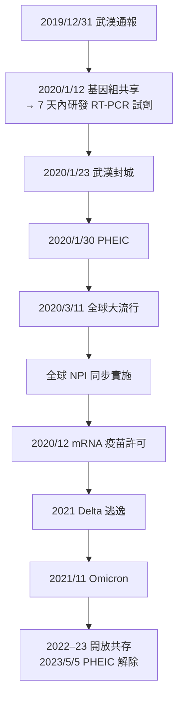

## 2020 - COVID19大流行（R₀、群體免疫與封城的數學總考）

## 案件摘要

**本案是二十一世紀的總考——一百年來所有瘟疫的教訓，在 36 個月內被逐一檢驗。**

2019 年 12 月 31 日，武漢市衛健委通報 27 例「不明原因肺炎」；2020 年 1 月 12 日，中國與國際團隊共享病毒全基因組序列；1 月 30 日 WHO 宣告 PHEIC；3 月 11 日宣告「全球大流行」（pandemic）。病原為新型冠狀病毒 **SARS-CoV-2**（與 2003 年 SARS-CoV 同屬、同以 ACE2 為受體），所致疾病命名 **COVID-19**。此後三年，全球確診逾 7.7 億、死亡逾 700 萬（WHO 估計超額死亡約 2,000 萬）——**這是 1918 年以來最嚴重的人類大流行**。本案的特殊性在於：它幾乎把全書所有理論同時搬上考場——$R_0$ 與群體免疫數學、過度離散（SARS 的遺產）、非藥物干預（1918 的遺產）、PHEIC 制度（WHO 的遺產）、mRNA 疫苗（三十分年的基礎研究）、以及「不信任比病毒更快」的社會流行病學（伊波拉的遺產）。

## 前因 -- 為什麼會有這個案子

- **冠狀病毒的「待命庫」**：2005–2017 年的研究（石正麗、 EcoHealth Alliance、王林發等）揭示中華菊頭蝠攜帶數千種 SARS 樣冠狀病毒，其中 WIV1、SHC014 等可直接使用人類 ACE2 受體——**「下一次 SARS 只是時間問題」是 2015 年後的公衛共識**（Shi et al., *Nat Med*, 2015）。SARS-CoV-2 的基因組與 RaTG13（雲南菊頭蝠樣本）相似度 96.2%，但**自然溢出 vs 實驗室相關起源的爭議至今未結案**（2021 年 WHO-中國聯合報告認為「可能至極不可能」經實驗室、2023 年 WHO 修正為「不完全排除」——本案的偵查仍未終審）。
- **武漢的條件**：1,100 萬人口、九省通衢的高鐵樞紐、春運（2020 年 1 月 10 日–2 月 18 日，預計 30 億人次流動）——**傳播網絡的最大放大器恰好撞上疫情初期**。華南海鮮市場的環境檢體檢出病毒（2020 年 1 月），但早期病例中有相當比例與市場無關——**指標病例的定位至今是懸案**。
- **資訊的摩擦**：2019 年 12 月底，武漢眼科醫師 **李文亮** 等八人在微信群警示「SARS 樣冠狀病毒」，被警方「訓誡」；李文亮本人於 2020 年 2 月 7 日死於 COVID——**本案的吹哨者悲劇是 1918 與 2003 年「審查—延遲」結構的第三次重演**。
- **全球準備度的真實樣貌**：2019 年 10 月約翰霍普金斯「Event 201」推演、2019 年 GHS Index 各國防疫能力評分（美國第一）——**推演與評分都未能阻止 2020 年 2–3 月的全球崩潰**（檢測試劑缺貨、個人防護裝備爭奪、封城倉促）。

## 線索與推理 -- 數學式、程式、理論

**第一重推理：$R_0$ 的估算與控制。**早期估算（Wuhan/華南海鮮市場期間）$R_0 \approx 2\text{–}3$（後續研究與 Alpha 變異株 $\approx 3\text{–}5$，Delta $\approx 5\text{–}7$，Omicron $\approx 8\text{–}10$）：

$$ \text{群體免疫閾值} = 1 - \frac{1}{R_0} \quad \begin{cases} R_0 = 2.5 \Rightarrow 60\% \\ R_0 = 6 \Rightarrow 83\% \end{cases} $$

**自然感染達成群體免疫的成本是數百萬條人命**（超額死亡的直接原因），這是「群體免疫策略」（如英國 2020 年 3 月初的 herd immunity 討論、瑞典的軟封鎖）在全球辯論中的核心數學。**終局是疫苗達成的人為群體免疫**——但 Omicron 的免疫逃逸使「一勞永逸」的夢想破產，**群體免疫從終點變成必須持續維持的動態平衡**。

**第二重推理：過度離散與戰術設計。**SARS-CoV-2 的離散參數 $k \approx 0.1$（比 SARS 更極端）：**約 10%–20% 的感染者製造 80% 的繼發傳播**（Edmund Adam、Heike 傳染力研究，Bi et al., *Wellcome Open Research*, 2020）：

$$ \text{有效} R \; = \; \bar{R} \times \frac{\text{多數病例的低傳染力}}{\text{少數超級傳播事件的高傳染力}} $$

**戰術含義**：封閉高風險密閉場所（KTV、夜店、婚宴、遊輪——鑽石公主號 3,711 人中 712 感染）比全面封鎖更高效；台灣、韓國、紐西蘭 2020–21 年以「精密疫調 + 接觸者追蹤 + 高風險場所管制」維持近乎零本土——**SARS 的數學被 17 年後的亞洲防疫原樣使用**。

**第三重推理：非藥物干預（NPI）的全球實驗。**2020 年人類史上第一次**全球同步 NPI**：封城（Wuhan 1 月 23 日、義大利 3 月、印度 3 月、美國各州 3–4 月）、口罩令、社交距離、邊境管制。Flaxman et al. (*Nature*, 2020) 對 11 歐洲國家的反事實估計：封城至 5 月避免了約 310 萬人死亡。**但 NPI 的社會成本（經濟衰退、教育中斷、心理健康、家暴）使其成為「兩難決策」而非「純醫學問題」**——這是 1918 年 Markel 研究的全球尺度放大版。

**第四重推理：變異株的演化競賽。**RNA 病毒的突變率約 $10^{-3}$/bp/代，SARS-CoV-2 每月累積約 1–2 個編碼區突變；免疫壓力下的抗原漂移產生序列：Alpha (2020/9 英國) → Beta (南非) → Gamma (巴西) → **Delta (2020/10 印度，$R_0 \approx 5\text{–}7$、疫苗突破) → Omicron (2021/11 波札那/南非，免疫逃逸極強但致死率較低)**。**病毒演化的方向由「免疫壓力 × 傳播機會」共同決定**——疫苗覆蓋不均（COVAX 缺口）與長期感染的免疫缺陷患者（慢性感染期的體內演化）是兩個「演化實驗室」。

**第五重推理：分子流行病學的極限應用。**全球共享的 GISAID（2008 年建立，開放病毒基因組資料庫）在 2020–2023 年累積逾 1,600 萬條 SARS-CoV-2 基因組——**史上最大的病原體即時演化監測系統**：Nextstrain/Nextclade 的系統發育追蹤、變異株命名（WHO 希臘字母系統）、PCR 試劑的動態更新——**分子流行病學從學科變成全球基礎設施**。

## 結案 -- 後果與影響

- **超額死亡與健康債**：WHO 估計 2020–21 年超額死亡約 1,490 萬（含未確診死亡）；「長新冠」（long COVID，感染後疲勞、腦霧、自主神經失調等持續症狀）成為新的慢性病類別——**急性傳染病的慢性後遺症被制度性承認**。
- **mRNA 疫苗的壓縮史**：Moderna 2020 年 1 月 13 日完成序列設計、3 月 16 日首劑人體試驗、12 月 11 日 FDA 許可——**從序列到許可 334 天**，打破一切紀錄（詳見 `2020-mRNA疫苗.md`）。
- **社會流行病學的崛起**：口罩與疫苗的政治化、misinfodemic（資訊疫情）、長期 COVID 與 ME/CFS 研究的重啟——**本案證明：21 世紀的瘟疫不只在肺裡傳播，也在演算法裡傳播**。
- **制度的補丁**：2024 年 IHR 修訂、Pandemic Accord 談判、WHO 的 One Health 與「prevention at source」（從動物源頭防止溢出）成為新議程；**動物源頭管理（野味市場、養殖業、土地利用）從生態學議題升級為公共衛生主戰場**。
- **一句話結案**：COVID-19 不是沒有預料的災難——**它是一場被反覆預言、被反覆演練、卻仍然打贏了人類的戰爭**；全書從雅典到伊波拉的每一份偵查筆記，都在這三年被當作教材重新翻開。

## 關鍵人物與文獻

- **李文亮（1985–2020）**——武漢中心醫院眼科醫師，「吹哨人」之一。
- **張永振**——復旦大學，2020 年 1 月 11 日首批公開 SARS-CoV-2 全基因組序列的團隊。
- **Shi Zhengli（石正麗）**——武漢病毒研究所，蝙蝠冠狀病毒庫的長期研究者；實驗室起源爭議的核心當事人。
- **Tedros Adhanom Ghebreyesus**——WHO 總幹事，PHEIC 與 pandemic 宣告者。
- **Roy Anderson、Neil Ferguson**——大流行數學模型（Imperial College 2020/3/16 的封城預估報告改變了英、美決策）。
- Zhu N et al., "A Novel Coronavirus from Patients with Pneumonia in China, 2019" (*NEJM*, 2020)。
- Flaxman S et al., "Estimating the effects of non-pharmaceutical interventions on COVID-19 in Europe" (*Nature*, 2020)。
- WHO, *World Health Statistics* 與 COVID-19 Dashboard（2020–2023）。
