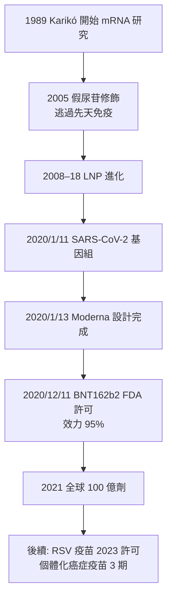

## 2020 - mRNA疫苗（從論文冷板凳到十億劑）

## 案件摘要

**本案的偵查者等了三十年——他們抓的不是病毒，而是「讓人體自己印出武器」的方法。**

2020 年 1 月 11 日，張永振團隊公布 SARS-CoV-2 基因組；**Moderna 在 1 月 13 日（兩天後）完成 mRNA-1273 的序列設計**，3 月 16 日首劑人體試驗，11 月 16 日公布 94.5% 效力中期數據，**12 月 18 日 FDA 許可緊急使用**；BioNTech/Pfizer 的 BNT162b2 更早，**12 月 11 日獲得史上第一個 COVID-19 疫苗許可**（效力 95%）。從病毒序列定案到全球注射，**334 天**——史上最快（此前最快是腮腺炎疫苗的 4 年）。本案的主角不是一種新病毒技術，而是 **Karikó 與 Weissman 的 2005 年核苷修飾突破**（2023 年諾貝爾獎）——**一項在冷板凳上躺了十五年的基礎研究，在 2020 年被全球動員壓縮成一場疫苗革命**。mRNA 疫苗不僅結束了 COVID 的急性階段，還打開了瘧疾、流感、HIV、癌症個體化疫苗的全新戰線。

## 前因 -- 為什麼會有這個案子

- **mRNA 的物理特性**：mRNA 是單鏈核糖核酸、極不穩定（RNase 無所不在）、分子量大（難入細胞）、且**外源 RNA 會觸發先天免疫警報**（TLR3/7/8、RIG-I 感知未修飾 RNA → 干擾素風暴 → mRNA 被降解、細胞受害）。**1990 年代起，「用 mRNA 在體內表達蛋白」是公認的聖杯與公認的不可能。**
- **Karikó 的三十年**：匈牙利移民 Katalin Karikó 自 1989 年起在賓州大學研究 mRNA 治療，被降職、被拒稿、被同事認為「鑽牛角尖」；1997 年起與免疫學家 **Drew Weissman**（當時剛從 Fauci 實驗室轉任賓大）合作。**2005 年的關鍵突破**：把尿苷（U）替換成假尿苷（pseudouridine）或 N1-甲基假尿苷，mRNA 就能「欺騙」免疫感測器——**不觸發干擾素風暴、翻譯效率反而提升**（*Immunity*, 2005）。**這一頁論文，是 2020 年所有 mRNA 疫苗的化學基礎。**
- **LNP（脂質奈米顆粒）的平行進化**：Pieter Cullis（英屬哥倫比亞大學）等自 1990s 開發的陽離子脂質體技術，2018 年才被 FDA 許可用於第一個 siRNA 藥物（Patisiran, Alnylam）——**LNP 是 mRNA 的「運輸車」**，解決了「如何把大分子送入細胞質」的問題。**2020 年的成功 = Karikó 的化學 + Cullis 的包裝 + 十數億美元的臨床試驗與製造規模。**
- **疫情前的技術佈局**：Moderna（2010 年成立，Derrick Rossi 的 reprogramming mRNA 工作）與 CureVac、BioNTech（2008 年成立，Uğur Şahin 與 Özlem Türeci，原主攻癌症個體化疫苗）——**2020 年之前，mRNA 疫苗沒有任何一款人類許可產品**；它們的幸運是「已經準備好平台，只等一種病原」。

## 線索與推理 -- 數學式、程式、理論

**第一重推理：mRNA 疫苗的工作原理。**mRNA 疫苗不是注入病原或蛋白，而是注入「**生產病原蛋白的指令**」：

$$ \text{mRNA（假尿苷修飾，LNP 包裹）} \xrightarrow{\text{肌注 → 細胞攝入 → 核醣體轉譯}} \text{S 蛋白} \Rightarrow \text{免疫系統辨識 → 抗體 + T 細胞} $$

**與傳統疫苗的對比**：

| 技術 | 開發時間 | 生產 | 免疫類型 |
|---|---|---|---|
| 滅活（沙克） | 4–10 年 | 培養病毒 | 體液為主 |
| 減毒活（沙賓） | 5–15 年 | 培養病毒 | 體液+黏膜 |
| 蛋白亞單位 | 3–7 年 | 發酵/純化 | 體液 |
| **mRNA** | **數天設計 + 數月生產** | **無細胞、化學合成** | **體液+細胞+中和抗體** |

**第二重推理：為什麼效力 95%？**疫苗的「效力」取決於**S 蛋白的構象**（用 S-2P 穩定化的 prefusion conformation，來自 NIH Barney Graham 與 Jason McLellan 的結構生物學工作）+ **足量抗原表達**（LNP 效率）+ **免疫原性最優化**。BNT162b2 與 mRNA-1273 的 3 期試驗（各約 3–4 萬人）：

$$ \text{VE} = \frac{AR_{\text{安慰劑}} - AR_{\text{疫苗}}}{AR_{\text{安慰劑}}} \times 100\% \approx 94\text{–}95\% $$

**這是疫苗效力史上前所未有的數字**（流感疫苗通常 40%–60%、輪狀 85%）；真實世界研究（以色列、英國、美國）確認實效性（effectiveness）亦達 80%–95%——**「效力—實效」落差極小，是 mRNA 技術的獨特優勢**。

**第三重推理：可編程性（programmability）的革命性。**傳統疫苗要「養」病原；mRNA 疫苗只要**序列**——這使它的開發瓶頸從「病毒培養」轉移到「**知道序列**」：

```python
def mrna_vaccine_development(genome, target_protein="S"):
    sequence = codon_optimize(target_protein)     # 密碼子優化, 幾小時
    chemically_modified = pseudouridine_modify(sequence)  # Karikó 2005
    encapsulated = lipid_nanoparticle(chemically_modified) # Cullis LNP
    return "數天內完成設計 → 3–11 個月完成 3 期"   # 2020 年實測

# 對比傳統路徑: 病毒分離→細胞適應→滅活/減毒→純化→3 期
# = 4–15 年
```

**第四重推理：安全性與副作用的流行病學。**mRNA 疫苗的副作用（注射痛、發燒、肌痛、罕見心肌炎——年輕男性風險約 1/10 萬劑）與極罕見的血栓（腺病毒載體疫苗的 VITT，肝素誘發性血小板減少的類似機制）——**「常見輕微副作用 vs 罕見嚴重副作用」的風險溝通是本案最大的公共衛生挑戰**；這是伊波拉（`2014-西非伊波拉.md`）「不信任比病毒更快」教訓在已開發國家的重演。



## 結案 -- 後果與影響

- **諾貝爾獎**：2023 年諾貝爾生理學或醫學獎頒給 **Katalin Karikó 與 Drew Weissman**——「發現核苷修飾使 mRNA 有效用於疫苗」；Karikó 從被降職的實驗室研究員到諾獎得主，成為基礎研究的象徵性人物。
- **疫苗學的第三條路線**：滅活（Salk）、減毒（Sabin）、mRNA（Karikó/Weissman/Cullis/Graham）——**「可編程疫苗」使「新病原 → 疫苗許可」的時間軸從年縮到月**；WHO 的 mRNA 技術轉讓中心（南非 Afrigen，2021）試圖把這條路線帶到全球南方。
- **臨床應用的擴張**：RSV mRNA 疫苗（2023–24 年 3 期成功）、流感四價 mRNA、HIV 與瘧疾疫苗試驗、**個體化癌症疫苗**（BioNTech 與 Moderna 的黑色素瘤個人化新抗原疫苗，3 期進行中）——**腫瘤疫苗（`../腫瘤科的歷史/`）與感染科疫苗在 mRNA 平台上匯流**。
- **製造與分配的政治**：十億級劑量的超低溫冷鏈、COVAX 的分配不均（低收入國家 2021 年覆蓋率 <5% vs 高收入國家 >70%）——**疫苗民族主義**成為全球衛生的新詞彙，是 2024 年 IHR 修訂「疫苗公平」條款的直接動機。
- **科學史的啟示**：本案與 1965 年 Blumberg（`1965-布倫伯格B型肝炎抗原.md`）同構——**基礎研究（多態性/mRNA 修飾）的意外果實在幾十年後拯救數億人**；區別是：Blumberg 是純粹的意外，Karikó 是「被拒絕三十年的堅持」。
- **一句話結案**：mRNA 疫苗證明了兩件事——**人體可以自己印出對抗病原的武器，而一個在實驗室角落堅持三十年的人可以改變全世界**；從序列到十億劑的 334 天，是全書所有案件的偵查速度之最。

## 關鍵人物與文獻

- **Katalin Karikó**——賓州大學（後 BioNTech 高級副總裁）；2005 年 *Immunity* 假尿苷論文；2023 年諾貝爾獎。自傳《Breaking Through: My Life in Science》(2023)。
- **Drew Weissman**——賓州大學免疫學家，Karikó 的長期合作者，2023 年共同諾獎。
- **Pieter Cullis**——UBC，LNP 技術的奠基者。
- **Uğur Şahin 與 Özlem Türeci**——BioNTech 創辦人夫婦，癌症疫苗起家、轉向 COVID。
- **Stéphane Bancel**——Moderna CEO；**Barney Graham**（NIH）與 **Jason McLellan**（UT Austin）——S-2P 構象穩定化技術。
- Karikó K et al., "Suppression of RNA recognition by TLR7/8: incorporation of modified nucleosides" (*Immunity*, 2005)。
- Polack FP et al., "Safety and Efficacy of the BNT162b2 mRNA Covid-19 Vaccine" (*NEJM*, 2020)。
- Baden LR et al., "Efficacy and Safety of the mRNA-1273 SARS-CoV-2 Vaccine" (*NEJM*, 2020)。
