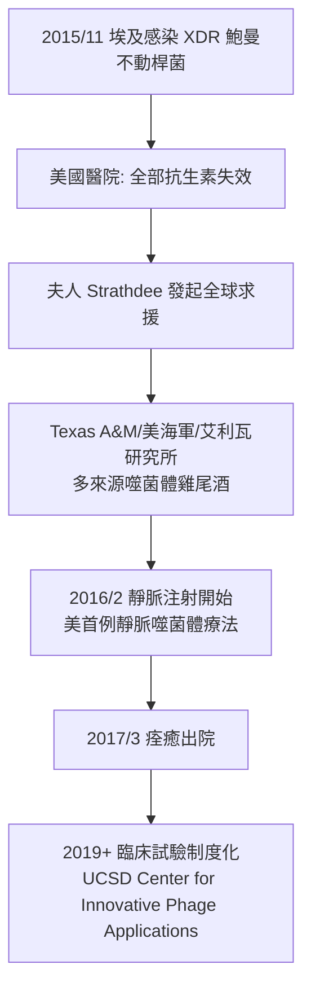

## 2025 - 噬菌體與超級細菌（後抗生素時代的最後武器）

## 案件摘要

**本案的戰場不是尋找新兇手，而是尋找「舊兇手的新天敵」——當抗生素的軍火庫見底，人類翻出了一百年前被冷落的另一種武器。**

21 世紀的第二個十年，全球每年死於抗生素耐藥感染（AMR）的人數已達 114 萬（2019 年 GRAM 估計），WHO 預計 2050 年可能達 1,000 萬——**超過癌症死亡數**。新抗生素的研發陷入「經濟學死亡螺旋」（藥越少用越安全、越少用越無利潤），而 2010s–2020s 的一條替代路線意外復活：**噬菌體療法（phage therapy）**——用感染細菌的病毒去殺細菌。本案的象徵性起點是 2016 年：加州大學聖地牙哥分校的 Tom Patterson（心理學教授）感染廣泛耐藥鮑曼不動桿菌（XDR *Acinetobacter*），全身膿腫、昏迷數月；夫人 Steffanie Strathdee（流行病學家）在絕望中翻出冷戰時期的蘇聯噬菌體研究，透過全球學者網絡取得噬菌體雞尾酒，Patterson 成為美國首例接受現代靜脈噬菌體療法而痊癒的病例（2016–17，*Antimicrob Agents Chemother* 與 *Nature Medicine* 報告）。**本案是「 Fleming 時代」與「d'Hérelle 時代」的重新會師——人類第一次承認：抗生素戰爭沒有終點，而噬菌體是共演化武器的活體軍火庫。**

## 前因 -- 為什麼會有這個案子

- **廣效抗藥性（MDR/XDR/PDR）的演進**：每一類抗生素的上市都伴隨耐藥的出現（時間間隔持續縮短）：

| 抗生素 | 上市年 | 首例耐藥 | 間隔 |
|---|---|---|---|
| 青黴素 | 1943 | 1940（酶已存在） | 負 |
| 甲氧西林 | 1960 | 1961（MRSA） | 1 年 |
| 萬古黴素 | 1958 | 1988（VRE） | 30 年 |
| 達托黴素 | 2003 | 2005 | 2 年 |
| 替加環素 | 2005 | 2007 | 2 年 |
| 多黏菌素（最後防線） | 1959 | 2015（**MCR-1** 質體可轉移耐藥） | 56 年 |

**2015 年 MCR-1（可水平轉移的多黏菌素耐藥基因）在中國豬場與人的分離株中被發現（Liu et al., *Lancet Infect Dis*）**——「最後防線」的耐藥**可以經質體在人畜之間流動**，敲響了後抗生素時代的喪鐘。WHO 2017 年發布「優先病原清單」（CRE、鮑曼不動桿菌、綠膿桿菌為「關鍵優先」）。
- **抗生素經濟學的失靈**：新藥研發成本 10–20 億美元，但**合理的醫療要求「少用」——藥賣得越少越好**。2019 年代以来多家抗生素研發公司（Achaogen、Melinta、Tetraphase）破產；**「市場失靈」成為 AMR 文獻的關鍵詞**，各國推動訂閱式付款（UK Netflix model, 2022；美國 PASTEUR Act 提案）。
- **噬菌體的冷戰分流**：1917 年，法國的 **Félix d'Hérelle** 發現「吞噬細菌的病毒」並命名 bacteriophage（英國 Twort 1915 年先觀察到現象）；1920–40 年代歐美展開早期治療嘗試，**1940s 抗生素問世後西方棄用**（噬菌體窄譜、易失效、需要快速配型）；**蘇聯與波蘭（Eliava 研究所、Hirszfeld 研究所）持續使用至今**——格魯吉亞第比利斯的 Eliava 研究所仍是全球最大的噬菌體治療中心。**本案的知識遺產一半來自冷戰對面。**
- **合成生物學與基因組學的工具箱**：2010s 起的 CRISPR、次世代測序、GMP 製造，使「個體化噬菌體雞尾酒」（從環境水樣分離、測序、配型、製造）從工藝變成平台——**Patterson 案的技術條件正好在此時成熟。**

## 線索與推理 -- 數學式、程式、理論

**第一重推理：為什麼噬菌體「不會過時」？**噬菌體與細菌的關係是**共演化軍備競賽**——細菌的耐藥機制（膜改變、排出泵、CRISPR 免疫）與噬菌體的反制機制（受體變異、抗 CRISPR 蛋白）在十億年的對峙中持續升級：

$$ \frac{dN_b}{dt} = r_b N_b \left(1 - \frac{N_b}{K}\right) - \beta N_b N_p, \qquad \frac{dN_p}{dt} = \beta N_b N_p \cdot e - d_p N_p $$

（$N_b$：細菌，$N_p$：噬菌體，$\beta$：吸附常數——**噬菌體的殺菌是「自我複製的抗生素」：劑量隨細菌密度自動放大**，這是化學抗生素做不到的。）

**第二重推理：耐藥性的不同結構。**抗生素的耐藥基因（β-內醯胺酶、mcr-1）可跨物種質體轉移；噬菌體耐藥的代價是**改變表面受體**——而受體常常與毒力（莢膜、菌毛、LPS）相關，**「抗噬菌體突變往往同時降低毒力或代謝劣勢」**（fitness cost）。這是選擇壓力理論的一個反向應用：**噬菌體的選擇壓力會把細菌推向「更弱」的方向**。

```python
def phage_vs_amr(bacterium, phage_cocktail):
    # 噬菌體配型: 吸附測試 + 宿主範圍 + 抗藥性檢查
    for phage in phage_cocktail:
        if phage.adsorbs(bacterium) and not bacterium.resistant_to(phage):
            return f"{phage.name}: 可用 ✓"
    return "需再篩選"  # 這是「活體精準武器」的配型流程
# 雞尾酒的意義: 多種噬菌體同時上陣, 
# 細菌對其中一種產生耐藥的概率 → 指數下降
# (與抗生素複方同構, 但原料是會自我複製的病毒)
```

**第三重推理：Patterson 案的偵查流程。**2015 年 11 月 Patterson 在埃及旅遊感染 XDR 鮑曼不動桿菌、敗血症轉移至腹部與血液、進入昏迷。救治流程成為現代噬菌體療法的**程序樣板**：



**同期的重要案例**：2017 年倫敦 Great Ormond Street 醫院的 Isabelle Carnell-Holdaway（囊腫性纖維化、耐藥分枝桿菌膿瘍，**改造噬菌體雞尾酒**（Graham Hatfull 實驗室，BACTERIOPHAGE 基因工程）救回）；2020s 的多篇 RCT（*Lancet Infect Dis*, *CID*）顯示**與抗生素併用時效果最佳**（噬菌體+抗生素的「協同作用」synergy）。

**第四重推理：政策與監管的數學**——**個體化藥物的監管悖論**：傳統藥物是「一藥千人」，噬菌體雞尾酒是「一人一藥」，FDA 的藥證框架（IND 緊急使用、 compassionate use）只能逐一批准；2020s 的解法是「**平台式審批**」（平台的製造與品質框架固定，每次配型視為新的應用）——**這是全書第一次出現「監管技術本身成為治療瓶頸」的案件**。

## 結案 -- 後果與影響

- **噬菌體治療的制度化**：美國、比利時、英國、法國、澳洲、印度相繼建立噬菌體中心（UCSD IPATH、Ghent、Leiden、Eliava）；FDA 的擴大使用（expanded access）累積數百例；歐盟啟動多個跨國臨床試驗網絡。
- **AMR 的全球治理**：WHO 2015 年「全球抗微生物耐藥行動計畫」、2024 年聯合國 AMR 高階會議、GLASS 監測系統——**AMR 從醫學議題升級為全球安全議題**（與 COVID、氣候並列）。
- **抗生素管理的社會學**：本案促使「**抗生素是公共財，用藥是集體行為**」的共識——農業用抗生素（全球抗生素用量 70% 用於畜牧）的管制、處方審核、診斷先行（POC 分子診斷）成為全球共同議程。
- **技術路線的多元並存**：噬菌體、抗菌肽、抗體、CRISPR-antibiotic（靶向耐藥基因）、群體淬滅（quorum sensing 干擾）、益生菌與糞菌移植（FMT，2013 年 FDA 許可用於難辨梭菌）——**後抗生素時代不是「一種超級武器」的時代，而是「武器庫多樣化」的時代**。
- **未竟之業**：2024 年 WHO 新版 Bacterial Priority Pathogens List 仍把耐碳青黴烯桿菌列為關鍵；新抗生素的臨床管線依舊稀缺；**AMR 與新興傳染病（X 疾病）共同構成 21 世紀下半葉感染科的雙重挑戰**。
- **一句話結案**：當人類的化學武器庫見底時，救場的是**一種會自我複製、會與敵人共同進化、且被人類冷落了一百年的活體獵手**——後抗生素時代的答案，也許早在抗生素之前就已經寫好。

## 關鍵人物與文獻

- **Félix d'Hérelle（1873–1949）**——1917 年噬菌體發現與命名；曾赴格魯吉亞協助 Eliava 研究所（其好友 Giorgi Eliava 被 Beria 處決的悲劇史）。
- **Tom Patterson 與 Steffanie Strathdee**——2016–17 年美首例靜脈噬菌體療法；Strathdee 的《The Perfect Predator》(2019) 是本案的第一手敘事。
- **Graham Hatfull**——匹茲堡大學，噬菌體基因組學與工程改造（2017 年囊腫性纖維化案例）。
- **Robert Schooley**——UCSD，噬菌體臨床試驗的領導者；IPATH 中心創辦人。
- Strathdee & Patterson, *The Perfect Predator*（2019）。
- Schooley RT et al., "Development and Use of Personalized Bacteriophage-Based Therapeutic Cocktails To Treat a Patient with a Disseminated Resistant *Acinetobacter baumannii* Infection" (*Antimicrob. Agents Chemother.*, 2017)。
- WHO, *Bacterial Priority Pathogens List, 2024*；GRAM Project（IHME），*Global Burden of Bacterial Antimicrobial Resistance* (*Lancet*, 2022)。
