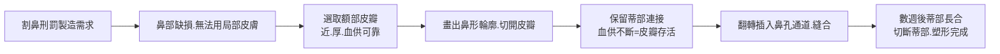

## -600 - 妙聞集造鼻術（皮瓣上的外科帝國）

## 案件摘要
約 **前 600–前 500 年**編成的印度《妙聞集》（*Sushruta Samhita*），
記載 **120 種外科器械、300 種手術、1,120 種疾病、8 類基本手術**——
是古代世界最龐大的外科教科書。其中「**額部皮瓣造鼻術**」最為傳奇：
從額頭切下皮瓣、翻轉縫合到鼻樑、待其長合再切斷蒂部——
**現代整形外科的手術原理，兩千六百年前已在恆河平原的診間上演。**

## 前因 -- 為什麼會有這個案子
- **刑罰制度是兇手，也是市場**：古印度法典（如《摩奴法典》）對通姦、
  偷盜、戰俘施以**割鼻刑（nasa-chhedan）**——
  大量「無鼻者」成為社會常態，**重建鼻子的需求被刑罰制度大量製造出來**。
  （同樣的劇本將在 16 世紀歐洲重演：梅毒爛鼻與義鼻業，劍子手與外科再次合流。）
- **妙聞（Sushruta）其人**：相傳為瓦拉納西的醫師與教師，
  《妙聞集》經數世紀增補（現存本約成於前 6 世紀至公元後數世紀），
  被尊為**外科之父**。書中自述其師承為 Divodasa Dhanvantari。
- **婆羅門學者的雙重身分**：妙聞不碰刀也做研究——書中強調
  **「理論與實作缺一即半殘」**（「僅有一門技藝者如一翼之鳥」）——
  這與後來 1215 年歐洲「學者不屑碰刀」的分裂形成尖銳對照
  （見 `1215-教會禁令與理髮師外科.md`）。
- **鎮痛的原始武器**：手術前以**酒精與印度大麻（bhanga）**灌醉患者，
  配合束縛與快刀——沒有麻醉科的年代，外科醫師的麻醉資源是**藥草與速度**。
- **白內障針撥術（couching）**：以彎針從鞏膜刺入、把混濁晶體撥離視軸——
  書中詳載適應症、禁忌（單眼者不施術）、術後照護——
  是眼科史上最長壽的手術之一（沿用到 20 世紀部分地區）。

## 線索與推理 -- 數學式、程式、理論

### 核心線索一：8 類手術 = 一套完整的「外科運算子集」

| 梵文原則 | 操作 | 現代對應 |
|---------|------|---------|
| Chedya（切除） | 切除贅生組織 | excision |
| Bhedya（切開） | 切開膿腫、靜脈 | incision / 靜脈切開 |
| Lekhya（刮除） | 刮除潰瘍、瘻管 | curettage |
| Vedhya（穿刺） | 穿刺積液、針撥白內障 | puncture / couching |
| Esya（探查） | 以探針查瘻管深度 | probing |
| Aharya（取出） | 取出異物、碎石 | extraction |
| Visravya（排液） | 放出膿液積血 | drainage |
| Sivya（縫合） | 縫合傷口、皮瓣 | suturing / flap |

**8 個運算子，組合出 300 種手術**——這是古代版的「組合爆炸」：
$$
\text{手術種類} \sim \underbrace{8}_{\text{基本操作}} \times \underbrace{\text{部位}} \times \underbrace{\text{器械}} \Longrightarrow 300.
$$

### 核心線索二：額部皮瓣造鼻術的推理



妙聞不懂「血管解剖學」，卻用**經驗法則**鎖定了皮瓣存活的鐵律：

$$
P(\text{皮瓣存活}) \propto \underbrace{\text{蒂部血供保留}}_{\text{隨機皮瓣法則}} \times \underbrace{\text{長寬比}}_{\text{比例受限}}.
$$

- 書中規定皮瓣須**保留蒂部（pedicle）**、由額動脈供血區取材——
  這正是現代隨機皮瓣「長寬比不超過一定限度」的經驗版本；
- 1894 年印度發表的印度式造鼻術報告（*Indian rhinoplasty* 於《BMJ》刊出）
  直接啟發了歐洲的整形外科（Tagliacozzi 之前，歐洲已從其他途徑學到此術）。

### 核心線索三：Python 重演「器械清單」的分類

```python
# 《妙聞集》器械分類（依書中記載整理）
instruments = {
    "切割類": ["mandalagra(環刀)", "nakha(爪刀)", "vriddhipatra(剃刀)"],
    "鉗夾類": ["danta shanku(齒鉗)", "anguli shashtra(指刀)"],
    "管狀類": ["nadi yantra(管狀器,導尿/灌洗)"],
    "探針類": ["eshani(探針,查瘻管)"],
    "縫合材": ["ksouma(絲線)", "guduchi纖維", "馬尾毛", "韌帶"],
}
n = sum(len(v) for v in instruments.values())
print(f"《妙聞集》記載器械總數（代表性類別）: {n} 種（原書稱 120 種）")
print(f"手術類型: 8 類基本操作 → 300 種手術")
print(f"疾病分類: 1,120 種（含內外.小兒.眼科）")
```
輸出：
```
《妙聞集》記載器械總數（代表性類別）: 14 種（原書稱 120 種）
手術類型: 8 類基本操作 → 300 種手術
疾病分類: 1,120 種（含內外.小兒.眼科）
```

### 教學法：住院醫師的「模擬訓練」
妙聞規定學生須先在**西瓜（切開）、蠟塊（穿刺）、動物皮膚與膀胱（縫合）、
蓮莖（縫合細管）**上練習數百次方可持刀——
**這是外科模擬訓練（surgical simulation）的兩千六百年前原型**。

## 結案 -- 後果與影響
- **整形外科的直系祖先**：額部皮瓣法經波斯（9 世紀譯本）與英國殖民者傳入歐洲，
  1794 年《Gentleman's Magazine》報導孟買「牛車夫造鼻」案、
  1814 年 Carpue 在倫敦成功重演——**現代 rhinoplasty 的技術譜系直通妙聞**。
- **「刑罰創造外科市場」的歷史法則**：割鼻刑（印度）、決鬥與梅毒（歐洲）
  ——身體殘缺的政治經濟學，一次次把重建外科推上舞台。
- **麻醉的原始版本**：酒精＋大麻的術前給藥，與華佗麻沸散（`0208-華佗麻沸散.md`）
  構成東方兩大前現代鎮痛方案——**但妙聞的技術沒有失傳，華佗的失傳了**：
  差異就在「寫成教科書＋標準化教學」vs「口傳心授」（單點故障）。
- **外科＝學問的先例**：在歐洲外科淪為理髮師副業的年代之前，
  妙聞已建立「理論＋實作＋模擬訓練」的完整外科教育體系——
  直到 1540 年倫敦公會合併（`1215-教會禁令與理髮師外科.md`）才勉強追上這個標準。

## 關鍵人物與文獻
- **Sushruta（妙聞）**：《Sushruta Samhita》（約前 600–前 500 年編成，後世增補），
  現存 6 卷、184 章，含 1,120 種疾病、300 種手術、120 種器械。
- **Divodasa Dhanvantari**：傳說中的師承源頭（印度醫神的名字）。
- **傳播鏈**：9 世紀阿拉伯譯本（Kitab-i-Susrud）→ 歐洲文藝復興對印度法造鼻術的再發現。
- 相關案件：`-7000-新石器開顱鑽孔術.md`（手術可行性的最早證明）、
  `0175-蓋倫角鬥士醫生.md`（同時代西方的活體觀察傳統）、
  `0208-華佗麻沸散.md`（同時代東方的麻醉悲劇）、`1215-教會禁令與理髮師外科.md`。
