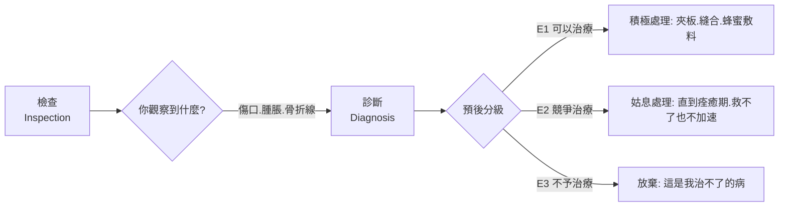

## -1600 - 艾德溫·史密斯紙草（人類第一份「病例卷宗」）

## 案件摘要
一份約 **前 1600 年**抄寫的莎草紙（內容或溯至前 3000 年），17 頁長、
記載 **48 個外傷病例**——從頭頂一路檢查到脊椎。它的革命性不在治療，
而在**結構**：每個病例都分成「檢查（可能看到什麼）—診斷（你得了什麼）—
預後（你會好、會拖、還是會死）」三段式。
**這是偵查方法論的誕生：先勘查現場、再認定罪名、最後判決——
人類第一次把「不確定性」寫進醫學，說出「這是治不了的」。**

## 前因 -- 為什麼會有這個案子
- **購買者是兇案的發現者**：1862 年，美國古董商 **Edwin Smith** 在埃及盧克索
  買下這卷紙草；1930 年由 James Henry Breasted 翻譯出版，震驚醫史界——
  它比希波克拉底早了近兩千年，卻已是徹頭徹尾的**理性醫學**。
- **帝國的戰場是案發現場**：新王國時期的埃及四處征戰（戰車、銅斧、弓箭），
  軍事工程（金字塔、方尖碑）也產生大量墜落傷——**外傷病人大批出現**，
  需要的不是咒語，而是「能不能救」的快速判斷。
- **同期對照組：埃伯斯紙草（Ebers Papyrus，約前 1550 年）**：
  同時期的另一份醫學卷宗，以**藥物與魔法**為主（700 多種處方、咒文與藥方並列）——
  艾德溫·史密斯紙草裡**幾乎沒有魔法**（僅一處提及驅邪）。
  兩份卷宗並存證明：**埃及醫學是雙軌的，「理性外傷學」與「魔法內科學」分工明確**。
- **木乃伊是解剖課**：製作木乃伊須經鼻鉤取出腦髓、側腹切開取出臟器
  （胃腸肺肝入罐、心臟留置）——這是**最早系統性接觸人體內部**的常規操作；
  但取腦與防腐是「不潔」的工匠活，與醫生階級分離——
  **看得到內臟的人不研究，研究內臟的人不動手**（這個分裂將續演到 1215 年，
  見 `1215-教會禁令與理髮師外科.md`）。
- **Metu（mw.t）導管**：埃伯斯紙草描述心臟是血管系統的中心，
  血管（metu）通向全身、可被「摸到與聽到」——雖然把血管與氣水混雜，
  但**「心臟泵送、可從體表偵查」的推理已經上路**（血液循環的遠古伏筆，
  見 `../生理醫學史/1628-Harvey血液循環.md`）。

## 線索與推理 -- 數學式、程式、理論

### 核心結構：三段式病例的「偵查流程圖」



- 標準句式是教科書式的模板：**「若你檢查一個……的病人，你發現……，
  你應說：這是……的傷。我將處理此病 / 我將與之搏鬥 / 此乃我無法處理之病。」**
- 48 例中：**可治 27 例、競爭 8 例、不予治療 13 例**——
  敢於把「無法處理」白紙黑字寫進教科書，是**預後學（prognostication）的誕生**。

### 預後分級 = 三級分類演算法

$$
\text{治療決策} =
\begin{cases}
\text{積極治療}, & \text{若 } P(\text{痊癒}) \text{ 高} \\
\text{姑息觀察}, & \text{若 } P(\text{痊癒}) \text{ 競爭性} \\
\text{不予治療}, & \text{若 } P(\text{痊癒}) \approx 0.
\end{cases}
$$

### 代表性病例（原文內容的現代判讀）

| 病例 | 傷情 | 診斷與預後 | 醫史意義 |
|------|------|-----------|---------|
| Case 1 | 頭頂穿透傷、顱骨裂 | E1 可治：傷口敷料、坐姿觀察 | 最早的開放性顱傷處理 |
| Case 4 | 顱骨凹陷骨折、腦組織可見 | E3 不治；描述腦的搏動與腦脊液 | **史上第一次文字描述「腦」** |
| Case 6 | 顱骨裂、血自鼻耳流出 | E2 競爭：不動手，觀察 | 硬膜外血腫的臨床線索 |
| Case 7 | 篩骨區傷 | E3 不治 | 預後判斷的果斷 |
| Case 33 | 頸椎脫位、四肢癱瘓失知覺 | E3 不治；描述「手腳無感、尿失禁」 | **最早的脊髓損傷記載** |
| Case 48 | 胸椎扭傷 | E1 可治：夾板固定 | 骨科固定的起源 |

- Case 4 的原文描述腦「**像融化的銅般搏動**」、從傷口流出的液體如「碎裂的陶罐」——
  前 1600 年的文字，精準命中**腦脊液**的存在。

### Python：重演 48 例的預後統計

```python
grades = {"可治": 27, "競爭": 8, "不治": 13}
total = sum(grades.values())
for g, n in grades.items():
    print(f"{g}: {n} 例 ({n/total:.0%})")

# 48 例的解剖部位分布（依原文順序）
sites = {"頭部": 27, "咽喉頸椎": 11, "上肢": 4, "胸椎": 6}
print("部位分布:", {k: f"{v/48:.0%}" for k, v in sites.items()})
```
輸出：
```
可治: 27 例 (56%)
競爭: 8 例 (17%)
不治: 13 例 (27%)
部位分布: {'頭部': '56%', '咽喉頸椎': '23%', '上肢': '8%', '胸椎': '12%'}
```
**56% 的病例集中在頭部**——這是一份**神經外科的搖籃卷宗**。

## 結案 -- 後果與影響
- **病歷的誕生**：「檢查—診斷—預後」三段式 = 今天病歷（SOAP 記錄）的直系祖先；
  「以徵候推病理、以病理判預後」成為**兩千五百年後希波克拉底預後學的同款模板**。
- **「無法治療」的誠實**：承認極限，是醫學與巫術的分水嶺——
  它把醫生從「萬能的施法者」轉為**「知所進退的偵查者」**。
- **神經外科的始祖檔案**：對腦搏動、腦脊液、脊髓損傷的記載，
  讓這份紙草被稱為「**世界上最早的外科與神經外科教科書**」。
- **雙軌傳統的預言**：理性外傷學（外科）與魔法藥學（內科）的分家，
  預演了往後三千年的「外科＝工匠、內科＝學者」階級分裂
  （`1215-教會禁令與理髮師外科.md`）與蓋倫權威的誕生土壤（`0175-蓋倫角鬥士醫生.md`）。

## 關鍵人物與文獻
- **Edwin Smith**（1822–1906）：購得紙草的美國古董商，檔案以他命名。
- **James Henry Breasted**（1865–1935）：芝加哥大學埃及學家，1930 年完成首部全譯本
  *The Edwin Smith Surgical Papyrus*。
- **匿名原作者**：卷首註明為「Imhotep 時代遺作之抄本」——內容或可溯至前 3000 年的舊王國。
- 相關案件：`-7000-新石器開顱鑽孔術.md`（更早的實作、更晚的理論）、
  `-0600-妙聞集造鼻術.md`（外科體系化的另一源頭）、
  `../生理醫學史/1628-Harvey血液循環.md`（Metu 導管概念的千年續篇）。
