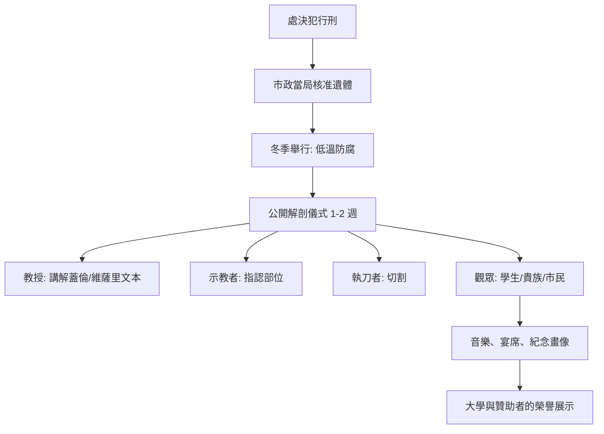

## 1594 - 帕多瓦解剖劇場（當解剖學變成一場冬季公共節慶）

## 案件摘要

1594 年冬天，帕多瓦大學。解剖學教授 Girolamo Fabrici（吉羅拉莫・法布里奇烏斯，Fabricius ab Aquapendente，維薩里學派的再傳弟子）讓人蓋了一座永久性的建築：一座橢圓形、分層環繞的**解剖劇場（Teatro Anatomico）**，中央是解剖台，八圈木造階梯圍繞而下，可容納兩百人以上的觀眾。

這是歐洲第一座專為解剖而建的永久劇場。從此，解剖不再需要臨時在庭院搭台、拆掉又重建——它有了自己的教堂。

這座劇場至今仍在：它是帕多瓦大學「博宮」（Palazzo del Bo）內的一間木造橢圓廳，二戰轟炸後依原樣修復，是今日的醫學史朝聖地。案發地點本身就是證物。

## 前因 -- 為為什麼會有這個案子

先回顧案情背景（見 `1543-維薩里人體的構造.md`）：維薩里親手執刀的教學法在帕多瓦大受歡迎，學生擠爆臨時解剖場地。此前大學的公開解剖是臨時性、季節性的活動，通常租用場所或在醫學院庭院架設看台。

先列出「前劇場時代」的解剖課有多簡陋：

- 場地臨時租借，解剖完就拆台，隔年重來；
- 冬季限定（低溫防腐），一年通常只有一具屍體可用；
- 教授朗讀蓋倫、示教者指點、理髮匠執刀的三層分工；
- 觀眾按身分付費站位，秩序靠市政官員現場維持；
- 儀式結束後，殘骸交由承辦人處理，無標本留存。

條件也逐漸到位了。義大利諸邦相對寬容的法律使遺體取得較容易（主要來源：處決犯），教會雖有顧慮但大學與市政當局支持——因為公開解剖同時是**市政榮譽的展示**。學生人數暴增（十六世紀末帕多瓦有來自全歐的三千多名學生），臨時看台不敷使用。於是 Fabricius 說服元老院出資，在醫學院大樓內興建永久劇場。

同時期北方的萊頓大學（1575 年新建）也急起直追。

## 線索與推理 -- 數學式、程式、理論

解剖劇場的制度設計，可以拆解成一張規格表：

| 劇場 | 年份 | 形制 | 容量 | 特色 |
| --- | --- | --- | --- | --- |
| 帕多瓦 Teatro Anatomico | 1594 | 橢圓形、六至八層木造環廊 | 200+ | 世界最早永久解剖劇場，保存至今 |
| 萊頓 Anatomisch Kabinet / Theatrum | 1596 | 圓形環廊，後擴建 | 數百 | 附設珍奇櫃（cabinet of curiosities）與警語標本 |
| 博洛尼亞 Teatro Anatomico | 1637 | 長方形木造階梯 | 數百 | Archiginnasio 內，二次大戰後依原樣重建 |
| （對照）阿姆斯特丹行會解剖室 | 1632 | 非永久建築，臨時布置 | 數十 | 林布蘭《杜爾博士的解剖學課》所繪場景 |

劇場的運作節奏是一套嚴格的儀式：

萊頓劇場還發展出一套獨特的「標本修辭」：觀眾席上方懸掛著穿著真實衣物的骷髏，手執鐮刀、旗幟，甚至踩著乾草堆（寓意「雜草叢生的墳墓」），旗上寫著警語——「Nos sepe ipsa loquimur, vos audite loquentis」（我們常常自己說話，請聽說話者）、「Mors sceptra ligonibus aequat」（死亡使權杖與鋤頭平等）。這是 **memento mori**（勿忘你終有一死）的視覺化：解剖學與道德訓誡、哲學沉思打包出售。

1632 年，26 歲的林布蘭為阿姆斯特丹外科行會繪下《杜爾博士的解剖學課》（*De anatomische les van Dr. Nicolaes Tulp*）：七位行會成員付了錢才擠進群像，杜爾博士以鑷子提起前臂屈肌群——這具屍體是當年 1 月 31 日被處決的竊賊 Adriaen Adriaenszoon（「t'Kindt」）。行會每年一次的公開解剖是特權典禮，群像畫則是榮譽的永久存證。細節耐人尋味：畫中的解剖從前臂開始（當時慣例是先剖腹，這裡為了美觀而破例），而且**沒有人看屍體**——所有人都在看書或看觀眾。

## 結案 -- 後果與影響

解剖劇場完成了三重制度化：

1. **合法性制度化**——從中世紀的黑市行為（盜墓、私刑風險）轉為市政核准、大學主辦的公共科學奇觀；遺體來源固定為處決犯，「刑場→解剖台」成為法律鏈條（這條鏈條日後在蘇格蘭斷裂，引爆 `1828-伯克與黑爾謀殺案.md`）。
2. **教學制度化**——永久場地讓解剖課從偶發事件變成年度學程，帕多瓦學派因此持續產出：Fabricius 本人在此發現靜脈瓣膜（1603 年出版 *De venarum ostiolis*），他的學生哈維（Harvey，1602 年入學帕多瓦）正是從靜脈瓣膜出發走向血液循環（`../生理醫學史/1628-Harvey血液循環.md`）。
3. **社會學制度化**——公開解剖同時是上流社會的看秀：貴族付費入場、學生按身分就座、市政官員坐最好的位置、儀式後有宴席與音樂。知識的傳播與贊助者的榮譽是同一場活動的兩面。

再補一組「劇場化」的社會學觀察：

- **座位即階級**：環廊的最底層留給教授與執刀者，上層依次是學生、市民、貴族包廂——空間結構就是知識權力結構的剖面圖；
- **季節即儀式**：冬季解剖季（通常一月前後）成為大學年的固定節慶，門票與紀念品成為大學收入；
- **標本即政治**：萊頓的骷髏群像握著的旗幟上寫著贊助者與市政官的名字，memento mori 同時是捐贈者名錄；
- **繪畫即履歷**：像《杜爾博士的解剖學課》這樣的群像畫，本質上是行會成員花錢購買的「出席證明」，是十七世紀的學術公關攝影。

但劇場也是一面照妖鏡：當解剖被「劇場化」，觀察開始讓位給表演。林布蘭畫中那些不看屍體的紳士，就是這個矛盾的定格——科學的公眾性與科學的嚴謹性，從第一天起就在互相拉扯。

還要記下劇場的陰影面：這套體制把遺體需求制度化為「每年的固定消耗」，而供給卻仍是刑場與貧民墓。在義大利，這條供需線靠寬容的法律勉強維持；一旦把體制移植到需求更猛烈的北歐（愛丁堡、倫敦），法律供給跟不上教學擴張，黑市便會填補缺口——兩百多年後的伯克與黑爾案（`1828-伯克與黑爾謀殺案.md`），正是帕多瓦劇場模式的影子在北方的變形。

## 關鍵人物與文獻

- **Girolamo Fabrici / Fabricius ab Aquapendente（1533–1619）**：帕多瓦解剖學教授、胚胎學先驅；1594 年興建世界首座永久解剖劇場，1603 年發表靜脈瓣膜研究。
- **Pieter Paaw（1564–1617）**：萊頓大學首任解剖學教授，1596 年建立萊頓解剖劇場與珍奇櫃。
- **Rembrandt van Rijn（1606–1669）**：1632 年繪《杜爾博士的解剖學課》，現藏海牙莫瑞泰斯皇家美術館。
- **文獻**：Fabricius, *De venarum ostiolis*（1603）；萊頓劇場箴言集（十七世紀蒐藏目錄）。
- 參照案件：`1543-維薩里人體的構造.md`（劇場的思想源頭）、`1828-伯克與黑爾謀殺案.md`（遺體供需失衡的惡性後果）。
