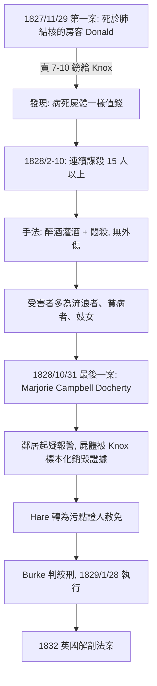

## 1828 - 伯克與黑爾謀殺案（當解剖學的需求，把窮人變成了商品）

## 案件摘要

1828 年 10 月 31 日，愛丁堡。William Burke 在絞刑架下當眾被處死，圍觀群眾估計超過兩萬人，朝他嘶吼的不是「去死」，而是兩個字：**「Burke him!」**——用他的方式悶死他。他的遺體隨後被送往愛丁堡大學解剖，由名教授 Alexander Monro tertius 親自主刀，學生們爭搶入場，一名學生撕下他的頭皮做紀念；他的皮被製成皮件與書套，至今仍存於博物館。

這個窮苦愛爾蘭勞工，一年內與同夥 William Hare 在愛丁堡 West Bow 一帶的廉價公寓中，悶殺了**至少 16 人**，賣給外科醫生 Robert Knox 的解剖學堂，一具屍體賣 7 至 10 英鎊——當時一個工人一週的工資不過 1 英鎊上下。

兇器不是刀，而是一種方法：跨坐在醉倒的受害者胸上、捂住口鼻，不留外傷——後人稱之為「burking」。不留傷口的屍體，才像「病死的」。

補一句受害者的輪廓，因為它就是本案的核心證據：已知 姓名 的受害者包括愛爾蘭移民、乞丐、聾啞少年 Jamie Wilson、年輕妓女 Mary Paterson、病弱的老婦 Abigail Simpson、最後的 Marjorie Campbell Docherty——**全是流動人口、貧民、無人會來尋找的人**。Knox 解剖堂的登記簿上，他們被簡化為「fresh subject」的到貨紀錄。

## 前因 -- 為什麼會有這個案子

先看需求端。十九世紀初愛丁堡是世界外科之都，醫學生人數暴增，蘇格蘭的教學規範要求**每位外科學生至少解剖三具屍體**——這是數量級的成長。而供給端幾乎歸零：1752 年英格蘭《謀殺法》（Murder Act）只允許解剖「殺人犯的屍體」，蘇格蘭（1819 年伯克案前的 Burke v. Innes 判例確立的法律環境）同樣只准用處決犯。問題是：愛丁堡一年處決的重罪犯屈指可數，一年需求卻高達數百具。

缺口由「復活者」（resurrection men）填補：盜墓、挖新墳、賣給解剖學家。這門生意在倫敦與愛丁堡半公開運作，價格一路上漲（十八世紀末一具約 2 英鎊，1820 年代漲到 8–14 英鎊）。市民反擊：鐵籠墓（**mortsafes**，蘇格蘭教堂墓園至今可見的巨大鐵籠）、守望塔（watch towers）、墓園守望隊（watch societies）、甚至租用「棺材槍」。盜墓成本與風險愈來愈高。

Knox 的解剖學堂（Surgeons' Square）是全城吞吐量最大的「採購單位」，每年需要數百具。於是經濟學發生了質變——當合法供給遠低於需求、價格又夠高，就有人開始思考：既然「新鮮、無外傷」的屍體最值錢，何必等他們病死？

把這條產業鏈寫成一個簡化的模型：

$$ \text{謀殺誘因} \;=\; \text{屍體單價} \times \text{Knox 的無限需求} \;-\; (\text{盜墓成本} + \text{法律風險}) $$

Burke 與 Hare 是這條式子的解：他們跳過「盜墓」這個變數，直接生產初級產品。

## 線索與推理 -- 數學式、程式、理論

案情時間軸（依法庭紀錄與 Hare 的污點證人證詞整理）：

本案的「偵探推理」有一個殘酷的技術細節：受害者在解剖台上被切割、消化掉了。Helen McDougal（Burke 之妻）涉嫌銷毀衣物，Knox 及其助手則把關鍵死者 Mary Paterson 與「啞巴小子」Jamie Wilson 的遺體做成了標本（Knox 的助手甚至把 Paterson 的頭髮保存多年）。屍體一進解剖刀，證據就永遠消失——**這正是「需求端」與「滅證端」重合的結構性問題**：解剖學家既是買家，也是最有效的滅證者。

英國輿論審判了 Knox，卻沒有法律工具：他從未出庭作證，僅在公眾壓力下寫了一封信自辯（後被證明由他人代筆）。他堅稱自己「從不問來源」——這在當時的解剖學界確實是普遍的默契，也是問題所在：**需求方刻意保持無知**。

而整起案件的因果鏈可以抽象為黑市經濟學的三段論：

1. 醫學教育法定需求（每生 3 具）＋法律供給歸零 ⇒ 黑市必然出現；
2. 黑市價格高於合法市場 ⇒ 盜墓產業專業化；
3. 盜墓風險上升 ⇒ 邊際突破：直接殺人。

還可以補一組對照數字，讓「需求—供給缺口」更具體（約略量級，依當代文獻估計）：

| 項目 | 估計值 |
| --- | --- |
| 愛丁堡醫學生人數（1820s） | 每年約一千人以上 |
| 法定／慣例需求 | 每生至少 3 具 |
| 合法處決犯屍體（全蘇格蘭年均） | 個位數 |
| 盜墓市價（1820s 愛丁堡） | 每具約 8–14 英鎊 |
| Burke & Hare 售價 | 每具 7–10 英鎊（冬春季加價） |
| 一年謀殺數 | 至少 16 人 |

合法供給與需求之間差了兩個數量級——這就是本案的作案動機結構。

## 結案 -- 後果與影響

直接後果：Burke 於 1829 年 1 月 28 日被絞死（Hare 免責釋放後從此下落不明，McDougal 獲釋後被群眾毆打逐出愛丁堡）；群眾高喊「Burke him!」，並有人焚燒 Hare 的假人。Burke 的屍體如大眾所願被公開解剖、製成標本——愛丁堡解剖博物館至今仍展示他的骨架。

審判本身的細節也值得存檔：案件於 1828 年 12 月在愛丁堡高等法院開審，主審為 Lord Justice-Clerk Boyle 勳爵；因 Hare 的豁免交易，辯方猛烈攻擊污點證人的可信度，但十六起以上的失踪案與 Knox 學堂的收屍紀錄串成的證據鏈過於完整。判決書對 Knox 隻字未罰——法律找不到起訴他的條文，這個缺口本身就成為法案改革的論據。

制度後果：案件直接催生 1832 年英國**《解剖法案》（Anatomy Act）**：

- 解剖用的合法遺體來源，從處決犯改為**無人認領的貧民屍體**（死於濟貧院、精神病院、醫院者，若無親屬領回，可由當局撥作解剖）；
- 設立**解剖督察制度**（inspectors of anatomy），所有解剖機關必須登記、領取執照、留存屍體接收紀錄，斬斷黑市；
- 醫學院需求因此得到滿足，盜墓業迅速消亡。

但這個「結案」埋著新的問題：**法案把代價轉嫁給窮人**。中產階級可以花錢買私人葬禮、認領遺體，貧民死後卻可能被強制解剖——「窮人的身體是國家的解剖材料」成為十九世紀英國階級憤怒的新火種（1830 年代濟貧院改革爭議與之共振）。愛爾蘭天主教徒尤其激烈抵制，因為他們的宗教要求完整下葬。

後續演變延續百年：1884 年英國陸軍開始為軍醫教學常備「教學屍體」；二十世紀逐漸轉向自願捐贈（英國 2004 年《人體組織法》徹底確立同意原則，Alder Hey 事件是催化劑）。

文化後果也值得記一筆：本案進入了語言——「burker」成為綁架誘拐者的代稱，維多利亞時代的父母以此嚇唬孩子不要跟陌生人走；狄更斯《雙城記》與史蒂文生《化身博士》的創作背景裡都有它的回聲；愛丁堡的 West Bow 巷至今在觀光導覽中以本案為賣點。一句話結案：伯克與黑爾案證明，**當身體成為稀缺商品而法律供給歸零，市場會自尋「生產方式」**——改革者若不願承擔屍體的道德成本，就會有窮人替他們承擔。

## 關鍵人物與文獻

- **William Burke（1792–1829）**：主犯，1829/1/28 絞死，遺體被公開解剖。
- **William Hare（1792–?）**：共犯，轉為污點證人獲赦免，釋放後下落不明。
- **Dr. Robert Knox（1791–1862）**：愛丁堡解剖學家，Burke & Hare 的最大買家，未受起訴但名譽盡毀，晚年遷居倫敦。
- **文獻**：愛丁堡高等法院審判紀錄 *Trial of William Burke and Helen McDougal*（1828）；蘇格蘭皇家委員會調查文件；1832 年英國《解剖法案》（2 & 3 Will. 4. c. 75）。
- 參照案件：`1594-帕多瓦解剖劇場.md`（「刑場→解剖台」合法鏈條的斷裂處）、`1543-維薩里人體的構造.md`（解剖學需求的思想源頭）。
