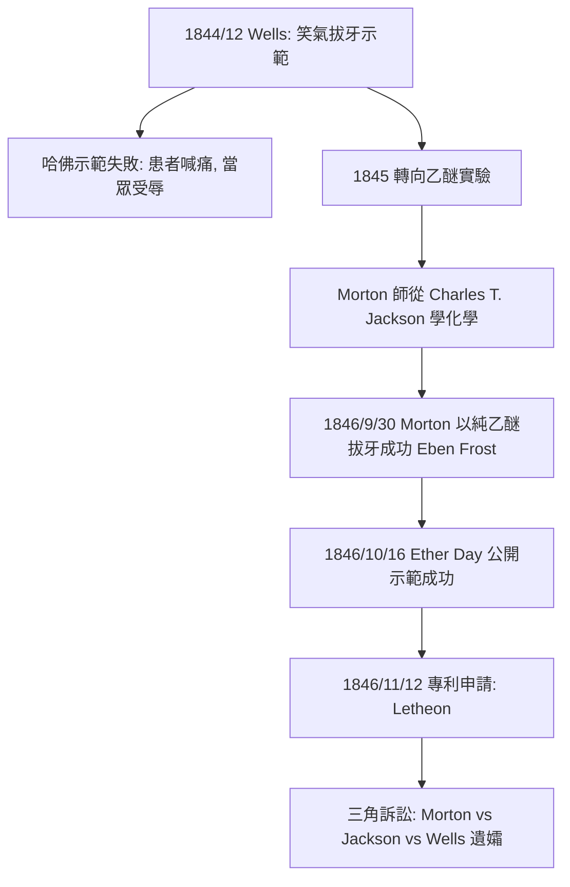

## 1846 - 莫頓乙醚麻醉（28 秒截肢的時代，在 10 月 16 日早晨終結）

## 案件摘要

1846 年 10 月 16 日上午，波士頓麻省總醫院（Massachusetts General Hospital）的手術圓形劇場——後人稱之為 **Ether Dome**（乙醚穹頂）。牙醫 William T.G. Morton（威廉・莫頓）帶著一個玻璃瓶與吸入裝置，讓患者 Edward Gilbert Abbott 吸入乙醚。外科教授 John Collins Warren 檢查後說：「病人已經準備好了。」接著切開 Abbott 頸部的先天性血管瘤。患者安靜躺著，沒有掙扎、沒有慘叫。

手術結束，Warren 轉向擠滿劇場的觀眾，說出那句流傳至今的話：

> **「Gentlemen, this is no humbug.」**——「諸位，這不是騙局。」

這一天被醫學史稱為 **Ether Day（乙醚日）**。人類外科史上的「痛楚屏障」，在這個上午正式破滅。

現場還有幾個細節值得存檔：患者吸入乙醚約五分鐘後失去意識，Warren 完整剝離了腫瘤連同部分血管，全程約十分鐘；圍觀者約二、三十人（醫生、醫學生與記者）；麻醉醫生身分一度保密，Morton 最初以「Letheon」註冊商標示人，只肯說這是「一種新藥」。**保密反而推遲了普及**——幾週後配方隨 Bigelow 的文章公開，全世界的醫院幾個月內開始複製：倫敦的 Liston 在 12 月 21 日以乙醚完成截肢，並對學生說「這套美國花招遠勝催眠術」（This Yankee dodge beats mesmerism hollow）。

## 前因 -- 為什麼會有這個案子

先理解「無麻醉外科」是什麼樣的行業。疼痛是絕對的物理極限：手術必須在患者休克、掙扎致死之前結束，於是外科變成**速度的競賽**。倫敦的名醫 Robert Liston（羅伯特・利斯頓）是速度之神——「先給我計時」（Time me, gentlemen, time me!）是他的招牌開場，他能以 28–30 秒完成一次大腿截肢（含止血帶操作）。這種速度的代價是組織撕裂、失血、偶發的災難：流傳的段子說他有一次快到連患者的睪丸與助手的手指一起切下，兩人隨後死於感染，旁觀一名觀眾也被嚇死——**史上唯一一台「300% 死亡率」的手術**（此說真偽存疑，但精準濃縮了那個時代的本質：手術是災害控制）。

在這種條件下，外科只能做三件事：截肢、切表淺腫瘤、綁動脈瘤。

再補一筆當時的「術前體驗」，因為它是本案的動機證據：患者通常要在手術前夜簽署同意、聽醫生詳述流程，並被建議「可以喝點白蘭地壯膽、找幾個壯漢按住自己」；手術檯旁常備皮質綁帶與木製咬棒。很多患者選擇拖延到腫瘤潰爛、別無選擇才上檯——**麻醉前的外科，是醫患雙方都需要勇氣的搏鬥**。胸腔、腹腔是不可想像的禁區。

技術的「原料」其實早已躺在貨架上。乙醚（diethyl ether，乙基醚）由 Valerius Cordus 在 1540 年左右合成，綽號「硫醚」（sweet vitriol）；1818 年 Michael Faraday 已記載吸入乙醚的麻醉效果與一氧化二氮相似。它便宜、易得，卻被當成派對道具——1840 年代美國流行**「ether frolics」（乙醚狂歡會）**：年輕人聚會吸乙醚取樂、摔跤、跌倒而不覺痛。這個「娛樂用途」正是關鍵線索：康乃狄克州哈特福的牙醫 Horace Wells（霍勒斯・威爾斯）從 1844 年的一場笑氣表演中看到「跌倒不痛」，開始用一氧化二氮拔牙；他的合夥人（兼前學生）正是 Morton。

更早的沉冤：喬治亞州的醫生 Crawford Long（克勞福德・朗）**早在 1842 年 3 月 30 日**就用乙醚為 James Venable 切除頸部腫瘤，之後又做了數例——但他只在 1849 年才發表論文，比 Ether Day 晚了近三年。史上第一台乙醚手術的榮譽，就此與專利與名譽之爭一起被埋進爭議。

還有一個常被遺漏的東方線索：日本外科醫生華岡青洲早在 **1804 年**就以曼陀羅華、烏頭等中藥配製的**通仙散（通仙湯）**完成世界首例記錄在案的全身麻醉手術（乳腺癌切除），比西方早了 42 年——但配方高度依賴個人經驗、有致死風險，且未傳出東亞，對西方外科革命沒有直接影響。（同時代的東方外科高手還有華佗的麻沸散傳說，見 `0208-華佗麻沸散.md`；兩案相隔一千六百年，可並讀。）

把無麻醉時代外科的「物理極限」整理成一張速查表：

| 極限 | 具體表現 |
| --- | --- |
| 時間 | 大手術必須在數分鐘內完成 |
| 範圍 | 只能處理四肢與體表 |
| 力量 | 需要助手按壓，患者掙扎常毀掉切口 |
| 心理 | 患者拖延就醫，腫瘤長到無法切除 |
| 品質 | 速度壓倒精細，組織損傷與失血失控 |

## 線索與推理 -- 數學式、程式、理論

Ether Day 之前的失敗史，本身就是一場實驗設計的教學：

化學與藥理的基本式可以寫成：

$$ \text{diethyl ether } (\mathrm{C_2H_5})_2\mathrm{O} \;:\; \text{揮發性高、油水分配係數大} \;\Rightarrow\; \text{易入中樞神經脂質層，產生可逆性全麻} $$

關鍵的工程問題不是「發現」而是**給藥裝置**：乙醚對黏膜刺激性強、易誘發咳嗽與嘔吐，Morton 的貢獻是把乙醚（先後嘗試添加香料的「Letheon」配方）裝進一個可控的玻璃吸入器，讓患者平順地吸收到麻醉濃度——這一步把「娛樂性昏厥」變成**可重複的臨床劑量**。他的公開示範也符合嚴格的試驗設計：先做牙科小手術驗證（9 月 30 日拔牙 Eben Frost），再上公立醫院的大手術，全程有醫學界名人見證（Henry J. Bigelow 隨即寫文發表，把消息傳遍世界）。

這個「公開、可重複、可驗證」的取證流程，正是它與 Crawford Long 的差別：Long 更早，但沒有在正確的時間、正確的舞台、以可傳播的形式發表。外科麻醉的「發現日」屬於能說服同行的那個人。

## 結案 -- 後果與影響

手術時限被解放了。麻醉普及後，外科從「幾分鐘內結束」的殘忍競速，轉為可以緩慢、精細、深入體腔的操作——腹部、胸腔手術在之後數十年內成為常規（Liston 的速度美學隨之破產，他的學生們轉向精細解剖）。但勝利只完成一半：麻醉讓患者睡著，卻沒有讓傷口不化膿。麻醉普及後手術量暴增，醫院裡的化膿感染反而惡化——這正是 Semmelweis 在維也納面對的產褥熱之謎（`../生理醫學史/1847-Semmelweis洗手.md`），以及李斯特 1865 年石炭酸消毒登場的舞台（`../生理醫學史/1864-Pasteur天鵝頸實驗.md` 之後的無菌外科）。麻醉＋消毒，兩場革命合體，才真正打開現代外科的大門。

而發明者們的下場是一場悲劇黑色喜劇：

- Morton、Jackson、Wells 三方搶專利（1846/11/12 以「Letheon」之名申請），並組成短命的專利聯盟向醫院收權利金；醫界群起抵制「對救人之術收費」。
- Wells 在 1848 年因氯仿成癮與身敗名裂而自殺。
- Jackson 聲稱自己才是化學原理的發現者，晚年精神崩潰，死於精神病院。
- Morton 窮盡家財打官司，向國會申請國家補償未果，1868 年貧病交加死於紐約（騎馬去死去的兒子墳前的途中中暑）。他的墓碑寫著：「在他之前，外科是一種痛苦；在他之後，疼痛得以被制服。」

更廣的制度反思：這場爭議成為「醫學發明該不該申請專利」的經典判例素材——支持方認為沒有專利誘因，Morton 不會投入提純與裝置設計；反對方（含多數倫敦與巴黎的外科權威）認為麻醉屬於「自然界的公共財產」，誰先發現皆無權壟斷。此後百年，「發現 vs. 發明」的界線之爭反覆出現於藥物與疫苗爭議（對照 `../生理醫學史/1796-Jenner牛痘接種.md` 中牛痘被刻意不申請專利的選擇）。

一句話結案：Ether Day 是外科史的歸零點——**痛楚的物理極限消失後，外科的全部邊界都要重新畫一遍**。而它的代價清單（名譽之爭、專利倫理、三個發明者全部悲劇收場）則成為此後所有醫學發明爭議的標準劇本。

## 關鍵人物與文獻

- **William T.G. Morton（1819–1868）**：波士頓牙醫，Ether Day 的執行者與專利申請人，死後被追認為「麻醉的公開引入者」。
- **John Collins Warren（1778–1856）**：麻省總醫院外科主任、新英格蘭外科之父，執刀者。
- **Crawford Long（1815–1878）**：1842 年最早用乙醚手術，1849 年才發表，一生未獲應有榮譽。
- **Horace Wells（1815–1848）**：笑氣麻醉先驅，1845 年示範失敗，1848 年自殺。
- **Charles T. Jackson（1805–1880）**：化學家，主張自己才是原理發現者。
- **華岡青洲（1760–1835）**：1804 年以通仙散完成世界首例有記錄的全身麻醉手術（乳腺癌切除）。
- **文獻**：Henry J. Bigelow, "Insensibility during Surgical Operations Produced by Inhalation," *Boston Medical and Surgical Journal*, 1846（ Ether Day 後一個月內發表，麻醉的革命性證據）；Crawford Long, 1849 年論文（主張優先權）。
- 參照案件：`../生理醫學史/1847-Semmelweis洗手.md`（麻醉之後浮現的感染之謎）、`1594-帕多瓦解剖劇場.md`（公開示範傳統的延續）。
