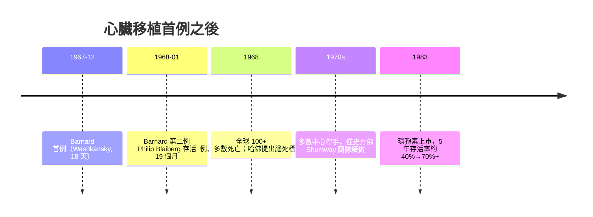

## 1967 - 巴納德心臟移植（十八天，改寫人類對「死亡」的定義）

## 案件摘要

- 時間：1967 年 12 月 3 日，南非開普敦 Groote Schuur 醫院。
- 嫌疑對象：瀕死的心臟，與一個更根本的問題——什麼時候可以宣布一個人已死？
- 侦探：Christiaan Barnard（1922–2001），開普敦心胸外科醫師。
- 手術：以 25 歲車禍死者 Denise Darvall 的心臟，移植給 53 歲的糖尿病性心衰竭病人 Louis Washkansky。
- 結局：Washkansky 術後心臟成功復跳、短暫好轉，**存活 18 天**後死於肺炎——兇手不是排斥，而是過量免疫抑制造成的感染。這仍是史上首例成功的人類心臟移植。

## 前因 -- 為什麼會有這個案子

技術條件在 1967 年前已逐步到位：

1. **體外循環**：Gibbon 1953 年的心肺機（見 `1953-吉本人工心肺機.md`）使心臟可以在直視下停跳操作。
2. **手術技術**：美國史丹佛的 **Norman Shumway**（與 Lower）在犬隻上發展出標準的原位心臟移植術式——自體心臟切除、供心吻合的順序（左心房→右心房→主動脈→肺動脈）；Shumway 是「心臟移植之父」，卻比 Barnard 晚了整整一個月動人類第一刀。
3. **Barnard 的知識旅程**：他在明尼蘇達大學（Lillehei 門下）受訓、到史丹佛向 Shumway 學低溫與體外循環技術，1958 年回開普敦建立心臟手術計畫，累積了南非最大的心外手術量。
4. **免疫抑制的半成品**：azathioprine＋類固醇（1954 年 Murray 之後的腎移植組合，見 `1954-默里同卵雙胞胎腎移植.md`）可用，但劑量—感染的權衡還沒摸清。

南非的兩個「條件」則是制度性的：當地法律允許在心跳停止後取得同意摘取器官，且媒體與院方高度支持——這在美國反而不易做到（Shumway 卡在腦死與倫理委員會的審查）。

## 線索與推理 -- 數學式、程式、理論

**1. 手術的免疫學賭注**：受體 T 細胞辨識供體心臟細胞表面的 MHC（HLA）分子：

$$
\text{供體 HLA} \neq \text{受體 HLA} \;\Rightarrow\; \text{T 細胞活化} \;\Rightarrow\; \text{細胞毒殺、血管炎、移植心衰竭}
$$

Washkansky 是瀕死者（存活率預估數週），所以 Barnard 願意押上超大劑量的免疫抑制：

```python
def immunosuppression_1967():
    regimen = {
        "azathioprine": "高劑量",        # 骨髓抑制風險
        "prednisolone": "高劑量",        # 感染風險
        "whole_body_irradiation": True,  # 全身照射（實驗性）
    }
    rejection_risk = suppress(regimen)   # 排斥壓下去了
    infection_risk = 1 - (1 - p_opportunistic) ** immunosuppression_duration
    # 1967 的悲劇：infection_risk >> rejection_risk
    return "Washkansky 死於肺炎（假單胞菌）"
```

**2. 排斥的病理與監測**：心內膜切片（心肌切片，後來由 Caves–Billingham 在史丹佛標準化）成為偵測急性排斥的常規——移植外科由此變成「終身監測的慢性病管理」：



**3. 腦死的邏輯必要性**：心跳著的供體才有可移植的心臟。傳統死亡定義（心肺停止）與移植需求正面衝突——1968 年哈佛特別委員會提出四條件：**無反應、無腦幹反射、無呼吸（apnea test）、腦電圖平直**，24 小時複查。這是把「死亡」從循環事件改寫為神經事件。

## 結案 -- 後果與影響

1. **傳播學效應**：首例引發全球媒體狂熱與倫理恐慌同時爆發——「醫生殺人取心」的指控、各國立法急補（供體同意、死亡定義）。一年內全球搶做 100+ 例、多數失敗，心臟移植一度進入寒冬；真正立足靠的是 Shumway 團隊的長期積累與 1983 年環孢素（見 `1983-環孢素與移植普及.md`），5 年存活率從約 40% 升至 70% 以上。
2. **Barnard 之後的手術成績**：第二例 Philip Blaiberg 存活 19 個月；Barnard 本人共做約 10 例心移植，晚年轉向異種移植與小兒外科，2001 年於塞普勒斯去世。
3. **外科技術的全球流動**：Lillehei（明尼蘇達）→ Barnard（開普敦）→ Shumway（史丹佛）→ 全球——「首例」的誕生地不完全等於技術的發源地；制度條件（供體法規、醫院支持）與技術條件同樣關鍵。這是外科史上的知識地理學樣本。
4. **死亡定義的法律革命**：腦死標準從 1968 哈佛報告走向各國立法（台灣 1987 年《腦死判定程序》納入器官移植條例），成為現代器官移植產業的法律地基。
5. **倫理的常規化**：受體選擇、供體家屬同意、器官分配排序——1967 年的媒體狂熱迫使移植醫學提前面對資源分配的正義問題。

## 關鍵人物與文獻

- **Christiaan Barnard**（1922–2001）：開普敦 Groote Schuur 醫院心胸外科；1967 年首例心臟移植執刀者。
- **Denise Darvall**：供體；其父親的同意成為供體同意制度的原型案例。
- **Louis Washkansky**（存活 18 天）與 **Philip Blaiberg**（存活 19 個月）。
- **Norman Shumway**（1923–2006）：犬隻心移植技術與臨床堅守者，「心臟移植真正的技術之父」。
- **Adrian Kantrowitz**：1967 年 12 月 6 日在紐約完成美國首例（嬰兒，存活數小時），比 Barnard 晚三天。
- 主要文獻：
  - Barnard, C. N. (1967). *The operation. A human cardiac transplant: an interim report of a successful operation performed at Groote Schuur Hospital, Cape Town*. S Afr Med J, 41: 1271.
  - Lower, R. R. & Shumway, N. E. (1960). *Studies on orthotopic homotransplantation of the canine heart*. Surg Forum.
  - Ad Hoc Committee of Harvard Medical School (1968). *A definition of irreversible coma*. JAMA, 205: 337.
  - Cooper, D. K. C. (2001). *Christiaan Barnard and his contributions to cardiovascular surgery*. Ann Thorac Surg.
