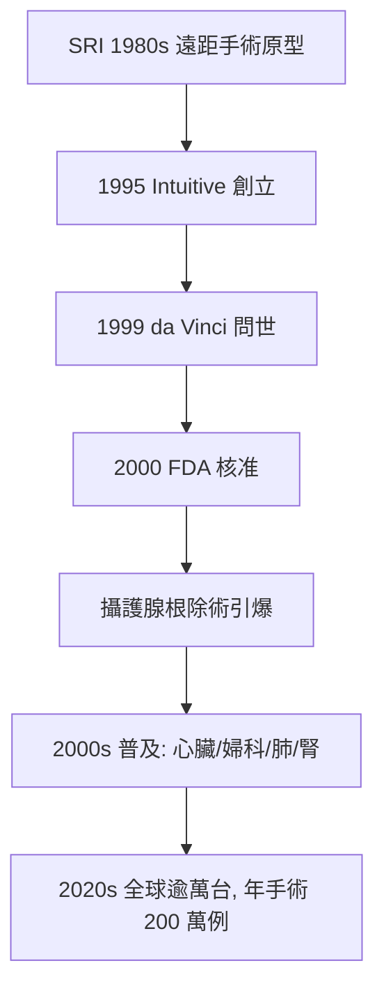

## 2000 - 達文西機器人手臂（當外科醫師的手，透過七自由度的機械腕伸進腹腔）

## 案件摘要

2000 年 7 月，美國 FDA 核准 da Vinci Surgical System（Intuitive Surgical 公司）用於腹腔鏡手術——史上第一個獲准臨床使用的手術機器人系統。外科醫師坐離手術台數公尺，雙手操縱主控台，機器的四條機械臂以 3D 立體視野與腕狀關節在患者體內動刀。創辦人 Frederic Moll 的賭注是：腹腔鏡革命（見 `1987-腹腔鏡微創革命.md`）留下了「觸覺歸零、器械僵硬」的缺口，誰能把手與眼還給外科醫師，誰就贏。

二十年後，全球裝機逾萬台，年手術量突破 200 萬例——一場以「攝護腺根除術」為灘頭堡的機器人革命，就此定局，儘管爭議從未停止。

## 前因 -- 為什麼會有這個案子

達文西的基因一半來自戰場，一半來自腹腔鏡的挫折：

1. **軍事遠距手術（1980s）**：美國 SRI International（史丹福研究院）在 DARPA 資助下研發遠距手術原型機，構想是讓後方專家遙控為戰場傷兵開刀——「不管醫師在哪裡，手術在傷兵身上」。這條線日後開花於 2001 年的跨大西洋遠距手術（見 `2001-林德伯格遠距手術.md`）。
2. **創業者的直覺（1995）**：婦科內視鏡醫師 Frederic Moll 看到腹腔鏡的痛點——直桿器械只有 4 個自由度、2D 影像、沒有觸覺——向 SRI 買下技術授權，與 Robert Younge、John Freund 創立 Intuitive Surgical，1999 年推出 da Vinci 系統（名字致敬文藝復興的解剖學家與工程師）。
3. **臨床灘頭堡**：1997 年歐洲首例機器人膽囊切除；真正引爆的是攝護腺根除術——這台手術要求在骨盆最深處、直徑數公分的空間裡，剝離攝護腺並保留海綿體神經（控尿與勃起功能），傳統腹腔鏡器械在此幾乎「轉不過彎」。

## 線索與推理 -- 數學式、程式、理論

**運動學：人類手腕 vs 機械腕。** 直桿腹腔鏡器械插經腹壁套管，其自由度被套管約束為 4 個（進退、繞套管軸旋轉、繞穿刺點兩軸擺動），在體內無法獨立俯仰——這是「直桿困境」。達文西的 EndoWrist 器械在體內端額外加上腕關節：

$$
\text{腹腔鏡器械自由度} = 4, \qquad \text{EndoWrist 自由度} = 7
$$

7 個自由度正是剛體在空間中自由運動的完整自由度（6 個剛體自由度 + 1 個抓握），意味著機械末端在手術空間內可達任意姿態。數學上，機器人的工作空間是主控台手腕動作的映射：

```python
def 動作映射(主控台位移, 縮放比=5, 震顫濾波=True):
    # da Vinci 的核心控制：動作縮放 5:1、震顫過濾
    縮放後 = [d / 縮放比 for d in 主控台位移]
    if 震顫濾波:
        # 濾除 6–10 Hz 的生理性手部顫抖
        縮放後 = 低通濾波(縮放後, 截止頻率_hz=2)
    return 縮放後
```

動作縮放 5:1 意味著醫師手移 5 mm，器械只動 1 mm——精細解剖（如神經旁的結締組織分離）的空間解析度被放大五倍。震顫過濾則濾掉人手 6–10 Hz 的生理顫抖，這在任何直視微創手術中都做不到。

**臨床證據：優勢集中於哪裡？** 攝護腺根除術的對比：

| 指標 | 開腹恥骨後路徑 | 機器人輔助 |
|---|---|---|
| 術中失血量 | ~500–1000 ml | ~100–250 ml |
| 輸血率 | 明顯較高 | 顯著下降 |
| 住院天數 | 2–4 天 | 1 天 |
| 切口 | 下腹 8–10 cm | 5–6 個小孔 |
| 尿控／性功能恢復 | 各家不一 | 學習曲線後相當或略優 |

失血優勢的機制清楚：氣腹靜脈壓壓迫 + 精細縫合背靜脈複合體。但功能結局（尿控、勃起）在隨機對照試驗中，與高容量中心的純腹腔鏡相比**未必顯著更優**——這是本書反覆出現的主題：**工程優勢 ≠ 臨床終點優勢**（RCT 與行銷的張力，見結案）。

**普及的動力學**（mermaid）：



## 結案 -- 後果與影響

- **攝護腺根除術的版圖翻轉**：美國的機器人輔助攝護腺根除在 2010 年代佔比超過 80 %，開腹近乎絕跡。這是患者選擇、醫院行銷與醫師學習曲線共同作用的結果，而非單純的 RCT 裁決。
- **高成本的倫理爭議**：單台系統約 150–250 萬美元，年維護費數十萬，器械每用 10 次強制更換。多篇衛生經濟學分析指出：多數手術的機器人方案成本更高、療效未證明更好。批評者稱達文西是「史上最成功的醫療行銷」；支持者則指出在骨盆深部縫合、喉部與肺部支氣管手術等狹窄空間，機器人確有不可替代性。
- **學習曲線的新問題**：主控台操作與開腹手感脫鉤，新一代外科醫師的縫合基本功引發老一輩憂慮；「機器人外科醫師」成為獨立次專科。
- **單一廠商的近壟斷**：Intuitive 長期佔有軟組織手術機器人市場九成，2020 年代才面對 Medtronic Hugo、CMR Versius 等挑戰者。
- **遠端靈巧性的通用理論**已外溢到所有微創領域：支氣管鏡機器人、血管介入機器人、眼科機器人——凡是「手需要比孔小、比眼更穩」的地方，都是機械腕的領地。
- **下一步**：單孔入路機器人（經單一肚臍切口）、柔性機器人與自主縫合實驗（見 `2023-AI手術與基因剪輯.md`），把「遠端靈巧」推向「演算法自主」——這正是外科下一場革命的伏筆。

## 關鍵人物與文獻

- Frederic Moll：Intuitive Surgical 創辦人，婦科內視鏡背景的連續創業家。
- SRI International 團隊：1980s DARPA 遠距手術原型機的工程源頭。
- 文獻：Binder & Kramer, "Initial experience with the telerobotic system", *Tech Urol* (2001)；U.S. FDA PMA 核准檔案 P000033（2000 年 7 月）。
- 相關檔案：`1987-腹腔鏡微創革命.md`、`2001-林德伯格遠距手術.md`、`2023-AI手術與基因剪輯.md`。
- 案件後記：da Vinci 沒有觸覺回饋，這個被工程師視為缺陷的特性，卻成為監管核准的意外助力——沒有觸覺，就沒有「機器自行判斷」的灰色地帶，責任主體清楚指向操刀醫師。直到自主性升級（Level 3，見 `2023-AI手術與基因剪輯.md`），這個責任架構才開始鬆動。


