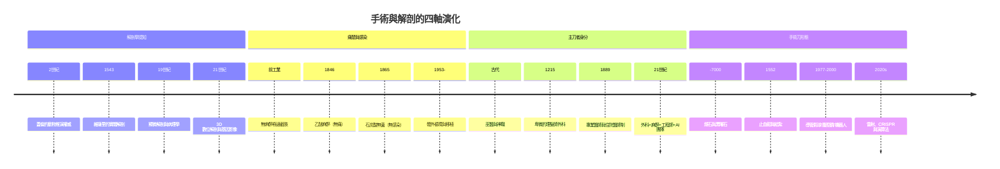

# 手術與解剖的歷史：從石器時代開顱、黑市盜屍、無痛無菌革命到微創與 AI 機器人手臂的割療史詩

> 本書以「推理探案」的體例，為手術與解剖史上的每個關鍵事件寫一篇 wiki：
> 誰是兇手（禁忌、權威、感染、痛楚）？偵探是誰（維薩里、帕雷、李斯特、庫欣……）？
> 線索與推理是什麼？每篇檔名以年份開頭（4 位數，負年以 `-` 開頭）。

## 雙線主軸

| 線 | 演變 |
|---|---|
| **解剖學認知線** | 動物推演與宗教禁忌（蓋倫） → 實體解剖與黑市盜屍（維薩里/博洛尼亞） → 顯微解剖與病理學 → 3D 數位解剖與分子基因影像 |
| **手術技術線** | 無麻醉極速切割 → 麻醉（無痛） → 無菌（無感染） → 體外循環與移植（突破生理極限） → 微創 → 機器人與 AI |

---

## 年表（非常詳細版）

### 第一篇：石刃、放血與神聖肉身——早期解剖與外科萌芽

| 年份 | 事件 | 意義 | wiki |
|---|---|---|---|
| 約前 7000–前 5000 | 新石器時代顱骨鑽孔（trepanation）：法國 Ensisheim 頭骨（約前 5100）、秘魯前印加大量開顱，骨緣癒合證明存活率 50–75% | 人類最早的手術，癒合骨緣＝最早的成功證據 | [-7000-新石器開顱鑽孔術](-7000-新石器開顱鑽孔術.md) |
| 前 3000–前 1600 | 燧石、黑曜石刀具；止血敷料（蜂蜜、樹脂、黴菌） | 最早的外科工具箱 | 同上 |
| 約前 3000–前 1600 | 埃及《艾德溫·史密斯外科紙草》：48 個外傷病例的「檢查—診斷—預後」三段式 | 最早的病歷與預後學 | [-1600-艾德溫史密斯紙草](-1600-艾德溫史密斯紙草.md) |
| 約前 1500 | 《埃伯斯紙草》以藥物與魔法為主；木乃伊製作的經鼻取腦與器官移除 | 最早的系統性內部觀察 | 同上 |
| 前 600–前 500 | 印度《妙聞集》：120 種器械、300 種手術、8 類手術法、額部皮瓣造鼻術 | 整形外科之祖 | [-0600-妙聞集造鼻術](-0600-妙聞集造鼻術.md) |
| 前 6 世紀 | 白內障針撥術（couching）；酒精/大麻鎮痛 | 最早的專科手術 | 同上 |
| 約 157 | 蓋倫任帕加馬角鬥士醫師，系統觀察活體傷口 | 活體生理學的起點 | [0175-蓋倫角鬥士醫生](0175-蓋倫角鬥士醫生.md) |
| 2 世紀 | 蓋倫動物解剖（豬、猴）：喉返神經實驗、體液學說、器官功能理論 | 用動物證據統治人體 1300 年 | 同上 |
| 約 200–208 | 華佗以「麻沸散」行全身麻醉剖腹術（《三國志》記載刳割縫合） | 最早的全身麻醉外科傳說 | [0208-華佗麻沸散](0208-華佗麻沸散.md) |
| 208 | 華佗因曹操頭風之請拒歸被殺；《黃帝內經》經絡傳統限制侵入性手術 | 中國外科的單點故障斷層 | 同上 |

### 第二篇：理髮師外科、黑市盜屍與解剖學革命

| 年份 | 事件 | 意義 | wiki |
|---|---|---|---|
| 1215 | 第四次拉特朗公會議禁神職人員流血（Ecclesia abhorret a sanguine） | 內科與外科的身分分裂 | [1215-教會禁令與理髮師外科](1215-教會禁令與理髮師外科.md) |
| 12–16 世紀 | 理髮師兼外科醫生（barber-surgeons）：放血、拔牙、截肢；紅白藍三色柱 | 醫療分工的階級雙軌制 | 同上 |
| 1540 | 倫敦理髮師外科公會合併（1745 分裂、1800 皇家外科醫師學會） | 專業化的漫長萌芽 | 同上 |
| 1543 | 維薩里《人體的構造》（與哥白尼《天體運行論》同年）：親自主刀解剖、修正蓋倫 200+ 處錯誤 | 觀察推翻權威的方法論革命 | [1543-維薩里人體的構造](1543-維薩里人體的構造.md) |
| 1537–1552 | 帕雷戰場上以軟膏取代沸油、以結紮術取代烙鐵；1552 發表 | 戰場＝最大的手術試驗場 | [1545-帕雷火器傷革命](1545-帕雷火器傷革命.md) |
| 1545 | 帕雷以法文出版《火器傷治療法》 | 知識的語言民主化 | 同上 |
| 1594 | Fabricius 建帕多瓦永久解剖劇場；博洛尼亞（1637）、萊頓（1596）跟進 | 解剖的制度化與劇場化 | [1594-帕多瓦解剖劇場](1594-帕多瓦解剖劇場.md) |
| 1632 | 林布蘭《杜爾博士的解剖學課》 | 解剖成為公共藝術奇觀 | 同上 |
| 18–19 世紀初 | 醫學院屍體需求暴增、處決犯供不應求；盜屍產業與 Mortsafe 守墓鐵籠 | 黑市經濟學製造罪案 | [1828-伯克與黑爾謀殺案](1828-伯克與黑爾謀殺案.md) |
| 1828 | 愛丁堡 Burke & Hare 為賣屍謀殺 16+ 人（悶殺不留傷） | 「為解剖而殺人」的世紀案件 | 同上 |
| 1829/1832 | Burke 被絞（群眾喊「Burke him!」）；英國《解剖法案》准用無人認領屍體＋督察制 | 黑市被制度終結（爭議：負擔轉嫁窮人） | 同上 |

### 第三篇：麻醉與無菌——解開外科鎖鏈的兩大奇蹟

| 年份 | 事件 | 意義 | wiki |
|---|---|---|---|
| 1804 | 日本華岡青洲以「通仙散」行全麻乳房切除（僅限東亞） | 更早的全麻，未進入全球敘事 | [1846-莫頓乙醚麻醉](1846-莫頓乙醚麻醉.md) |
| 1830s–1840s | 無麻醉時代：Liston 的 28–30 秒截肢、皮帶固定患者 | 速度＝仁慈的殘忍競賽 | 同上 |
| 1842 | Crawford Long 用乙醚切瘤卻不發表 | 「不發表的偵探」得不到署名 | 同上 |
| 1844–1846 | 笑氣派對（Wells）、乙醚狂歡（ether frolics）→ Morton | 麻醉的意外來源 | 同上 |
| 1846.10.16 | 「乙醚日」：Morton＋Warren 在波士頓麻省總醫院無痛切瘤 | 手術進入無痛時代 | 同上 |
| 1847 | Simpson 發現氯仿；1853 年 Snow 為維多利亞女王分娩施用 | 「痛楚是上帝旨意」的崩解 | [1847-辛普森哥羅芳無痛分娩](1847-辛普森哥羅芳無痛分娩.md) |
| 1847 | Semmelweis 發現洗手可防產褥熱（見 `../生理醫學史/1847-Semmelweis洗手.md`） | 無菌革命的先聲（悲劇） | [1865-李斯特石炭酸無菌革命](1865-李斯特石炭酸無菌革命.md) |
| 1864 | 巴斯德證明發酵與腐敗由微生物引起 | Lister 的關鍵線索 | 同上 |
| 1865.8.12 | Lister 以石炭酸處理複合骨折；1867《Lancet》發表防腐原則 | 外科的細菌學革命 | 同上 |
| 1867–1890s | 從防腐（antisepsis）到無菌（asepsis）：1880s 高壓蒸氣滅菌、1889 橡膠手套、口罩帽子 | 現代無菌手術室定型 | [1889-哈爾斯特德橡膠手套](1889-哈爾斯特德橡膠手套.md) |
| 1889 | Halsted 為助手訂製橡膠手套；創立手術室分工與無創原則、住院醫師制度 | 外科哲學從屠夫到工程師 | 同上 |

### 第四篇：開胸、開腦與器官移植——突破禁區的黃金時代

| 年份 | 事件 | 意義 | wiki |
|---|---|---|---|
| 1900s | Cushing 開創顱內腫瘤定位與腦手術技術；1912 任哈佛教授 | 「最後禁區」被數據管理打開 | [1912-庫欣創立神經外科](1912-庫欣創立神經外科.md) |
| 1901 | Cushing 推廣術中血壓監測 | 麻醉監測的誕生 | 同上 |
| 1926 | Cushing 與物理學家 Bovie 共製電燒刀 | 器械—物理學合作範式 | 同上 |
| 1932 | Cushing 描述 Cushing 病；腦瘤手術死亡率從 ~50% 降至 ~7% | 專科化的成果驗證 | 同上 |
| 1931–1953 | Gibbon 構想→與 IBM 合作研發人工心肺機 | 醫學工程的長跑 | [1953-吉本人工心肺機](1953-吉本人工心肺機.md) |
| 1950 | Bigelow 低溫法；1954 Lillehei 交叉循環 | 直視心臟的過渡方案 | 同上 |
| 1953.5.6 | Gibbon 為 Cecelia Bavolek 關閉心房中隔缺損——首例成功的體外循環心內直視手術 | 心臟禁區破冰 | 同上 |
| 1954.12.23 | Murray 完成同卵雙胞胎腎移植（Richard Herrick 存活 8 年） | 首例成功器官移植 | [1954-默里同卵雙胞胎腎移植](1954-默里同卵雙胞胎腎移植.md) |
| 1959–1962 | 全身照射免疫抑制；屍體腎移植＋azathioprine | 排斥問題的藥物解法 | 同上 |
| 1967.12.3 | Barnard 完成首例人類心臟移植（Washkansky 存活 18 天）；第二例存活 19 個月 | 移植時代的媒體與倫理震撼 | [1967-巴納德心臟移植](1967-巴納德心臟移植.md) |
| 1968 | 哈佛腦死標準確立 | 器官供體的倫理基礎 | 同上 |
| 1971–1983 | 環孢素從挪威土壤真菌分離（Sandoz）→ 1983 FDA 核准 | 排斥反應被馴服 | [1983-環孢素與移植普及](1983-環孢素與移植普及.md) |
| 1980s | 心移植 5 年存活率 40%→70%+；肝/肺/胰移植大規模普及 | 移植成為常規手術 | 同上 |

### 第五篇：微創、賽博格與 AI 機器人——未來的外科視野

| 年份 | 事件 | 意義 | wiki |
|---|---|---|---|
| 1929 | Forssmann 把導管插進自己的心臟（1956 諾獎） | 心導管的瘋狂起點 | [1977-冠狀動脈氣球擴張](1977-冠狀動脈氣球擴張.md) |
| 1959 | Sones 冠狀動脈造影；1964 Dotter 血管擴張術 | 血管內治療的鋪路 | 同上 |
| 1977.9.16 | Gruentzig 首例冠狀動脈氣球擴張（PTCA）——不開胸治冠心病 | 介入性心臟病學誕生 | 同上 |
| 1986 | 首例冠狀動脈支架；2003 藥物塗層支架對抗再狹窄 | 血管內治療的成熟 | 同上 |
| 1960s | Hopkins 柱狀透鏡內視鏡、冷光源、電視影像 | 微創的技術儲備 | [1987-腹腔鏡微創革命](1987-腹腔鏡微創革命.md) |
| 1987.3 | Mouret 首例腹腔鏡膽囊切除；1988 美國推廣 | 「大切口大醫生」崩塌 | 同上 |
| 1980s–1990s | 住院 7 天→1 天；NOTES、單孔手術 | 微創成為標準 | 同上 |
| 1980s | SRI 軍事遠距手術專案 → Frederic Moll 創立 Intuitive Surgical | 機器人手術的搖籃 | [2000-達文西機器人手臂](2000-達文西機器人手臂.md) |
| 2000.7 | FDA 核准 da Vinci 系統：3D 視野、7 自由度 EndoWrist、震顫過濾 | 機器人手臂上市 | 同上 |
| 2000s | 攝護腺根除術普及；逾萬台裝機、年手術 200 萬例（2020s） | 機器人成為常規 | 同上 |
| 2001.9.7 | 「林德伯格手術」：紐約遙控斯特拉斯堡膽囊切除（延遲 ~150 ms） | 手術去地理化 | [2001-林德伯格遠距手術](2001-林德伯格遠距手術.md) |
| 2019 | 中國 5G 遠距腦手術（3000 km） | 延遲瓶頸被通訊突破 | 同上 |
| 2020 | CRISPR 獲諾貝爾化學獎；2021 NTLA-2001 體內基因編輯首例 | 「分子層面的手術」 | [2023-AI手術與基因剪輯](2023-AI手術與基因剪輯.md) |
| 2022 | STAR 自主軟組織吻合機器人（LAMP 研究） | 自主性階層 Level 3 的逼近 | 同上 |
| 2020s | 手術影片 AI 分期（Cholec80）、AR 術中導航、脊椎/肝手術路徑規劃 | 演算法接管導航 | 同上 |

---

## 核心線索：四大維度的演變

## 章節目錄

### 第一篇：石刃、放血與神聖肉身
1. [-7000 新石器開顱鑽孔術](-7000-新石器開顱鑽孔術.md)
2. [-1600 艾德溫史密斯紙草](-1600-艾德溫史密斯紙草.md)
3. [-0600 妙聞集造鼻術](-0600-妙聞集造鼻術.md)
4. [0175 蓋倫角鬥士醫生](0175-蓋倫角鬥士醫生.md)
5. [0208 華佗麻沸散](0208-華佗麻沸散.md)

### 第二篇：理髮師外科、黑市盜屍與解剖學革命
6. [1215 教會禁令與理髮師外科](1215-教會禁令與理髮師外科.md)
7. [1543 維薩里人體的構造](1543-維薩里人體的構造.md)
8. [1545 帕雷火器傷革命](1545-帕雷火器傷革命.md)
9. [1594 帕多瓦解剖劇場](1594-帕多瓦解剖劇場.md)
10. [1828 伯克與黑爾謀殺案](1828-伯克與黑爾謀殺案.md)

### 第三篇：麻醉與無菌
11. [1846 莫頓乙醚麻醉](1846-莫頓乙醚麻醉.md)
12. [1847 辛普森哥羅芳無痛分娩](1847-辛普森哥羅芳無痛分娩.md)
13. [1865 李斯特石炭酸無菌革命](1865-李斯特石炭酸無菌革命.md)
14. [1889 哈爾斯特德橡膠手套](1889-哈爾斯特德橡膠手套.md)

### 第四篇：開胸、開腦與器官移植
15. [1912 庫欣創立神經外科](1912-庫欣創立神經外科.md)
16. [1953 吉本人工心肺機](1953-吉本人工心肺機.md)
17. [1954 默里同卵雙胞胎腎移植](1954-默里同卵雙胞胎腎移植.md)
18. [1967 巴納德心臟移植](1967-巴納德心臟移植.md)
19. [1983 環孢素與移植普及](1983-環孢素與移植普及.md)

### 第五篇：微創、賽博格與 AI 機器人
20. [1977 冠狀動脈氣球擴張](1977-冠狀動脈氣球擴張.md)
21. [1987 腹腔鏡微創革命](1987-腹腔鏡微創革命.md)
22. [2000 達文西機器人手臂](2000-達文西機器人手臂.md)
23. [2001 林德伯格遠距手術](2001-林德伯格遠距手術.md)
24. [2023 AI手術與基因剪輯](2023-AI手術與基因剪輯.md)
