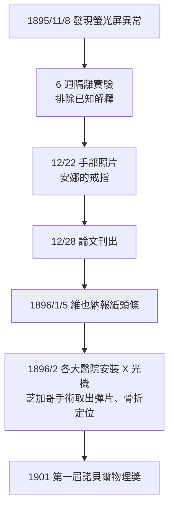

## 1895 - 侖琴發現 X 光（人類第一次不開刀就看見身體內部）

## 案件摘要

**本案偵破的是一個困擾醫學五千年的謎題：如何在不剖開身體的前提下看見身體內部？**

1895 年 11 月 8 日晚間，德國符茲堡大學物理學教授 Wilhelm Conrad Röntgen 在暗室中研究陰極射線時，注意到一公尺外塗著鉑氰化鋇的螢光屏發出了微光——而陰極射線管已被黑紙包住，不可能有光逃出。他意識到自己碰上了一種全新的、看不見卻能穿透物質的射線，因為算不出其本質，他乾脆命名為「X 射線」。六個星期後，他拍下了史上最著名的醫學照片：妻子 Anna Bertha 的左手，無名指上的戒指清晰可見，骨骼的影子浮在暗處。1896 年 1 月，這張照片登上了維也納報紙頭條，整個世界的醫學一夜之間改變。

## 前因 -- 為什麼會有這個案子

- **陰極射線的研究熱潮**。1858 年 Plücker 製成蓋斯勒放電管，此後歐洲物理學家競相研究真空管中「陰極射線」的本質——它是波還是粒子？這場爭論正是 1897 年電子發現（J. J. Thomson）的前奏。
- **意外的前兆被忽略**。1890 年，美國的 Goodspeed 與 Jennings 在賓州大學拍攝示範照時已意外得到 X 光影像（事後被稱為「史上第一張 X 光片」卻無人理解）；Crookes 曾抱怨底片莫名霧化；Lenard 的「Lenard 射線」穿出管外——但沒有人把「底片霧化」與「看不見的穿透輻射」連成因果。
- **醫學的老願望**。麻醉（1846）與消毒（1867）解決了「開刀的痛苦與感染」，但診斷仍靠聽診、觸診與屍體解剖——醫生被稱為「在黑暗中摸索的手指」。
- **符茲堡的孤立優勢**。Röntgen 五十歲、非主流射線學圈內人，但他擁有一流的放電管、極佳的暗室與極端嚴謹的實驗習慣——「重複、隔離、控制變因」的偵探方法。

## 線索與推理 -- 數學式、理論

**線索一：排除法鎖定「新射線」。** Röntgen 的推理是經典的差分實驗：

```text
觀察: 鉑氰化鋇屏發光
假設 A: 可見光從管內漏出      → 管已用黑紙完全包裹 → 排除
假設 B: 紫外線引發螢光        → 用各種玻璃/溶液過濾後仍發光 → 排除
假設 C: 陰極射線本身穿出      → 陰極射線在空氣中只能行進數公分 → 一公尺外仍發光 → 排除
結論: 存在新射線，穿透力遠超已知任何輻射 → 命名 X-strahlen
```

**線索二：穿透能力的物理量化。** X 光的穿透本領來自其光子能量 $ E = h\nu $（$ h $ 為普朗克常數，此時量子論尚未誕生——這是本案最美麗的反諷：解釋者的工具要到 1900–1905 年才出現）。X 光被物質吸收服從指數衰減：

$$ I = I_0 \, e^{-\mu x} $$

其中 $ \mu $ 為線性衰減係數，隨物質密度與原子序 $ Z $ 增加而增大（大致 $ \mu \propto \rho Z^3 $）。骨骼含大量鈣（$ Z = 20 $），軟組織以氫、碳、氧、氮為主（$ Z \le 8 $）——這個巨大的差異就是「骨骼顯影」的全部物理基礎。

**線索三：驗證「醫學可用」的三連測。** Röntgen 接著確認：(1) X 光能使底片感光（因此可記錄、可保存）；(2) 能穿透木門、書本、肌肉但被骨骼與金屬強烈阻擋（有對比度）；(3) 不受磁場偏轉（故非帶電粒子——這條線索後來證明它是電磁波）。他在七週內完成 17 篇實驗筆記組成的《論一種新的射線》（*Über eine neue Art von Strahlen*），一個月內論文刊出、寄送全球。

**線索四：狂熱式的全球複現。**



## 結案 -- 後果與影響

- **診斷醫學革命**。「放射線科」（Röntgen 部門 → Radiology）成為第一個「不接觸病人也能診斷」的醫學專科；骨折、異物、肺結核、牙科全景攝影全部改寫。
- **物理學被炸開**。X 光開啟了連鎖：1896 年貝克勒爾（見 `1896-貝克勒爾發現天然放射性.md`）、1897 年電子、1898 年鐳（見 `1898-居禮夫婦發現鐳.md`）——「原子不可分割」的教條崩潰，現代物理誕生於這一年的暗室。
- **1912 年還清物理債**。勞厄繞射實驗（見 `1912-勞厄與X光繞射.md`）終於證明 X 光是波長約 $ 10^{-10} $ m 的電磁波，並反過來成為解析晶體與 DNA 結構的工具。
- **陰影面**。第一批操作者不知道防護，灼傷與癌症隨之而來（見 `1925-國際放射防護的誕生.md`）；「透視」的獵奇狂熱（鞋店選腳型機、夜總會透視表演）預演了任何醫學奇觀被商業化的劇本。
- **一句話結案**：Röntgen 的偵探術語只有一條——「當所有已知解釋都排除後，剩下的就是真相，哪怕它叫 X。」

## 關鍵人物與文獻

- **Wilhelm Conrad Röntgen（1845–1923）**——符茲堡大學物理教授；1901 年首屆諾貝爾物理學獎（他拒絕了貴族冊封與專利，堅稱發現屬於全人類）；德文至今稱 X 光為「Röntgenstrahlen」。
- **Anna Bertha Röntgen（1839–1919）**——第一張醫用 X 光片的手；據傳她看見自己骨骼後說：「我看見了我的死亡。」
- **被忽略的前驅**——Goodspeed（1890 意外影像）、Lenard（陰極射線窗外研究，1905 獲諾獎後與 Röntgen 終生交惡）、Crookes（底片霧化投訴者）。
- 原始文獻——Röntgen, *Über eine neue Art von Strahlen*, Sitzungsberichte der Würzburger Physik.-medic. Gesellschaft, 1895/12/28。
- 現代註腳——Röntgen 拒絕申請專利，臨終遺願是把私人文件全部燒毀；世上僅存一張他本人不願多談的 X 光手照原件，藏於德國博物館。
