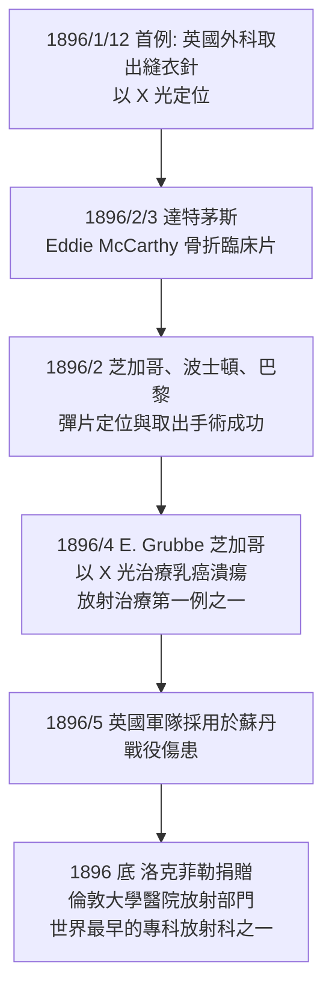

## 1896 - X 光狂熱與第一批放射線科（從魔術到醫療的十二個月）

## 案件摘要

**本案偵破的是：一個物理發現如何在十二個月內變成全球醫療體系？**

1896 年 1 月 Röntgen 的論文與照片公開後，世界陷入史上罕見的科學狂熱：報紙把 X 光稱為「攝魂之眼」，倫敦一度出現「內褲加鉛以防紳士透視」的廣告笑話；同一時間，芝加哥、倫敦、維也納、巴黎的醫院在數週至數月內安裝 X 光機，外科醫生第一次在手術前就能確認彈片與骨折的位置。1896 年 2 月 3 日，美國達特茅斯學院的 Gilman Frost 為少年 Eddie McCarthy 拍攝了史上第一張用於臨床診斷的 X 光片（確認尺骨骨折）。本案追蹤的正是「發現 → 複製 → 商品化 → 制度化」的完整第一圈。

## 前因

- **Röntgen 論文的公開傳播**。1896 年 1 月初論文以單行本形式寄出；1 月 5 日維也納《Die Presse》率先報導（據說由 Röntgen 寄給老友 Exner 的照片外流），一週內全球報紙跟進。
- **已存在的技術基礎**。感光底片工業（Kodak 1888）、放電管供應商、電氣技師——「安裝一台 X 光機」在當時只需物理講堂等級的設備。
- **戰場與工傷的需求**。1890 年代醫學最痛的難題之一是「體內異物」：子彈、彈片、針——觸診與探查手術的死傷率極高。
- **獵奇市場**。馬戲團、百貨公司、鞋店（後來的 Fluoroscope 選鞋機）搶先採用，「被看見」本身就是商品。

## 線索與推理

**線索一：第一批臨床照片的時間軸。**

**線索二：為何醫學採納快過任何歷史技術？** 可以用一個簡單的診斷價值函數描述：新工具被採用的條件是

$$ \Delta V = (\text{診斷資訊增益}) - (\text{成本} + \text{風險}) > 0 $$

X 光的獨特處在於「風險項」在 1896 年被視為零（無痛、非侵入、無藥物毒性），而資訊增益是質變（看得見 vs 猜不著）——所以 $ \Delta V $ 是醫學史上最大的正值之一，採納曲線近乎垂直。

**線索三：並行的早期放射治療。** 幾乎同時，芝加哥的 Emil Grubbe、維也納的 Leopold Freund（1896 年 11 月治療色素性毛痣，公認最早的放射治療案例之一）發現照射會使皮膚起紅斑、毛髮脫落——「能殺死細胞的射線就能殺死癌細胞」。這是 **燒傷→生物效應→治療** 的偵探三段論：副作用本身就是適應症。

**線索四：狂熱的偽科學側翼。** 「X 光眼鏡」「透視心靈」「X 光治禿頭」——偽科學的氾濫曲線與真科學同步上升，這是本書反覆出現的規律：**新醫學技術的第一批使用者中，騙子與先驅使用同一批器材。**

## 結案

- **放射線科作為專科的誕生**。1896–1900 年間，歐美大醫院陸續設立獨立的「X 光部門」，電氣技師與醫生的混合職位「Roentgenologist」出現——這是後世放射科醫師、放射技師、醫學物理師三重職業的胚胎。
- **放射治療與診斷同源**。早期「診斷科」從第一天就兼具治療任務，兩者的分裂要到 20 世紀中葉腫瘤放射手業獨立（見 `1931-勞倫斯迴旋加速器.md` 的中子治療線）。
- **軍事的長期聯姻**。從 1896 蘇丹戰役到一戰居禮夫人的輻射車（見 `1914-一戰戰場X光與居禮輻射車.md`），戰爭始終是放射科規模化最快的催化劑。
- **傷害的賬單開始累積**。操作者手部灼傷、皮膚癌在 1896–1900 年間大量出現，「X 光醫生」平均壽命異常短——本結案的下一章就是防護制度（見 `1925-國際放射防護的誕生.md`）。
- **一句話結案**：1896 年證明了本書的主題公式——**一個好偵探（Röntgen）加上一個好謎題，可以讓整個醫學系統在一年內換腦。**

## 關鍵人物與文獻

- **Gilman Frost 與 Edwin Frost**——達特茅斯的醫生與物理學家兄弟檔，1896/2/3 完成第一例臨床診斷 X 光片。
- **Eddie McCarthy**——14 歲的滑雪傷患，名字因一張骨折照片留在醫學史。
- **Leopold Freund（1868–1943）**——維也納皮膚科醫師，1896 年完成公認最早的放射治療案例；後被納粹迫害流亡。
- **Emil Grubbe（1875–1960）**——芝加哥自學 X 光的藥學生，宣稱 1896/1 照射乳癌為最早放射治療（日期存爭議）；他本人一生接受 91 次手術切除輻射致癌組織。
- 文獻——Freund, *Ein mit Röntgen-Strahlen behandelter Fall von Naevus pigmentosus pilosus*, Wien. Med. Wochenschr., 1897；各國 1896 年醫學期刊的 X 光臨床報告潮。
- 現代註腳——1920 年代鞋店 X 光透視機全美估計上萬台，直到 1950–60 年代才被立法取締——醫學發現的商品化後遺症，平均延遲約半世紀才被社會消化。
