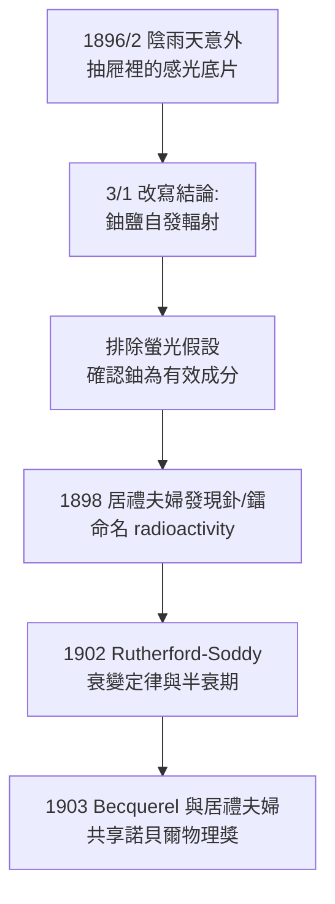

## 1896 - 貝克勒爾發現天然放射性（X 光的幽靈妹妹現身）

## 案件摘要

**本案偵破的是：X 光究竟是什麼？追查答案的偵探，撞見了藏在礦石裡的另一個宇宙。**

1896 年 1 月，法國科學院年會上看到 Röntgen 照片後，Henri Becquerel 被一個問題擊中：X 光是否由螢光物質在陽光激發下發出？他選了家中三代研究的硫酸雙氧鈾鉀（一種會發黃綠色螢光的鈾鹽）做實驗：陽光曬過後放在包黑紙的底片上——底片感光了。看似成功。但 2 月底巴黎連日陰雨，他把樣品與底片一起收進抽屜；3 月 1 日取出沖洗，**未經陽光、未經激發的底片竟然感光更強**。他立即改寫結論：鈾鹽自發地、不需任何外部能源地發出一種穿透輻射。「放射性」（radioactivité）一詞後來由居禮夫人命名。

## 前因

- **Röntgen 的公開示範效應**。1896/1/20 科學院會議上 Poincaré 展示 X 光照片，Becquerel 當場提問：螢光與 X 光是否同一現象？
- **Becquerel 家族三代螢光研究**。祖父 Antoine César、父親 Edmond 都是螢光與磷光專家，實驗室裡存有數百種礦物樣品——武器庫早已備好。
- **當時的物理圖像**。能量守恆已確立（1840s），「物質不需能量就能持續發射輻射」在理論上是異端——Becquerel 的發現等於挑戰整個能量框架。

## 線索與推理

**線索一：陰雨天摧毀了第一假設。** 偵探推理的標準劇情：控制變因失敗反而揭示了真相。

```text
假設: 螢光(需陽光激發) → X 光
實驗 1: 曬太陽 + 黑紙包底片 → 感光 ✓（支持假設）
實驗 2: 不曬太陽(陰雨,抽屜) → 感光更強 ✗（假設死亡）
推論: 輻射與螢光無關；鈾鹽自發發射；且可能無限期發射
```

**線索二：鈾是唯一要素。** Becquerel 接著證明：非螢光的鈾化合物同樣有效，螢光但不含鈾的礦物無效——**有效成分是鈾元素，而非螢光現象**。這是一次漂亮的成分分離推理。

**線索三：本質之謎留下的未結案卷宗。** Becquerel 測得這種射線：(1) 能使空氣導電（後來成為輻射偵測的基礎）；(2) 部分成分被磁場偏轉（即後來的 $ \beta $ 射線——高速電子，Rutherford 1899 分類出 $ \alpha, \beta $，1900 Villard 加入 $ \gamma $）。為什麼原子會持續輸出能量？答案要到 1898 年居禮夫婦發現釙與鐳（見 `1898-居禮夫婦發現鐳.md`）、以及 1902 年 Rutherford–Soddy 提出衰變定律才完整揭曉。

**線索四：衰變的數學骨架（先借後來的答案補全本案）。** 放射性強度隨時間指數下降：

$$ A(t) = A_0 \, e^{-\lambda t}, \qquad t_{1/2} = \frac{\ln 2}{\lambda} $$

半衰期的概念使「放射性」第一次成為可測量、可預測、可用於年代測定與劑量計算的物理量。



## 結案

- **人類第一次知道原子內部有能源**。天然放射性是後來所有核醫學（碘 131、鎝 99m、PET 的正子，見 `1941-碘131與核子醫學誕生.md`、`1974-PET正子斷層掃描.md`）與放射治療的物理起點。
- **「意外」的方法論地位**。與 Röntgen 並列科學史上兩大「準備好的頭腦遇見意外」案例；Becquerel 的過人之處不是發現異常（Good速度也見過），而是**立即改寫自己的假設**。
- **醫學的雙面刃就此開箱**。鐳療法、輻射傷害、鐳女孩悲劇（見 `1927-鐳女孩與輻射傷害審判.md`）都從這個 3 月 1 日的抽屜開始。
- **1903 年諾貝爾物理獎**。Becquerel（單獨一半）與居禮夫婦（共享另一半）——史上第一次一個獎頒給同一現象的三位偵探。
- **一句話結案**：最好的實驗失敗，是讓你的假設死於一場陰雨——Becquerel 的抽屜因此成為核子時代的第一個檔案櫃。

## 關鍵人物與文獻

- **Henri Becquerel（1852–1908）**——巴黎工藝學院物理教授，祖孫三代同一講席；1903 年諾貝爾物理獎；1908 年因長期接觸放射物質皮膚燒傷早逝（口袋裡曾裝鐳樣品，留下灼傷疤作為人體證據）。
- **Henri Poincaré（1854–1912）**——把 Röntgen 照片帶進科學院會議的數學家，間接點燃本案。
- 原始文獻——Becquerel, *Sur les radiations invisibles émises par les corps phosphorescents*, Comptes Rendus Acad. Sci., 1896（兩週內連發七篇短文）。
- 現代註腳——Becquerel 當年「螢光激發」的原始假設並非全錯：光致發光與 X 光激發確實存在，只是與鈾鹽自發輻射是兩回事——科學偵探的錯誤假設，往往仍留有一半的物理真相。
