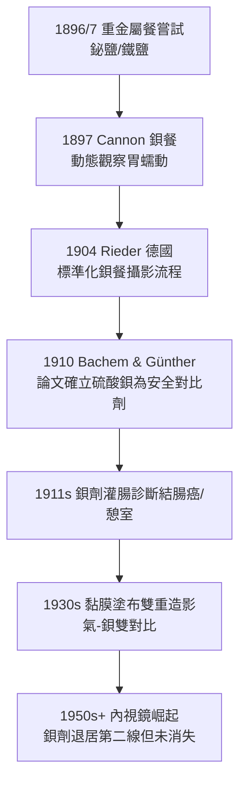

## 1897 - 坎農以鋇餐追蹤消化道（讓空腔器官顯影的第一步）

## 案件摘要

**本案偵破的是：X 光能看見骨骼，卻看不見胃腸——怎麼辦？**

X 光對比的物理基礎是衰減係數 $ \mu \propto \rho Z^3 $：胃、腸主要由 H、C、N、O 組成（低 $ Z $），與周圍組織幾乎同密度，影像上一片糊。1896–97 年，年輕生理學家 Walter B. Cannon 在哈佛用鉍鹽（後改用硫酸鋇）混入食物餵給動物，以 X 光透視**即時觀察胃的收縮與排空**——人類第一次「看見」消化過程本身。鋇餐（barium meal）與鋇劑灌腸就此成為延續百年的消化道造影基石。

## 前因

- **低對比難題**。1896 年起已有人嘗試以鉍、鐵、銀鹽等「重金屬餐」使胃顯影；德國的 Boas、美國的 Bevan 也做過類似嘗試，但多半是單張照片。
- **消化生理學的盲區**。當時胃腸蠕動理論仍受 Beaumont（1833，靠槍傷瘻管直接觀察胃）的個案限制；消化道運動學缺乏無傷方法。
- **Cannon 的位置**。哈佛醫學院學生（1897 年時 26 歲），受 Bowditch 生理實驗室與新到任的 X 光技師影響，手邊正好有一台透視機。

## 線索與推理

**線索一：對比劑的物理要求。** 理想的消化道顯影物質需同時滿足：

$$ Z_{\text{高}}\ (\mu\ \text{夠大}) \;\land\; \text{不溶}\ (\text{不被腸道吸收}) \;\land\; \text{無毒} \;\land\; \text{性狀可控（糊/懸浮液）} $$

- 硫酸鋇：$ Z_{\text{Ba}} = 56 $，溶解度極低（$ K_{sp} \sim 10^{-10} $，腸道幾乎不吸收）——幾乎完美。
- 早期的鉍鹽：$ Z_{\text{Bi}} = 83 $ 顯影更佳，但貴、且有吸收毒性疑慮；第一次世界大戰後鋇成為主流。
- 有毒的碳酸鋇（可溶）曾造成死亡事故——「同元素、不同化合物、生死之別」是本案的化學陷阱。

**線索二：從靜態照片到動態電影。** Cannon 的革命不在「看見胃」而在「看見胃在動」：他以連續透視＋系統餵食不同食物（肉、麵包、牛奶、米），量化排空時間，做出第一張「消化動態學」圖譜。這是 **對比劑 + 時間維度** 的二維升級——為後來的心血管造影、動態吞嚥攝影立下方法論原型。

**線索三：鋇餐診斷學的展開。**

**線索四：壓迫技術與「觸診眼睛」。** 早期鋇餐的一大突破是檢查者一邊透視一邊**用拳頭壓迫腹部**，讓鋇劑在潰瘍龕影（niche）處分佈出輪廓——「透視下的觸診」把兩種古老的與最新的診斷合而為一。

## 結案

- **消化道放射學成為獨立次專科**。1900–1970 年代，鋇餐/鋇灌腸是胃潰瘍、胃癌、結腸癌、憩室炎的第一診斷工具；直到內視鏡與 CT 普及才讓位，但吞嚥攝影、腸套疊空氣灌腸復位至今仍在使用。
- **Cannon 的第二人生**。鋇餐實驗把他推向著名生理學家：後來提出 Cannon–Bard 情緒學說、「戰或逃」反應與緊急狀態下的腸胃缺血理論——他一生自認最愛的仍是那間透視室。
- **對比劑方法論的起點**。本案確立了「以物性差異製造影像對比」的通用思路，直接通往碘水溶性對比劑（血管造影，見 `1953-塞丁格技術與血管造影.md`）與後來的 MRI 顯影劑。
- **一句話結案**：看不清的東西，就餵它一口看得見的東西——Cannon 證明放射科偵探可以用「染料」讓嫌犯自己現形。

## 關鍵人物與文獻

- **Walter Bradford Cannon（1871–1945）**——哈佛生理學家，「homeostasis（恆定）」一詞的創造者；1897–1900 年以 X 光研究消化的先驅。
- **Bachem 与 Günther（1910）**——德國學者，發表系統性毒理與顯影比較研究，確立硫酸鋇的安全地位。
- **A. Rieder**——德國放射學者，1904–05 年標準化「Rieder 氏鋇餐系列攝影」。
- 原始文獻——Cannon, *The movements of the stomach studied by means of the Röntgen rays*, Am. J. Physiol., 1898。
- 現代註腳——硫酸鋇至今仍是全球用量最大的對比劑；唯一的禁忌是「懷疑腸道穿孔」時禁用（鋇漏入腹腔會引發腹膜炎）——物理完美的對比劑，敗給一個解剖學假設。
