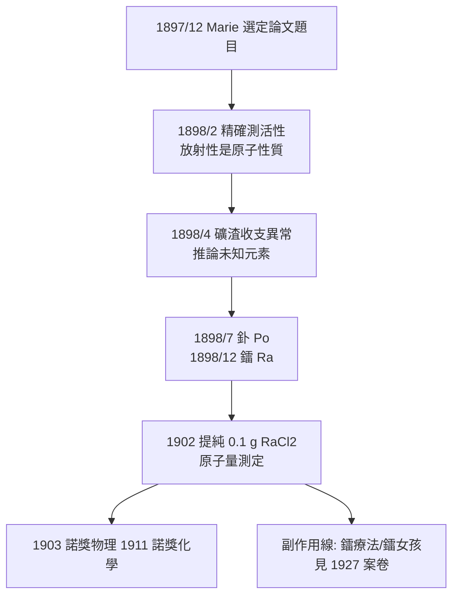

## 1898 - 居禮夫婦發現鐳（從放射性到「放射性強度」的量化革命）

## 案件摘要

**本案偵破的是：Becquerel 射線到底有多強？有多稀有？以及——地球上的輻射源藏在哪裡？**

1898 年，Marie Skłodowska-Curie 選定「Becquerel 射線」作為博士論文題目，用丈夫 Pierre 與弟弟 Jacques 發明的壓電石英靜電計把「底片變黑」這種定性現象變成可測量的電流。她發現：(1) 放射性強度只與鈾含量成正比，與化合物形式無關——**放射性是原子的性質**；(2) 瀝青鈾礦的放射性遠超其鈾含量應有的值，礦裡必有未知的、更強的元素。夫婦二人以數年時間從數噸瀝青鈾礦渣中化學分離，1898 年 7 月發現釙（以祖國波蘭命名）、12 月發現鐳（radium，源自 radius「射線」）。鐳的放射性約為鈾的百萬倍。

## 前因

- **Becquerel 射線尚無定量方法**。1896–97 年的觀察全靠底片與驗電器放電快慢，無法比較不同物質。
- **壓電石英靜電計（1880）**。居禮兄弟的發明：石英受壓產生已知電荷，可精確抵消游離電流——本案的關鍵測量儀器。
- **Marie 的處境**。來自被瓜分波蘭的清貧留學生，在巴黎以木棚為實驗室、以瀝青鈾礦渣（奧地利政府免費提供的提鈾廢料）為原料——史上最艱苦的諾獎實驗室。
- **化學分離的傳統**。19 世紀分光術發現銫銣鉈的模式：未知元素往往藏在礦渣的「雜質」裡。

## 線索與推理

**線索一：放射性 ∝ 鈾原子數。** Marie 的關鍵測量建立了線性關係：

$$ I_{\text{游離電流}} = k \cdot N_{\text{放射性原子}} $$

化合物形式（氧化物、鹽類、溶液）無關緊要——**這排除了分子/化學解釋，鎖定原子內部**。此推理與 Daltons 定比定律同構，是「放射性屬於原子」的第一個實驗證據。

**線索二：瀝青鈾礦的會計異常。** 礦樣活性是純鈾的約 4 倍，但其中鈾含量只應貢獻 1 倍單位——差額 3 倍必來自「含量極少但活性極強」的未知元素。這是一個純粹的**收支不平衡偵探法**：

```python
# 1898 年的放射性收支表（簡化復原）
uranium_contribution = 1.0        # 純鈾基準活性
ore_measured = 4.0                # 瀝青鈾礦實測活性
gap = ore_measured - uranium_contribution   # 缺口 = 3.0
# 結論: 存在未知元素 X，含量 ~ 0.1% 以下，比活性 > 鈾的 1000 倍
print("必須找到 X → 釙(Po, 1898/7) 與 鐳(Ra, 1898/12)")
```

**線索三：以放射性為「化學指紋」的新方法。** 傳統化學分析找不到超微量新元素，居禮夫婦反其道而行：每一步分離後測活性，活性跟著哪一份走，元素就在哪一份——**放射化學**就此誕生。這個方法後來直接孕育了核醫學的追蹤劑（tracer）思想（見 `1941-碘131與核子醫學誕生.md`）。

**線索四：0.1 克鐳的八年。** 1898 年只得到痕量氯化鐳；至 1902 年，Marie 從 8 噸礦渣中煉出 0.1 克純氯化鐳並測得原子量 225.93——元素的存在無可辯駁。深夜木棚裡發著幽藍光的鐳鹽瓶，成為科學史的圖騰。



## 結案

- **「放射性」成為醫學資源**。鐳的極強活性使其成為 20 世紀上半葉腫瘤近距治療（brachytherapy，鐳針植入）的黃金標準，也成為「鐳水」之類致命保健騙局的原料——同一瓶鹽，兩種病歷。
- **量化思想改變放射科**。居禮的方法論——把生物效應化約為可測物理量——最終結晶為「劑量」（見 `1925-國際放射防護的誕生.md`）。
- **放射性定年與原子物理的副產品**。半衰期成為地質與考古時鐘；「原子內部有巨大能量」的結論預告了 20 世紀的核物理。
- **性別與階層的案子**。Marie 以外國女性身分兩獲諾獎（1903 物理、1911 化學），至今唯一；她的實驗筆記至今仍有輻射、需穿防護衣才能翻閱——檔案本身成為本案的延長證據。
- **一句話結案**：居禮夫婦的最大發現不是鐳，而是「**跟著訊號走**」——今天核醫學的每一支追蹤劑，都還在用 1898 年那套「活性跟到哪、元素就在哪」的偵探法。

## 關鍵人物與文獻

- **Marie Skłodowska-Curie（1867–1934）**——首位諾獎女性、唯一跨物理與化學雙獎得主；命名 radioactivity；1934 死於再生不良性貧血（輻射暴露）。
- **Pierre Curie（1859–1906）**——壓電效應、居禮點的發現者；1906 年死於街頭馬車事故；其實驗筆記至今仍超過輻射安全限值。
- **Gustave Bémont（1857–1932）**——共同署名發現鐳的化學家，常被遺忘的第三位偵探。
- **André Debierne（1874–1949）**——發現錒（Ac）；1910 年協助分離出金屬態鐳。
- 原始文獻——M. & P. Curie（及 Bémont）, *Sur une nouvelle substance fortement radioactive, contenue dans la pechblende*, Comptes Rendus, 1898；M. Curie, *Traité de radioactivité*, 1910。
- 現代註腳——居禮夫婦終生未申請鐳製程專利，Marie 名言：「鐳不該使任何人發財，它屬於全人類。」——與 Röntgen 拒絕專利（見 `1895-侖琴發現X光.md`）構成放射科史上的雙重道德標記。
