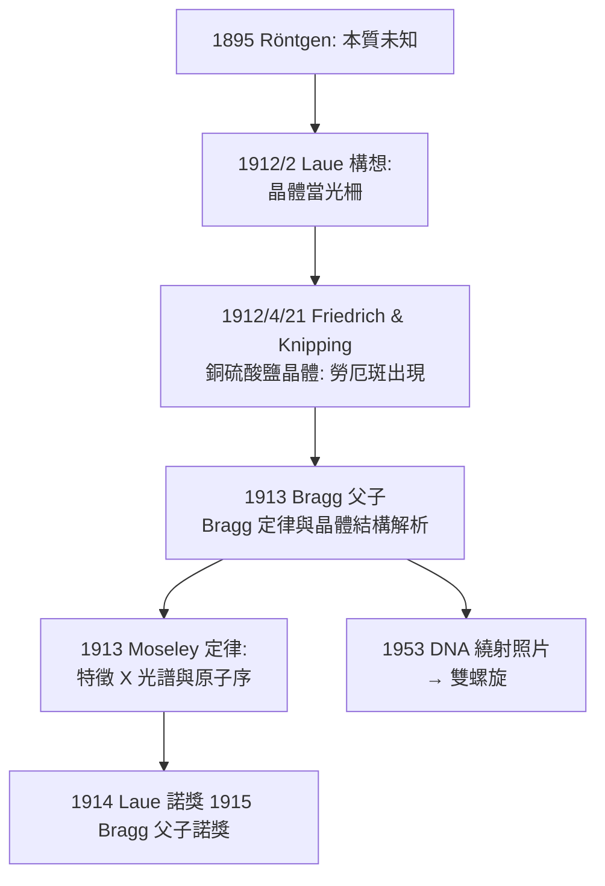

## 1912 - 勞厄 X 光繞射實驗（終於知道 X 光是什麼）

## 案件摘要

**本案偵破的是 1895 年留下的懸案：X 光到底是波還是粒子？**

Röntgen 曾用磁場偏轉（失敗）、縫隙繞射（失敗）測試 X 光，十七年間其本質懸而未決。1912 年，慕尼黑大學的 Max von Laue 在與晶體學家聊天時想到：如果 X 光是波長極短的電磁波，那麼「縫隙不夠小」的問題可以反過來解——**用原子間距（約 $ 10^{-10} $ m）當作天然光柵**。他說服助手 Friedrich 與 Knipping 用銅硫酸鹽晶體試射 X 光：底片上出現了規則排列的斑點群。X 光是波——且晶體的原子結構第一次被「照」了出來。一個實驗，同時結案兩件懸案。

## 前因

- **十七年的波粒之爭**。X 光不受磁場偏轉（像波，非帶電粒子），但從未觀察到繞射或干涉（像粒子或極短波）——實驗矛盾持續懸置。
- **波長尺度的估算**。由陰極射線打靶的能量換算，理論預估 X 光波長約 $ 10^{-11} \sim 10^{-10} $ m，遠小於任何人工光柵（當時最細約 $ 10^{-6} $ m）。
- **慕尼黑的獨特地緣**。同一棟樓裡有晶體學家 Groth 與礦物學家——有人指出晶體原子間距恰好在 $ 10^{-10} $ m 量級；1900 年代的晶體點陣理論（基於 Barlow 的堆積模型）雖成熟，卻從未被直接驗證。
- **Laue 的身份**。他不是實驗家而是理論家（Einstein 相對論的早期支持者）——由理論家提出實驗構想、由助手完成操作，是本案的組織特徵。

## 線索與推理

**線索一：把繞射條件反過來用。** 光柵繞射的基本條件是光柵週期 $ d $ 與波長 $ \lambda $ 同量級。問題一直被理解為「$ \lambda $ 太小所以找不到光柵」；Laue 的反轉是：

$$ \lambda \approx 10^{-10} \text{ m} \;\Rightarrow\; \text{找 } d \approx 10^{-10} \text{ m 的天然光柵} = \text{晶體} $$

**線索二：三維勞厄方程。** 晶體是三維點陣，繞射極大須同時滿足三個方向的光程差條件：

$$ \mathbf{a} \cdot (\mathbf{s} - \mathbf{s}_0) = h\lambda, \quad \mathbf{b} \cdot (\mathbf{s} - \mathbf{s}_0) = k\lambda, \quad \mathbf{c} \cdot (\mathbf{s} - \mathbf{s}_0) = l\lambda $$

「斑點群」而非同心圓環——這個圖形特徵本身就是三維週期結構的指紋。1913 年 Bragg 父子把勞厄斑重寫成更易用的鏡面反射條件：

$$ 2d\sin\theta = n\lambda \quad (\text{Bragg 定律}) $$

**線索三：從「X 光是波」到「晶體長怎樣」的雙向通道。** 同一條公式可以往兩個方向解：知道 $ \lambda $ 求 $ d $（晶體結構學），或知道 $ d $ 求 $ \lambda $（X 光譜學）。Moseley（1913，見下）用後者建立原子序—特徵 X 光譜定律；前者則最終走向 1953 年以繞射解析 DNA 雙螺旋。

**線索四：Moseley 的放射科遺產（順手結案）。** 1913 年 Henry Moseley 用 Bragg 方法測量各元素特徵 X 光譜，發現譜線頻率平方根與原子序 $ Z $ 成線性：

$$ \sqrt{\nu} = A\,(Z - \sigma) $$

「元素由原子序而非原子量定義」就此確立，化學週期表的最後空洞（72 號鉿等）被預測補齊。而特徵 X 光（characteristic X-ray）也正是後來診斷 X 光管的能量設計基礎。Moseley 1915 年死於加里波利戰場，年僅 27——本案最令人痛惜的偵探。

## 結案

- **X 光本質結案**：電磁波，波長 $ 10^{-12} \sim 10^{-9} $ m，介於紫外線與 $ \gamma $ 射線之間；Röntgen 1895 年記錄的「不受磁場偏轉」線索獲得最終解釋。
- **結構生物學的出生證明**。繞射技術從鹽類晶體一路走到蛋白質、病毒核糖體（2009 年諾獎）與 DNA；放射科的診斷工具與分子生物學的核心工具本是同一發現的兩面。
- **醫學成像的波長哲學**。本案確立了整個成像醫學的選波原則：**波長必須與目標結構尺度匹配**——X 光照原子、可見光照細胞、超音波（毫米級）照器官——這個原則後來解釋了為何 MRI 與 CT 選擇各自的能量窗口。
- **一句話結案**：找不到更小的光柵時，就借用上帝造好的——Laue 證明最好的偵探儀器，有時是大自然自己的晶格。

## 關鍵人物與文獻

- **Max von Laue（1879–1960）**——1914 年諾貝爾物理獎；二戰期間是德國「鈾協會」中抵制納粹核計畫的科學家之一；1945 年被盟軍拘於農場廳（Farm Hall）竊聽計畫對象。
- **Walter Friedrich 與 Paul Knipping**——碩士生與博士後助手，實際操作者；歷史常遺忘其姓名。
- **W. H. Bragg 與 W. L. Bragg**——父子共享 1915 年諾獎（小 Bragg 獲獎時 25 歲，史上最年輕科學獎得主）；Bragg 定律成為晶體學基本方程。
- **Henry G. J. Moseley（1887–1915）**——Moseley 定律；若非早逝，普遍認為必得諾獎；英國戰後因此修改規則禁止科學家上前線。
- 原始文獻——Friedrich, Knipping & Laue, *Interferenz-Erscheinungen bei Röntgenstrahlen*, Sitzungsber. Bayer. Akad. Wiss., 1912；W. L. Bragg, *The Diffraction of Short Electromagnetic Waves by a Crystal*, 1913。
- 現代註腳——勞厄斑分析至今仍用於同步輻射蛋白質晶體學；COVID-19 抗病毒藥的結構設計仍在用 1912 年那條 Bragg 方程。
