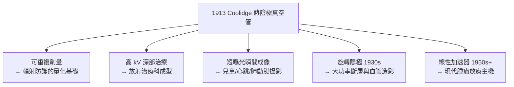

## 1913 - 庫利吉管與現代 X 光機（從漏氣玻璃球到可調功率的診斷引擎）

## 案件摘要

**本案偵破的是：為什麼 1895 年的 X 光機又燙又不穩、照片品質看運氣，而現代 X 光機能精確控制劑量與能量？**

Röntgen 使用的離子管（gas tube）靠殘餘氣體被游離後產生陰極射線，管內真空度會隨玻璃壁吸附氣體釋放而漂移——操作者必須憑經驗「調節火花隙」來維持輸出，同一管子今天與明天的能量譜完全不同。1913 年，奇異公司（GE）的 William D. Coolidge 推出**熱陰極高真空 X 光管**：以鎢絲加熱發射電子，電子由外加高壓加速打擊鎢靶——管電流與管電壓第一次被**獨立且穩定地控制**。這是 X 光從手工藝變成工程學的分水嶺。

## 前因

- **離子管的不穩定性**。1896–1912 年的氣體管輸出隨時間漂移；「硬化」（真空度變高）後需用打火或加熱玻璃壁讓氣體釋出才能繼續工作——劑量無法重複。
- **熱陰極真空管的前身**。1904 年 Wehnelt 熱陰極整流管、1905–09 年 Lilly 與 Snook 嘗試以熱陰極管產生 X 光，皆受真空技術與陰極壽命限制。
- **Langmuir 的真空工程**。GE 實驗室的 Irving Langmuir 大幅改進高真空抽氣與鎢絲處理工藝（鎢絲燈泡專案），為 Coolidge 提供了技術土壤。
- **醫學需求**。深部治療需要更高且可重複的管電壓（$ \ge 100 $ kV）；診斷需要短曝光（病人動不了）——兩者都要求「功率可設計」。

## 線索與推理

**線索一：把輸出參數解耦。** 離子管的致命問題是電流與電壓耦合於同一個氣體游離過程。Coolidge 管的物理把兩者分開：

$$ I_{\text{管電流}} \approx I_{\text{鎢絲熱發射}}\ (\text{由燈絲溫度決定}), \qquad E_{\text{光子}} \le e\,V_{\text{管電壓}} $$

燈絲電流控制劑量率（mA），管電壓控制穿透力（kVp）——**兩個旋鈕、兩個物理量**，診斷參數第一次成為可設計的處方。

**線索二：X 光譜的生成數學。** Coolidge 管的輸出譜由兩部分構成：

- **制動輻射（bremsstrahlung）**：電子在靶核庫侖場中被減速，連續譜，短波限 $ \lambda_{\min} = \dfrac{hc}{eV} $——Duane–Hunt 定律（1915），它的精確驗證順便量出了 $ h $ 與 $ e/c $，成為普朗克常數的獨立測量法。
- **特徵輻射**：入射電子打出靶原子內層電子，外層躍遷填補發出線狀譜（鎢的 K 譜線等）——Moseley 定律（見 `1912-勞厄與X光繞射.md`）描述其頻率。

選擇鎢（$ Z = 74 $）作靶：熔點 3422 °C 最高、產率 $ \propto Z $ 高、導熱好——三重優化的工程答案。

**線索三：從管到系統。** Coolidge 管使以下整套現代設備成為可能：

**線索四：專利與標準化。** GE 以 Coolidge 管專利主導了 1910–30 年代全球 X 光設備市場，也推動了設備規格、安全標準與品管程序的工業化——醫學影像第一次被「標準」而非「師傅經驗」治理。

## 結案

- **劑量學成為可能**。可重複輸出是輻射防護與劑量單位（見 `1925-國際放射防護的誕生.md`）的前提——沒有 Coolidge 管，就沒有可測量的「倫琴」。
- **放射治療獨立成科**。高能可調輸出使深部腫瘤治療成為現實，診斷與治療的組織分化自此加速。
- **物理學的回饋**。Duane–Hunt 短波限與 Compton 效應（1923）實驗皆倚賴 Coolidge 管的單色可控輸出——醫學工程反哺基礎物理的經典案例。
- **一句話結案**：1895 年的管子是「打雷」，1913 年的管子是「開關」——把閃電裝進旋鈕，放射科才真正有了可開立的處方箋。

## 關鍵人物與文獻

- **William David Coolidge（1873–1975）**——GE 研究實驗室主任、鎢絲燈泡與 Coolidge 管發明人；活到 102 歲，見證了從玻璃球管到 CT 的整段歷史。
- **Irving Langmuir（1881–1957）**——1932 年諾貝爾化學獎；高真空與表面化學之父，Coolidge 的同事與合作者。
- **William Duane（1872–1935）**——哈佛物理學家，Duane–Hunt 定律與軍用放射標準（一戰美國陸軍 X 光勤務）的雙重功臣。
- 原始文獻——W. D. Coolidge, *A Powerful Röntgen Ray Tube with a Pure Electron Discharge*, Phys. Rev., 1913；Duane & Hunt, *On X-Ray Wave-Lengths*, Phys. Rev., 1915。
- 現代註腳——今日 CT 球管仍是 Coolidge 管的直系後裔（旋轉陽極＋熱陰極＋鎢靶）；液態金屬軸承與飛焦點技術改變了散熱，但 1913 年「電壓定穿透、電流定劑量」的物理契約從未改寫。
