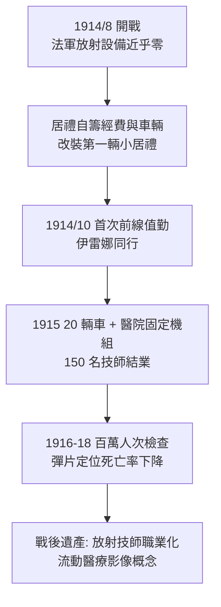

## 1914 - 一戰戰場 X 光與居禮的「小居禮」輻射車（放射科第一次大規模出勤）

## 案件摘要

**本案偵破的是：如何在泥濘的戰場上，於數分鐘內定位士兵體內的彈片？**

1914 年 8 月第一次世界大戰爆發，法國軍醫系統面對的殘酷算術是：每月數萬傷兵，體內彈片、子彈與碎骨無法觸診定位，探查手術時間長、感染率高。Marie Curie 48 歲，兩屆諾獎得主，卻被法國軍方拒於實驗室外（她的鐳研究所直到開戰後才被軍方勉強接受）。她的反應是親手把放射科搬上汽車：以 X 光機＋發電機改裝 20 輛「Petites Curies（小居禮）」，親自駕車赴前線，並訓練 150 名女性技師。據估計逾百萬傷兵接受過戰場 X 光檢查。本案是「放射科制度化」的第一場實戰壓力測試。

## 前因

- **1900–1914 的平時積累**。歐洲大醫院已有 X 光部門，但設備笨重（需固定供電）、技師稀缺、流程未標準化——「醫院裡的儀器」尚未變成「可攜的醫療系統」。
- **軍醫的舊困境**。普法戰爭（1870）以來，異物定位靠探針與手指；彈片深部感染（氣性壞疽）是最大死因——「晚發現一小時，死亡率陡升」。
- **居禮的物資劣勢**。戰爭切斷德國庫利吉管（見 `1913-庫利吉管與現代X光機.md`）與鐳的供應；法國放射設備嚴重不足，且無人把 X 光當作「軍事必需品」。
- **Irene 的加入**。19 歲的女兒 Irène Joliot-Curie（後於 1935 獲諾貝爾化學獎）擔任戰場放射技師，母女同車執勤。

## 線索與推理

**線索一：移動性的工程解。** 居禮的設計把問題拆成三個子系統：

```text
1. 電源: 車載 Dyanamotor（由汽車引擎驅動發電機）→ 解決前線無電網
2. 射源: 可攜式感應線圈 X 光管（老式氣體管, 也能用戰後搶到的庫利吉管）
3. 流程: 傷兵→就車透視→現場標記彈片位置→外科醫師依標記開刀
```

**線索二：時間—感染的定量邏輯。** X 光定位的價值可以寫成存活函數：

$$ P(\text{存活}) = f\left(\Delta t_{\text{定位}}\right), \qquad \frac{dP}{d\Delta t} < 0 $$

定位時間從「多次盲探手術的數日」壓縮到「一次透視的數分鐘」，等於把感染窗口期砍掉一個數量級——這是軍方最終全面採用的說服式（量化論證而非英雄敘事）。

**線索三：人力系統的複製。** 居禮在巴黎與前線開設放射技師速成班，訓練對象是醫生與志願女性（男性人力已被戰場抽空）。結業標準是「能在 20 分鐘內獨立完成一次可讀的透視」——這是史上第一套**放射技師職業訓練與認證制度**的雛形。

**線索四：診斷與治療的並行。** 車上除診斷 X 光外也攜帶鐳管（radon/鐳射氣小管），用於淺表腫瘤與傷口照射——「小居禮」同時是史上第一輛流動放射治療車。



## 結案

- **戰爭＝放射科的加速器**。一戰把 X 光從「大醫院的奢侈品」變成「戰地必需品」；戰後各國軍醫系統的放射預算與人員培訓直接平移回民用醫院——與 1896 年的英國蘇丹戰役（見 `1896-X光狂熱與第一批放射線科.md`）形成首尾呼應，二戰將再加速一次（行動式 X 光、血管造影、鈷 60）。
- **技師職業的誕生證書**。「能在 20 分鐘內出片」的結業標準是放射技師（radiographer）成為獨立職業的起點；今天各國放射技術學會的證照制度皆可溯源至此。
- **居禮的代價**。她本人累積的輻射劑量（含一戰前後）在 1934 年奪去她的生命——本案偵探以身殉案，成為防護制度（見 `1925-國際放射防護的誕生.md`）最沉重的論據。
- **一句話結案**：當系統拒絕你時，就把系統裝上輪子——居禮證明放射科不只是儀器，而是一套可以移動、可以訓練、可以複製的社會技術。

## 關鍵人物與文獻

- **Marie Curie（1867–1934）**——親自駕車赴前線逾百次；戰後出版《戰爭中的放射學》（*La Radiologie et la Guerre*, 1921）記錄全程。
- **Irène Joliot-Curie（1897–1956）**——19 歲起任戰地技師；1935 年與丈夫 Frédéric 因人工放射性（見 `1934-費米與人工放射性.md`）獲諾貝爾化學獎；1956 年死於輻射相關白血病。
- **美國方面的平行案**——1917 年美國參戰後成立 Army X-ray Service；物理學家（如 Duane）主導軍用放射標準，強化了「醫學物理師」職業。
- 原始文獻——M. Curie, *La Radiologie et la Guerre*, Paris, 1921；法國陸軍衛生部 1915–1918 放射勤務報告。
- 現代註腳——今日的移動 CT、戰地 X 光車與急救站掌上超音波，皆可視為「小居禮」的直系子孫；2020 年代野戰醫院的操作流程，仍有 1915 年那本居禮手冊的影子。
