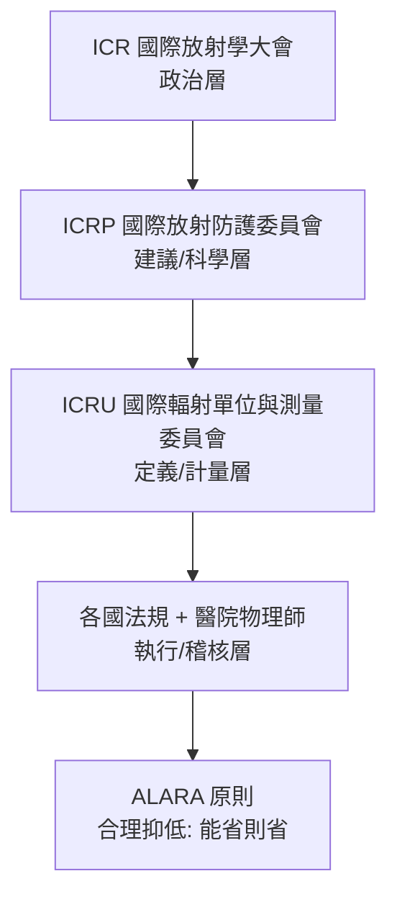

## 1925 - 國際放射防護的誕生（第一批殉職者換來的制度）

## 案件摘要

**本案偵破的是：放射科醫生為什麼一批批死於皮膚癌與白血病？以及，如何把「看不見的傷害」變成「可管理的數字」？**

1896 年後短短二十年，全球放射線工作者出現系統性的職業災害：手部慢性潰瘍、皮膚癌、輻射白內障、再生不良性貧血與白血病；早期甚至流行「以自己皮膚紅斑劑量（skin erythema dose, SED）校機器」——用自己當劑量計。1925 年倫敦第一屆國際放射學大會（ICR）上，物理師與醫生開始建立定量劑量單位；1928 年第二屆大會成立**國際 X 光與鐳防護委員會**（IXRPC，ICRP 前身），採納「倫琴（R）」為國際單位並發布第一套防護建議。本案是醫學史上第一個「職業危害 → 量化 → 制度化」的完整案例。

## 前因

- **殉職者名冊**。1900–1920 年代：X 光技師手指截肢常態化；美國 X 光與鐳防護先驅如 Mihran Kassabian、Elizabeth Fleeson 等死於輻射癌症；倫敦多家醫院的「放射部殉職紀念牌」記載著這段史實。
- **早期自救**。1900 年代已有鉛圍裙、鉛玻璃與「縮短曝光」的民間經驗，但**沒有劑量單位就沒有法定限值**——「多少才算安全」無從回答。
- **物理學家的介入**。游離室與電離測量技術（Becquerel 射線使空氣導電）成熟，Villard（1908）提出以游離量定義劑量的構想。
- **職業團體的形成**。1920 年代各國放射學會（美國 RSNA 1915、英國 ICR 1897 之後繼者）開始集體談判「安全的定義」。

## 線索與推理

**線索一：劑量單位的物理定義。** 1928 年採納的「倫琴」定義基於空氣游離：

$$ 1\ \text{R} = \text{在 } 0\,^\circ\text{C},\ 1\ \text{atm 的空氣中產生 } 1\ \text{esu} \text{ 電荷（每 } 1\ \text{cm}^3 \text{）的 X 光量} $$

後來的演進鏈：**R（游離）→ rad（吸收劑量, 1953）→ rem（等效劑量）→ Gy/Sv（SI, 1977）**。吸收劑量的核心式：

$$ D = \frac{\mathrm{d}\bar{E}}{\mathrm{d}m}\ [\text{J/kg} = \text{Gy}], \qquad H = D \cdot w_R\ [\text{Sv}] $$

其中品質因數 $ w_R $ 把不同輻射（X 光 1、$ \alpha $ 粒子 20）的生物效應差異納入——「物理量 × 生物權重」是本案最重要的推理結構。

**線索二：從經驗限值到科學限值。** 第一代限值（1925 年 Mutscheller 與 Sievert 各自提出）是「無明顯傷害的最大量」：約每天 1/100 SED。1934 年 IXRPC 定出「耐受劑量」約每天 0.2 R。1950 年代遺傳效應（Muller 1927 果蠅實驗獲 1946 諾獎）與白血病資料進場後，邏輯反轉為 **線性無閾值（LNT）假設**：

$$ \text{風險} = \alpha \cdot D,\quad D \ge 0 \ \text{（無安全下限）} $$

LNT 至今仍是低劑量防護的爭論核心（放射科劑量管理、CT 篩檢、低劑量斷層風險辯論皆源於此）。

**線索三：制度的四層架構。** 1925–1928 年間形成的治理骨架至今未變：

**線索四：醫學物理師職業的確立。** 劑量必須有人「算」：瑞典的 Rolf Sievert（Sv 單位以其命名）、美國的 Edith Quimby 等建立「醫院內物理師」角色——放射科自此成為唯一常駐物理學家的臨床科。

## 結案

- **第一套現代職業安全制度**。ICRP 的建議—國家法規—醫院執行三層結構，成為日後藥品安全、化學品暴露限值等制度的模板。
- **劑量文化**。「每張片子 0.1 mSv」的社會溝通、CT 劑量爭議（2000s）、低劑量肺癌篩檢——所有現代放射科的劑量話語都建立在 1925–1934 年的定量骨架上。
- **反面案例作為對照組**。鐳女孩（見 `1927-鐳女孩與輻射傷害審判.md`）顯示「沒有制度時」的後果；ICRP 的誕生正是為了不再重演。
- **一句話結案**：防護史的偵探法則只有一條——**看不見的兇手必須被翻譯成數字**；倫琴、rad、Sv 都是翻譯詞典的版本迭代。

## 關鍵人物與文獻

- **Rolf Sievert（1896–1966）**——瑞典物理學家，輻射劑量測量儀器與理論先驅；等效劑量單位 Sievert（Sv）以他命名。
- **George Kaye（1898–1985）**——英國 NPL 物理師，1928 年 IXRPC 首任秘書，把「建議」變成可稽核的標準。
- **Edith Quimby（1891–1982）**——美國醫學物理先驅，鐳與 X 光劑量學標準化者，1940 年代首位獲 Janeway 獎章的物理師。
- **Hermann Joseph Muller（1890–1967）**——1927 年證明 X 光誘發基因突變，1946 年諾貝爾獎；其成果把防護邏輯從「皮膚紅斑」升級為「遺傳風險」。
- 原始文獻——International Commission on X-Ray and Radium Protection, *International Recommendations for X-Ray and Radium Protection*, 1928（1925 ICR 倫敦會議決議的續篇）。
- 現代註腳——ICRP 至今持續出版建議書（最新主幹為 2007 年 ICRP Publication 103）；2011 年福島事件與 CT 劑量辯論仍以其 LNT 框架為戰場——這份 1925 年的卷宗，永遠處於「再上訴」狀態。
