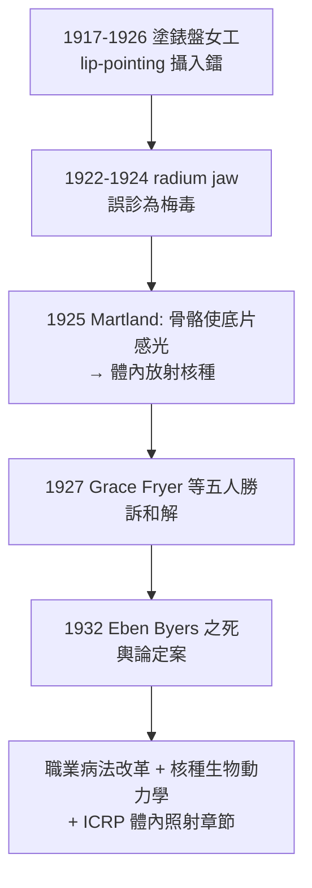

## 1927 - 鐳女孩與輻射傷害審判（當追蹤劑變成毒藥）

## 案件摘要

**本案偵破的是：表盤女工的下顎為什麼一碰就碎？**

1920 年代，美國數百名年輕女性受僱於 U.S. Radium Corp. 等公司，為軍用與鐘錶錶盤塗繪含鐳的自發光塗料。公司教導她們用**嘴唇舔尖筆刷**（lip-pointing），每位女工每天吞下微量鐳。1922 年起，她們接連出現齒槽壞死（下顎一碰即碎，所謂 radium jaw）、貧血、骨肉瘤——Mollie Maggia 的死被醫生誤判為梅毒。1925 年，毒理學家 Harrison Martland 證明其骨組織具放射性；1927 年，五位垂死的「鐳女孩」（Grace Fryer 等人）在紐澤西提告並勝訴和解。本案確立了「體內沉積放射核種」的傷害模式，是職業病與核種代謝研究的起點。

## 前因

- **鐳的商品狂熱**。鐳（見 `1898-居禮夫婦發現鐳.md`）被包裝成保健品：Radithor 鐳水（富含鐳與釙的蒸餾水，每瓶 0.5 微居里）、鐳牙膏、鐳化妝品；社交名流 Eben Byers（Radithor 重度用戶）1932 年痛苦死去，《華爾街日報》標題：「The Radium Water Worked Fine Until His Jaw Came Off」。
- **發光的戰爭生意**。一戰軍用錶盤需求暴增，塗繪女工數以千計；「舔筆」因省料被廠方默許甚至鼓勵。
- **醫學誤診三件套**。年輕女性＋下顎壞死＋貧血 → 被診斷為梅毒、磷中毒或壞血病——偏見（把職業病歸咎「私生活」）直接遮蔽了職業暴露線索。
- **法律環境**。當時工傷賠償限時申請（潛伏期長的輻射傷害不符），且公司掌握「鐳無害」的內部研究。

## 線索與推理

**線索一：骨頭會發光。** 1925 年 Martland 的關鍵實驗：把死者骨骼貼上底片——骨頭本身讓底片感光。推理鏈：

```text
骨骼自發使底片感光 → 體內沉積放射核種
→ 鐳的化學性質類似鈣 → 骨骼把它當鈣吸收（骨表面沉積）
→ α 粒子射程極短（組織中 ~50 µm）→ 能量全部沉積在骨細胞旁
→ 骨細胞DNA 受持續照射 → 骨壞死與骨肉瘤
```

**線索二：生物動力學的量化。** 鐳在體內的行為建立了最早的放射核種生物動力學模型：

$$ A_{\text{骨}}(t) = A_0 \left( f_r e^{-\lambda_r t} + f_s e^{-\lambda_s t} \right) $$

快速清除成分 $ \lambda_r $ 與骨表長期滯留成分 $ \lambda_s $ 並存；再乘上鐳本身 1600 年的物理半衰期，等於**終身內照射源**。劑量估算的概念（後來的 committed dose）從此案萌芽。

**線索三：以牙齒為偵測器。** Marland 發明用女工呼出氣體測氡（鐳衰變子代）：呼出氡越多 → 體負荷鐳越多——把活人變成可量測的樣本，這是體內計量的鼻祖，也是後來全身計數器與核醫學代謝研究的前身。

**線索四：法庭上的科學戰。** 1927 年案件的關鍵不在法條而在**專家證人制度**：Martland 等獨立科學家的證詞壓倒公司自聘專家；媒體（紐約時報記者）與工會的公眾動員是第二引擎。1928 年和解，並催生新澤西州的職業病立法改革。



## 結案

- **職業病學與放射毒理的誕生**。本案建立了「攝入途徑—代謝沉積—內照射劑量—癌症」的分析框架，後來應用於鈽（曼哈頓計畫的「鈽檔案」直接借鑑鐳女孩資料）、碘 131（見 `1941-碘131與核子醫學誕生.md`——治療用與防護用是同一數學）。
- **ICRP 的體內照射章節**。核種年攝入限值（ALI）、劑量係數等制度皆源於鐳女孩與鐳錶盤工人隊列——該隊列至今仍是人類輻射流行病學最長的追蹤研究之一。
- **社會面的結案**。「公司知道、工人不知」的資訊不對稱成為職業安全立法的教科書案例；Radithor 下架標誌著「放射性保健品」神話終結。
- **一句話結案**：物理學家花了三十年搞懂外照射防護，鐳女孩用生命補上了另一半——**內照射**的卷宗；任何追蹤劑都是雙面刃，劑量與標的決定它是藥還是兇器。

## 關鍵人物與文獻

- **Harrison S. Martland（1883–1954）**——紐澤西醫學檢查官，1925 年發表鐳中毒病理證據；本案首席法醫偵探。
- **Grace Fryer（1899–1933）**——訴訟核心原告之一；五位原告被稱為「the Radium Girls」，多数在和解後數年內去世。
- **Eben Byers（1880–1932）**——社交名流、Radithor 重度使用者；其死使本案從法庭進入全國輿論。
- **Katherine Wiley 與消費者聯盟（Consumers' League）**——推動調查與立法改革的社運組織。
- 文獻——Martland, Conlon & Knef, *Some Unrecognized Dangers in the Use and Handling of Radioactive Substances*, JAMA, 1925；Kate Moore, *The Radium Girls*, 2017（現代非虛構整理）。
- 現代註腳——1970–90 年代科學家以現代劑量學回算鐳女孩的骨骼劑量，驗證了劑量—風險模型；她們的遺骨至今仍具微弱放射性——本案證據，還在底片上繼續感光。
