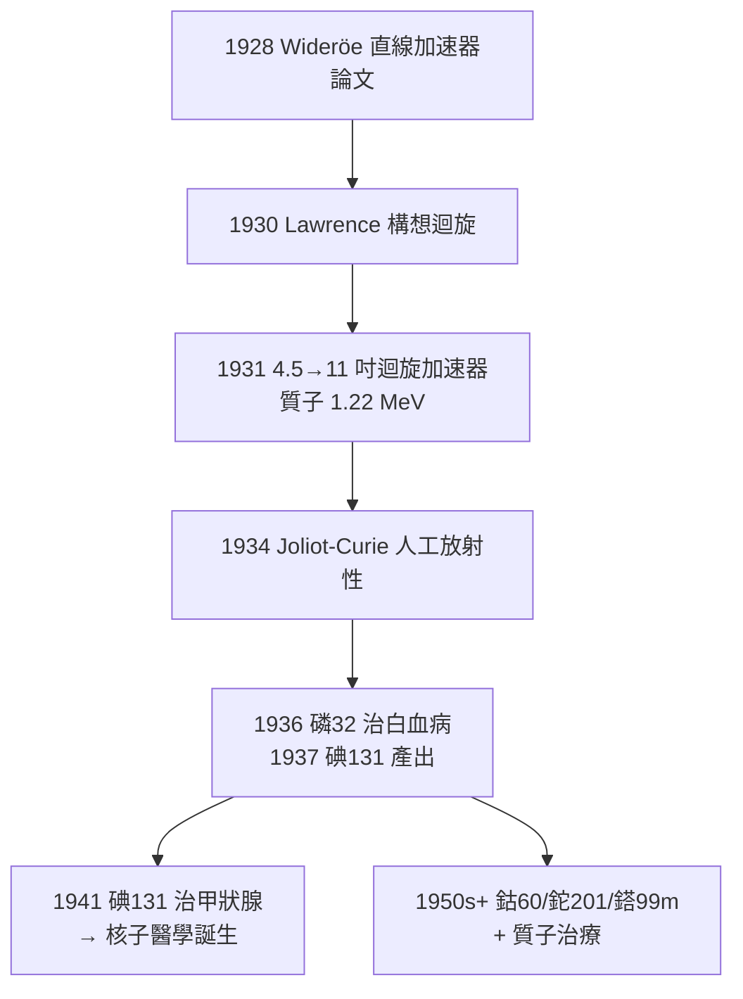

## 1931 - 勞倫斯迴旋加速器（把放射性從自然界搬進工廠）

## 案件摘要

**本案偵破的是：天然放射性元素既稀又貴（鐳 1 克要數十年礦渣提煉），怎樣才能像點菜一樣「製造」放射性核種？**

1930 年，27 歲的 Ernest O. Lawrence 在《物理學評論》上讀到 Wideröe 的直線加速器示意圖，算出一個讓粒子反覆加速的圓形捷徑：讓帶電粒子在磁場中做圓周運動，每半圈跨越一對交變電極被加速一次——半徑越轉越大，能量越轉越高。1931 年與研究生 M. Stanley Livingston 建成 11 吋迴旋加速器，把質子加速到 1.22 MeV；1934 年居禮家族第二代 Irène 與 Frédéric Joliot-Curie 以 $ \alpha $ 粒子轟擊鋁製得人工放射性核種，Lawrence 的加速器立即成為**醫用同位素工廠**。本案是核子醫學（見 `1941-碘131與核子醫學誕生.md`、`1974-PET正子斷層掃描.md`）與現代放射治療的工業起點。

## 前因

- **靜電加速器的能量天花板**。Cockcroft–Walton（1932）與 Van de Graaff（1929）加速器靠一次高電壓加速，受限於絕緣擊穿——「想要 10 MeV 就要蓋 10 層樓」。
- **Wideröe 的靈感**。1928 年挪威工程師 Rolf Wideröe 示範以多級漂移管反覆加電壓——Lawrence 讀到譯文後做了乘法：多級加速＋磁場回旋 = 無限級聯。
- **核物理的飢渴**。1919 年 Rutherford 以 $ \alpha $ 粒子打出氮核，但天然 $ \alpha $ 源能量固定、強度低——「可控高能粒子束」是整個核物理的瓶頸需求。
- **Berkeley 的資源**。Lawrence 在加州大學伯克萊分校任職，手上有一台退役的 4 吋磁鐵——第一台迴旋加速器的全部硬件幾乎是廢物利用。

## 線索與推理

**線索一：迴旋共振條件。** 帶電粒子在均勻磁場中回旋頻率與速度無關（非相對論），這是全部魔法的來源：

$$ f = \frac{qB}{2\pi m} $$

只要振盪器頻率固定在 $ f $，粒子每次跨過「D 形盒」縫隙都恰好被加速——**加速次數 $ N $ 與能量**：

$$ E \approx \frac{(qBr_{\max})^2}{2m} $$

能量由磁場與最終半徑決定，與電壓無關——「用小電壓換大能量」的乘法結構。

**線索二：相對論的終點與同步解法。** 當粒子接近光速，質量增大 $ m = \gamma m_0 $，共振條件被破壞——這是迴旋加速器的能量上限（質子約 20–25 MeV）。解法分支成譜系：同步迴旋加速器（調頻）、同步加速器（調磁）。醫學上質子治療（1954 起）用的正是這條加速器譜系的後代。

**線索三：人工放射性的醫學化閘門。** 1934 年 Joliot-Curies 的反應：

$$ {}^{27}\mathrm{Al} + \alpha \rightarrow {}^{30}\mathrm{P} + n,\qquad {}^{30}\mathrm{P} \xrightarrow{\beta^+} {}^{30}\mathrm{Si} $$

半衰期約 2.5 分鐘的磷 30 會「集體衰變」——**放射性第一次可被訂製**。Lawrence 團隊（其弟 John Lawrence 醫生主導）立即以迴旋加速器生產磷 32（1936 年首次用於白血病治療）、碘 131（1937–38 年製得）、鈉 24 等——放射核種從「礦物」變成「產品」。

**線索四：橡樹嶺的反應爐接棒。** 二戰後核反應爐成為更廉價的核種量產方式（鈷 60、碘 131 大量供應），但短半衰期正子核種（碳 11、氮 13、氧 15、氟 18）**必須由迴旋加速器現場生產**——PET 的每一台掃描儀背後都站著一台加速器。

## 結案

- **核子醫學的供應鏈誕生**。沒有迴旋加速器就沒有醫用同位素產業；今天全球 PET 顯影劑（氟 18 FDG）依賴數百台迴旋加速器的每日配送網（半衰期 110 分鐘決定了「正子藥廠」的地理半徑約 2 小時車程）。
- **放射治療的武器升級**。1930s 中子治療實驗（E. O. Lawrence 與 Stone，副作用慘烈但建立快中子 RBE 概念）→ 1950s 鈷 60 治療機 → 1990s 質子治療中心——加速器譜系一手打造現代腫瘤放療。
- **大科學的模板**。Lawrence 首創「實驗室 → 團隊 → 巨型設備 → 聯邦經費」模式，曼哈頓計畫的電磁分離法直接使用他的迴旋加速器技術——醫學發明反哺核武，是本案最沉重的複雜性。
- **1939 年諾貝爾物理獎**。Lawrence 獲獎時 38 歲；他終生宣稱迴旋加速器最重要的用途是醫學而非物理。
- **一句話結案**：居禮夫婦在礦渣裡淘金，勞倫斯直接開了印鈔機——**當放射性可以訂製，核子醫學才能從科學奇聞變成日常處方**。

## 關鍵人物與文獻

- **Ernest O. Lawrence（1901–1958）**——1939 年諾貝爾物理獎；勞倫斯伯克萊實驗室（LBNL）與勞倫斯利佛摩（LLNL）以其命名。
- **M. Stanley Livingston（1905–1986）**——研究生時期做出第一台實用迴旋加速器，後任費米實驗室首任所長。
- **John H. Lawrence（1904–1991）**——醫生弟弟，創立 Donner 實驗室（全球首個醫用迴旋加速器中心），核子醫學的臨床之父。
- **Rolf Wideröe（1902–1996）**——被引用者而非獲獎者；他的 1928 年論文同時啟發了 Lawrence 與後來的對撞機。
- 原始文獻——E. O. Lawrence & N. Edlefsen, *On the Production of High Speed Protons*, Science, 1930；E. O. Lawrence & M. S. Livingston, *The Production of High Speed Light Ions without the Use of High Voltages*, Phys. Rev., 1932。
- 現代註腳——全球約 1500 台醫用迴旋加速器在運轉；你胸前口袋裡的鉈 201 心臟掃描、醫院裡的鎝 99m 骨掃描（鉬 99/鎝 99m 發生器供應鏈），最上游都是 1931 年那塊 4 吋廢磁鐵。
