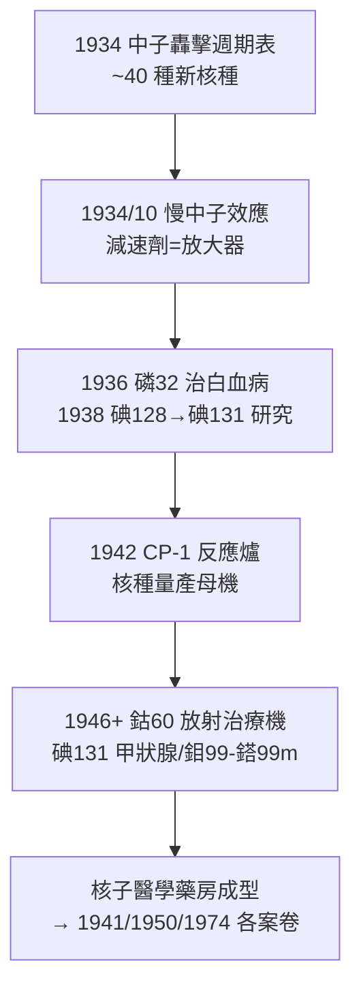

## 1934 - 費米與人工放射性（中子：更安靜的子彈，更豐富的藥房）

## 案件摘要

**本案偵破的是：$ \alpha $ 粒子帶正電、會被原子核的庫侖斥力彈開——有沒有一發「不帶電的子彈」，能射進任何原子核？**

1934 年初，Enrico Fermi 在羅馬得知 Joliot-Curie 夫婦的人工放射性（見 `1931-勞倫斯迴旋加速器.md`）後，立即意識到中子（Chadwick 1932 年發現）沒有電荷、不受庫侖障礙——**用中子轟擊，理論上能活化所有元素**。他與團隊（Amaldi、Segrè、Rasetti 等人）在數個月內系統轟擊了元素週期表全部元素，造出約 40 種新核種；1934 年 10 月又意外發現**石蠈含氫材料能把中子「減速」而使活化率大增**——慢中子物理誕生。這條線直通核反應爐、碘 131 與鈷 60 的量產，以及核醫學的整座藥房。

## 前因

- **中子剛剛現身**。1932 年 Chadwick 以 $ \alpha $ 轟鈹發現中子（1935 年諾獎）——「原子核由質子與中子組成」的圖像確立，中子束成為新玩具。
- **Joliot-Curie 的示範**。1934 年 1 月人工放射性發表，證明「放射性可以製造」，但 $ \alpha $ 粒子只對輕元素有效。
- **羅馬小組的系統性**。Fermi 是理論與實驗兼修的罕見類型（他自建的統計—費米–狄拉克統計—與實驗直覺同在），且有「按週期表順序掃過一遍」的工業化偵探習慣。

## 線索與推理

**線索一：中子捕獲的核反應式。** 中子被核捕獲後放出 $ \gamma $，形成同位素的「重一號」：

$$ {}^{A}Z + n \rightarrow {}^{A+1}Z + \gamma, \qquad {}^{A+1}Z \xrightarrow{\beta^-} {}^{A+1}(Z{+}1) $$

$ \beta^- $ 衰變把中子變質子——**原子序 +1**：這就是從穩定元素「登階」造出鄰位放射性元素的通用配方。碘 127 → 碘 128 → 而後 1938 年以反應爐生產的碘 131（醫療主力）正是此道的產物。

**線索二：慢中子的意外發現。** 1934 年 10 月，團隊發現銀樣品放在木桌上比金屬檯面上活化得多；Fermi 直覺是含氫物質的影響，於是在中子源與靶之間放石蠟——活性暴增百倍。推理：

```text
觀察: 含氫物質使活化率 ↑
推理: 中子與質子質量相近 → 彈性碰撞能量轉移最大 → 中子被「減速」
     → 慢中子在核附近停留時間更長 → 捕獲截面 ∝ 1/v（1/v 律）
結論: 減速劑（水/石墨/重水）= 放大器
```

這條「減速劑」線索直接孕育 1942 年芝加哥一號堆（CP-1，石墨慢化）——**核反應爐與核醫學共用同一個物理開關**。

**線索三：鈾的謎團與下一樁大案。** 1934 年 Fermi 轟擊鈾時得到數種 $ \beta $ 活性，誤認為超鈾元素；1938 年 Hahn–Strassmann 的化學分析與 Meitner–Frisch 的理論解釋揭曉真相是**核分裂**。本案留下的未解卷宗，成為核能與核武的分岔口——也使戰後反應爐成為碘 131、鉬 99/鎝 99m、鈷 60 的量產母機。

**線索四：醫學的立即收成。**



## 結案

- **核醫學藥房的配方冊**。磷 32（1936 首次治療白血病）、碘 131（甲狀腺亢進與甲狀腺癌，見 `1941-碘131與核子醫學誕生.md`）、鎝 99m（今日全球約 3000 萬人次/年的顯影核種）——全部源自「中子捕獲 + $ \beta $ 衰變登階」這條 1934 年配方。
- **「慢化」思想的雙重遺產**。反應爐用它發電與產核種；放射治療用它設計中子捕獲治療（BNCT，硼中子捕獲治療的現代復興）。
- **流亡的偵探**。1938 年 Fermi 因反猶配偶法律攜家赴斯德哥爾摩領獎後轉往美國——本案的另一層教訓：科學的供應鏈同樣會被政治切斷（與一戰切斷德國庫利吉管供應（見 `1914-一戰戰場X光與居禮輻射車.md`）互為鏡像）。
- **1938 年諾貝爾物理獎**。授獎理由正是「中子照射產生新放射性元素」——得獎論文的結論後來被證明部分誤讀（其實是分裂產物），諾獎史上的著名張力。
- **一句話結案**：$ \alpha $ 粒子是砸門的錘子，中子是無聲的鑰匙——Fermi 用一把不帶電的鑰匙，打開了整座週期表的核種藥房。

## 關鍵人物與文獻

- **Enrico Fermi（1901–1954）**——1938 年諾貝爾物理獎；1942 年主持 CP-1；費米統計、費米估算法皆以其命名；1954 年死於胃癌（其實驗生涯的輻射暴露被視為可能因素）。
- **羅馬「Via Panisperna 男孩們」**——Emilio Segrè（1959 諾獎，發現鎝——第一個人工元素，正是醫用鎝 99m 的同族前輩）、Edoardo Amaldi、Franco Rasetti、Oscar D'Agostino。
- **Leó Szilárd（1898–1964）**——讀到慢中子與分裂消息後提出鏈式反應構想並申請專利，後與 Fermi 共建 CP-1。
- 原始文獻——E. Fermi et al., *Artificial Radioactivity Produced by Neutron Bombardment*, Proc. Royal Soc. A, 1934–35（系列）；E. Amaldi & E. Fermi, *On the Absorption and the Diffusion of Slow Neutrons*, Phys. Rev., 1936。
- 現代註腳——今日醫院的鉬 99/鎝 99m 發生器、碘 131 膠囊、鈷 60 治療機，其核種符號背後的產能反應式，九成可抄回 1934 年羅馬那間地下實驗室的筆記本。
