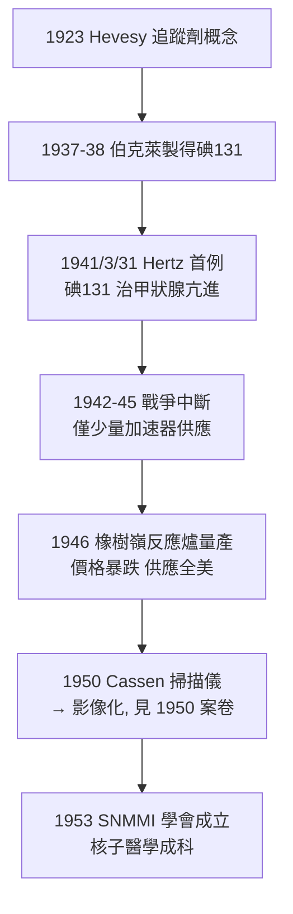

## 1941 - 碘 131 與核子醫學的誕生（追蹤劑概念的臨床首演）

## 案件摘要

**本案偵破的是：能否讓藥物本身發出訊號，告訴醫生「它去了哪裡、做了什麼、殺了誰」？**

1938 年起，加州與麻省的物理學家以迴旋加速器與中子製得放射性碘（$ {}^{131}\mathrm{I} $，半衰期 8 天，$ \beta^- $ + $ \gamma $）；關鍵的生理學事實是：**甲狀腺是體內唯一會主動大量攝取碘的器官**。1941 年，Saul Hertz 在麻省總醫院（MGH）首次以放射性碘治療甲狀腺亢進（Graves 病）——「診斷（測攝取率）與治療（$ \beta $ 殺腺體）用同一顆原子」的雙面戲法一舉成立。1946 年戰後反應爐使碘 131 廉價量產，甲狀腺掃描與治療普及，核子醫學（Nuclear Medicine）正式成科。

## 前因

- **追蹤劑概念的醞釀**。1923 年 Georg von Hevesy 以鉛 212 追蹤植物吸鉛（後以磷 32 研究動物代謝），首倡「放射性示蹤劑」思想——1951 年獲諾貝爾化學獎。
- **甲狀腺碘代謝的已知**。19 世紀末已知甲狀腺濃縮碘；1930s 放射性碘使「攝取—儲存—分泌」全過程可被定量追蹤。
- **核種供應線**。1937–38 年 J. Livingood、G. Seaborg 等在伯克萊迴旋加速器（見 `1931-勞倫斯迴旋加速器.md`）製得碘 130/131；但加速器產量低、價昂。
- **Hertz 的機緣**。1936 年 Karl Compton（MIT 校長）在 MGH 演講預言放射性同位素將用於醫學；Hertz 當場提問並被指派合作——醫學與物理的直接撮合。

## 線索與推理

**線索一：器官特異攝取＝天然的標靶。** 治療指數的魔法來自生理學而非化學：

$$ \frac{C_{\text{甲狀腺}}}{C_{\text{血液}}} \gg 1 \quad \Rightarrow \quad \frac{D_{\text{甲狀腺}}}{D_{\text{全身}}} \gg 1 \quad \Rightarrow \quad TI_{\text{生理}} \gg 1 $$

與埃爾利希的化學選擇性（見 `../性病的歷史/1910-埃爾利希洒爾佛散606.md`）並列：**選擇性可以用生理機制達成**——這是「追蹤劑原理」的治療版。碘 131 發出的 $ \beta^- $ 粒子在組織中射程約 0.8 mm，能量幾乎全數沉積在攝取它的腺體細胞內——**「自帶手術刀的標靶藥」**。

**線索二：診斷與治療的同一性。** 1938–41 年 Hertz–Hamilton 先以微量碘 128/130/131 測甲狀腺攝取率（diagnostic tracer），確認甲亢病人攝取率異常高；再「加量使用同一核種」做治療。這個「低劑量測流量、高劑量做治療」的雙態用法，成為核醫學的核心範式（今天的碘 131 甲狀腺癌術後清除、鉈 201 心肌灌注、氟 18 PET 皆是範式後裔）。

**線索三：劑量學的挑戰。** 治療用碘 131 需要「給予多少 MBq 才能破壞過量腺體而不傷全身」——Marinelli 等人 1940s 建立**醫用內照射劑量學（MIRD 體系的前身）**：

$$ D_{\text{靶}} = \int_0^\infty A(t)\, \Phi\, dt \approx A_0 \cdot \tau_{\text{有效}} \cdot S $$

其中有效半衰期 $ \tau_{\text{有效}} $ 綜合物理半衰期與生物半衰期：

$$ \frac{1}{T_{\text{有效}}} = \frac{1}{T_{\text{物理}}} + \frac{1}{T_{\text{生物}}} $$

這組公式使內照射第一次可比照外照射（見 `1925-國際放射防護的誕生.md`）做定量管理。

**線索四：戰後供應鏈與制度化。**

## 結案

- **核子醫學的第一個殺手級應用**。碘 131 至今仍是甲狀腺亢進與分化型甲狀腺癌（術後殘餘/轉移清除）的標準治療；「一日一膠囊、門診完成」的放射治療模式使核醫學成為最「藥物化」的放射次專科。
- **治療性核種譜系的開端**。磷 32（白血病/骨轉移）、碘 131、後來的钇 90（肝癌 SIRT）、鎦 177（前列腺癌 PSMA 治療）、鑥 177——「放射性藥物治療（theranostics 診療一體）」是當代核醫學最熱的主線，邏輯全部回溯 1941。
- **公共衛生的陰影**。1950s 美國曾以碘 131 做過未經同意的人體實驗（如 Fernald 學校事件），戰後核醫學的倫理清算（ACER 1994）與鐳女孩（見 `1927-鐳女孩與輻射傷害審判.md`）構成內照射的兩面歷史。
- **一句話結案**：Hevesy 說「讓分子自己報告行蹤」，Hertz 說「讓它順手執行手術」——**一顆碘原子同時當偵探與劊子手**，這就是核子醫學的誕生證書。

## 關鍵人物與文獻

- **Saul Hertz（1905–1950）**——MGH 甲狀腺科醫師，1941 年 3 月完成首例放射性碘治療；戰後其先驅地位一度被湮沒，2000 年代由其後人與史家還原。
- **Joseph Hamilton 與 John Livingood**——伯克萊迴旋加速器核種製備者；Hamilton 本人日後因輻射暴露死於白血病。
- **Georg von Hevesy（1885–1966）**——追蹤劑之父，1943 年諾貝爾化學獎（另 1951 年補授和平利用獎金）；二戰期間用重水藏匿匈牙利猶太朋友的諾獎獎章（溶解於鹽酸，戰後還原）。
- **Robley Evans（1909–1996）**——MIT 物理學家，建立鐳與碘的體內劑量測量標準，核醫學劑量學的制度化者。
- 原始文獻——S. Hertz, A. Roberts & R. D. Evans, *Radioactive Iodine as an Indicator in the Study of Thyroid Physiology*, Proc. Soc. Exp. Biol. Med., 1938；S. Hertz, A. Roberts, *Application of Radioactive Iodine in Therapy of Graves' Disease*, J. Clin. Invest., 1942。
- 現代註腳——2025 年的「診療一體」（theranostics）浪潮：同一分子偶聯診斷核種（鎵 68）與治療核種（鎦 177/钇 90）——本質上仍是 1941 年那顆碘原子的「偵探＋劊子手」雙面戲法的升級版。
