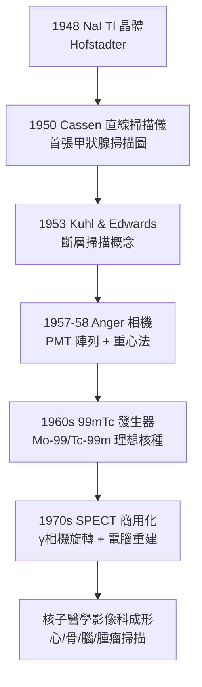

## 1950 - 閃爍掃描儀與 Anger 伽瑪相機（讓核醫學真正「看見」）

## 案件摘要

**本案偵破的是：碘 131 治療成功了，但醫生只能用蓋革計數器在病人身上「一點一點聽」攝取分布——如何把「計數」變成「影像」？**

1950 年，加州大學伯克萊的 Benedict Cassen 發明直線掃描儀（rectilinear scanner）：把 NaI(Tl) 閃爍晶體＋光電倍增管裝在準直器後，像繪圖機一樣逐行掃過病人身體，同步在紙上打出濃淡——第一張甲狀腺放射性核種掃描圖誕生。1957–58 年，同校的 Hal Anger 發明**Anger 相機**：大面積 NaI 晶體＋19 至 37 支光電倍增管陣列，以電子學「重心法」同時計算每個閃爍事件的座標——**不需機械掃描、全景成像**。伽瑪相機成為此後半世紀核醫學的標準眼，並直接孕育 SPECT（斷層版）。

## 前因

- **「聽得見、看不見」的核醫學**。1940s 的核種分布測量靠蓋革–彌勒管逐點計數，一張甲狀腺圖要數十分鐘以上且空間解析度極差。
- **閃爍晶體的成熟**。1948 年 Hofstadter 發現 NaI(Tl) 晶體把 $ \gamma $ 光子轉為可見閃光的效率極高；光電倍增管（PMT）1930s 已商業化——探測器材料與電子學均已到位。
- **Cassen 的臨床動機**。他服務於 Donner 實驗室（John Lawrence 的醫用加速器中心，見 `1931-勞倫斯迴旋加速器.md`），每天面對「只想知道腺體長在哪裡」的內分泌醫生。
- **Anger 的工程背景**。他在 Ernest Lawrence 團隊做過核物理儀器，熟悉 PMT 陣列與脈衝電子學。

## 線索與推理

**線索一：$ \gamma $ 成像的物理難題。** 與 X 光不同，體內核種向 **4π 全方向**發射光子——沒有「入射方向」可言。成像必須重建方向資訊，唯一的 1950 年代答案是**吸收式準直器**（鉛孔洞只允許特定角度光子抵達晶體）：

$$ \text{空間解析度} \propto \frac{d\,(L + z)}{L}, \qquad \text{靈敏度} \propto \left(\frac{d}{L}\right)^2 $$

（$ d $：孔徑，$ L $：孔長，$ z $：源距準直器距離）——**解析度與靈敏度互相拉扯**，這是 $ \gamma $ 成像永恆的設計約束（高解析必低計數，反之亦然）。

**線索二：Anger 相機的重心法電子學。** Anger 的天才在於放棄「每個 PMT 對應一個位置」的一對一思維，改用**類比重心演算法**：

$$ x = \frac{\sum_i x_i \cdot S_i}{\sum_i S_i}, \qquad y = \frac{\sum_i y_i \cdot S_i}{\sum_i S_i} $$

($ S_i $：第 $ i $ 支 PMT 的脈衝幅度，$ x_i, y_i $：其幾何位置)——閃光在晶體中的位置由整個 PMT 陣列的加權平均解出，**一支閃爍、全域定位**。這是純電子學的「多點測向」，與後來 CT 的反投影（見 `1971-洪斯菲德與CT的誕生.md`）同屬「由投影像素反推位置」的數學家族。

**線索三：從平面到斷層的下一步。** 平面相機把三維分布壓成二維投影，前後病灶互相重疊。1963 年 Kuhl 與 Edwards 以旋轉探測器做斷層重建（SPECT 的直系前驅），1970s Anger 相機＋電腦重建正式組成 SPECT——核醫學補上「斷層」這一課，與 CT 同步（且數學相同）。

**線索四：技術擴散的時間軸。**

**線索五：鎝 99m 的完美搭檔。** 1960 年代 Brookhaven 的鎝 99m 發生器（鉬 99 衰變柱，生理食鹽水淋洗即得）提供理想核種：140 keV $ \gamma $（恰好匹配 NaI 晶體與準直器設計）、6 小時半衰期（劑量低、可當日檢查）、純 $ \gamma $ 無 $ \beta $（無內照射燒傷）、可標記多種藥物——**相機與核種的共演化**，兩者任一缺位，核醫學影像都不成立。

## 結案

- **核醫學從「計數科」變成「影像科」**。Anger 相機問世後，心臟灌注掃描、骨掃描（乳癌/前列腺癌轉移偵測）、腦灌注、腎圖成為常規；今日全球仍有數萬台 Anger 型伽瑪相機在服役，基本設計 65 年未換。
- **與 CT 的數學匯流**。SPECT 與 CT 共用反投影/疊代重建數學（見 `1971-洪斯菲德與CT的誕生.md`），1990s 後 SPECT/CT、PET/CT 一體機把「功能資訊」與「解剖資訊」疊加——影像醫學的大一統。
- **供應鏈的脆弱性**。鉬 99 主要由少數老反應爐產製，2009–2010 年加拿大 NRU 爐停機曾造成全球鎝 99m 斷供——核醫學的命脈至今懸於 1950s 年代的核基礎設施。
- **一句話結案**：Cassen 讓計數器學會走路，Anger 讓它學會一眼看全局——**重心法把 19 支管子變成一隻眼睛**，核醫學自此有了瞳孔。

## 關鍵人物與文獻

- **Hal O. Anger（1920–2005）**——伯克萊 Donner 實驗室工程師；Anger 相機（scintillation camera）專利與原型（1957）設計者；終身未成為教授，是「工程師改寫醫學」的典範。
- **Benedict Cassen（1902–1972）**——直線掃描儀發明人，1950 年代初使甲狀腺掃描成為常規檢查。
- **David Kuhl 與 Roy Edwards**——1963 年發表斷層放射核種掃描，SPECT 概念之父；Kuhl 後被稱為「SPECT 與 PET 的祖父」。
- **Powell Richards 與 Brookhaven 團隊**——鎝 99m 發生器與臨床標記化學的建立者。
- 原始文獻——B. Cassen et al., *Instrumentation for I-131 Use in Medical Studies*, Nucleonics, 1950；H. O. Anger, *Scintillation Camera*, Rev. Sci. Instrum., 1958；D. Kuhl & R. Edwards, *Image Separation Radioisotope Scanning*, Radiology, 1963。
- 現代註腳——數位化 CZT 半導體探測器相機（2010s 起）開始取代 NaI+PMT 方案，解析度與靈敏度同時提升——本案的「解析度–靈敏度拉扯」約束，正在被半導體物理緩緩改寫。
