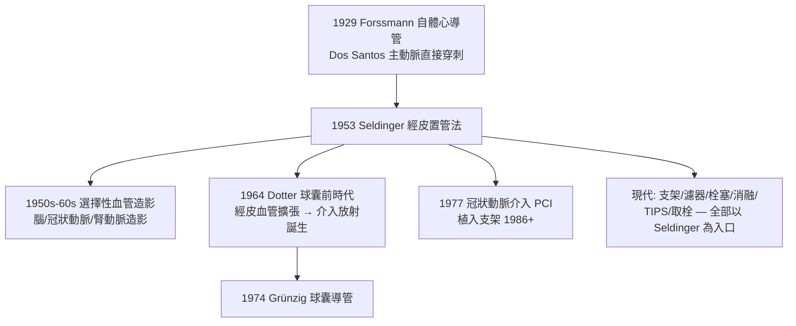

## 1953 - 塞丁格技術與血管造影（讓放射科開始「動手」）

## 案件摘要

**本案偵破的是：如何把一根導管送進動脈，卻不留一個需要縫合的大傷口？**

X 光問世後，血管本身是透明的——要「看見血管」必須注入對比劑（含碘水溶液，$ Z_{\mathrm{I}} = 53 $），但要讓對比劑精準到達目標動脈，又必須經皮穿刺送入導管。1953 年，斯德哥爾摩的年輕放射科住院醫師 Sven-Ivar Seldinger 發表了以導引鋼絲為樞紐的穿刺置管法：**針→鋼絲→拔針→沿鋼絲送管→拔鋼絲**。四步驟把血管造影從「外科式切開動脈」（Dos Santos 1929 的直接穿刺、 Forssmann 1929 的自體切開置管）變成「針孔級門診手術」——血管造影自此普及，並成為一切介入性放射（見 `1964-多特與介入性放射線的誕生.md`）的平台。

## 前因

- **對比劑的進化已完成一半**。1920s–40 年代碘化鈉、碘吡酮酸（Diodrast）等水溶性碘劑問世（取代了危險的油與溴化物）；「看見血管」的化學問題已解，剩下的全是**通道**問題。
- **通道的三種舊解法**：(1) 直接穿刺目標動脈（Dos Santos 1929 主動脈造影，風險極高）；(2) 外科切開置管（Forssmann 1929 在自己身上切開靜脈送入導管，1956 獲諾獎；Richards 與 Cournand 發展為心導管生理學）；(3) 針管內滯針置換法（尺寸受限、滲血嚴重）。
- **Seldinger 的處境**。24 歲的住院醫師在 Karolinska 做股動脈造影研究，受不了切開動脈的併發症與手術室依賴——住院醫師的痛點驅動了本世紀最簡潔的發明之一。

## 線索與推理

**線索一：把「大孔」問題拆成「細絲」問題。** Seldinger 的推理核心是**中介物**思想：針孔與導管之間尺寸不匹配，那就造一個「先導」

$$ \text{針（小而硬）} \rightarrow \text{導引鋼絲（細而軟，可彎曲塑形）} \rightarrow \text{導管（粗而軟）} $$

穿刺只留 1–2 mm 傷口；鋼絲沿血管腔走行，導管沿鋼絲滑入——**血管壁只在針尖處被穿過一次**。

**線索二：安全閥門與可重複性。** 技術的另一重偵探價值是**可重複的標準流程**（與 Ehrlich 篩選法（見 `../性病的歷史/1910-埃爾利希洒爾佛散606.md`）同構）：

```text
Seldinger 標準五步（1953 論文原版）:
1. 穿刺針進入股動脈（搏動定位）
2. 透針置入彈性導引鋼絲（先確認在血管腔內）
3. 拔針、按壓固定鋼絲
4. 沿鋼絲擴張+送入導管
5. 拔鋼絲 → 造影 → 術末按壓止血
每一步都有可檢查的成功/失敗判準 → 可教學、可複製、可改進
```

**線索三：造影系統的配套。** 導管到位後，快速換片器（AOT roll film changer）＋壓力注射器使連續血管顯影成為可能；1960s 影像增強器＋電視使即時透視導管操作可行——「導管手術看著做」的平台在此成形。

**線索四：技術樹的全面開花。**



## 結案

- **「幾乎全部血管內操作的單一入口」**。心導管檢查、冠狀動脈支架（PCI）、腦動脈瘤栓塞、主動脈支架（EVAR）、靜脈濾器、TVP 取栓——今天全球每年數千萬例血管內手術，第一步都是 Seldinger 技術。它可能是醫學史上被執行次數最多的單一術式。
- **介入性放射的地基**。Dotter 的血管成形術（見 `1964-多特與介入性放射線的誕生.md`）直接站在 Seldinger 之上；「放射科醫師從診斷者變成治療者」的身分革命由此開啟。
- **超音波導引的再進化**。1980s 後穿刺在即時超音波導引下進行（股靜脈、橈動脈），併發症率再降——平台仍在被迭代。
- **一句話結案**：Seldinger 的天才不在發明任何新器材——針、鋼絲、導管全是現成物——而在**找到讓它們彼此銜接的順序**；最偉大的醫學發明有時只是一個正確的操作序列。

## 關鍵人物與文獻

- **Sven-Ivar Seldinger（1921–1998）**——Karolinska 放射科住院醫師時發表此法；其後職業生涯平凡低調，卻以一篇短文不朽；晚年參與瑞典醫療資訊系統建設。
- **Werner Forssmann（1904–1979）**——1929 年在自己左臂切開靜脈將導管送入右心房（被開除、一度轉行泌尿科）；1956 年與 Cournand、Richards 共享諾貝爾生理學或醫學獎。
- **Rodney Smith（Sir Rodney Smith, 1914–1998）**——英國外科學者，1950s 把 Seldinger 技術介紹到英語世界並推廣標準化訓練。
- 原始文獻——S. I. Seldinger, *Catheter Replacement of the Needle in Percutaneous Arteriography; A New Technique*, Acta Radiologica, 1953（被引用逾萬次的兩頁短文）。
- 現代註腳——2010s 起桡動脈入路（wrist access）在冠狀動脈介入中超越股動脈——病人術後立即坐起步行；但操作法仍是 1953 年那五步。
