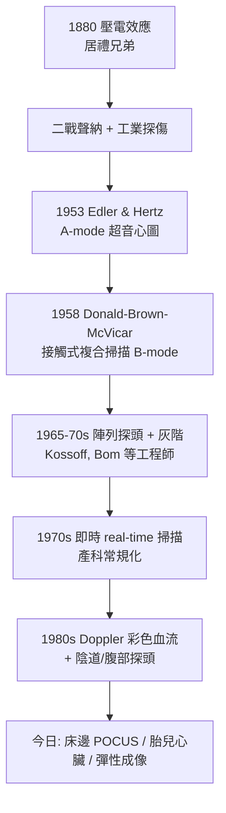

## 1958 - 唐納超音波看見胎兒（「影像科」裡唯一的非電離偵探）

## 案件摘要

**本案偵破的是：X 光看得到骨骼，卻對軟組織與胎兒無能為力（且不可對孕婦使用）——有沒有安全、可攜、即時的成像方式？**

聲納（SONAR）在兩次大戰中成熟；1950s 美國的 Howry、Wild 等以工業超音波探傷原理嘗試人體成像，但機器笨重（浸水槽）、影像緩慢。1958 年，蘇格蘭格拉斯哥的婦產科醫師 Ian Donald 與工程師 Tom Brown、John McVicar 發表《Lancet》論文，展示以接觸式複合掃描（contact compound scanner）取得的婦產科超音波影像——**可移動到病床邊、即時、無輻射**的成像第一次進入臨床。胎兒、卵巢囊腫、腹水在黑白聲影中現形。產科從此有了「安全的眼睛」。

## 前因

- **物理基礎早已存在**。壓電效應（1880 居禮兄弟發現——見 `1898-居禮夫婦發現鐳.md` 的同一對兄弟）使石英晶體既可發射又可接收超音波；二戰聲納與 1940s 工業探傷提供了脈衝回波技術。
- **1950s 的先驅混戰**。美國 Douglas Howry（浸水式 3D 嘗試）、Denver 的 Joseph Holmes、瑞典 Inge Edler 與 Hellmuth Hertz（1953 心臟回波，超音心圖之父）、英國 John Wild（組織回波與乳癌 A-mode）——各有碎片，缺的是**臨床可用性**。
- **產科的迫切需求**。1950s 判斷「懷孕幾週、單胎多胎、囊腫還是腫瘤」全靠觸診與 X 光（胎兒骨化後才能照），而孕婦照 X 光有輻射風險（見 `1925-國際放射防護的誕生.md`）。
- **Donald 的機緣**。他曾在皇家海軍接觸聲納；格拉斯哥的鍋爐公司（Babcock & Wilcox）願意借出工業探傷儀——醫生與鍋爐工程師的跨界組合。

## 線索與推理

**線索一：回波測距的物理。** 脈衝回波法的基本公式：

$$ d = \frac{c \cdot \Delta t}{2} \qquad (c_{\text{軟組織}} \approx 1540\ \text{m/s}) $$

聲阻抗差 $ Z = \rho c $ 決定反射強度（聲阻抗相差越大，回波越強；骨骼/空氣界面幾乎全反射——所以肺與骨是超音波的死角，也是「必須塗耦合劑趕走空氣」的原因）。成像的對比來源是**組織的聲學性質**而非密度——這是超音波與 X 光（$ \mu \propto \rho Z^3 $）在本質上的分岔。

**線索二：複合掃描（compound scanning）的巧思。** 單角度掃描會因組織界面方向而漏掉回波；Donald–Brown 的接觸式複合掃描讓探頭以多角度、多次掃過同一斷面，把多個方向的回波疊加在示波器餘輝上——**用掃描策略彌補物理缺陷**。且「接觸式」免掉了 Howry 的浸水槽，機器可以推到病房——可攜性是本案的決勝點。

**線索三：1958 論文的臨床證據鏈。** 論文展示的案例是「偵探式」的：巨大卵巢囊腫被誤認為腹水/巨孕腹，超音波顯示囊性結構（無回聲區+後方增強）→ 手術證實。Donald 同時展示了胎頭測量（雙頂徑）——**產科測量學**由此誕生，胎兒生長曲線、胎齡評估、多胎與胎位診斷全面改寫。

**線索四：即時實時成像的最後一躍。**

## 結案

- **非電離影像的獨特生態位**。超音波無輻射、可重複、便宜、可攜——成為孕婦與兒童的第一影像工具，也是全球貧困地區唯一負擔得起的成像手段（WHO 評價其為性價比最高的醫學影像）。
- **產科與胎兒醫學的革命**。胎齡、生長、畸形（神經管、心臟）、胎盤位置、羊水量——產前診斷的整座大廈建在 1958 年那台「鍋爐探傷儀」上；也因此引出選擇性流產、性別篩選等倫理爭議——影像的社會後果與物理同樣深遠。
- **診斷與治療的第三條線**。超音波同時成為介入操作的導航（穿刺、活檢、神經阻斷）與治療能源（HIFU 高強度聚焦超音波，碎石術 1980）——聲波從偵測器變成手術刀。
- **一句話結案**：X 光用一束看不見的光穿過身體，超音波用一聲聽不見的呼喚等身體回答——**Donald 證明最好的成像，有時是問問題而不是照光**。

## 關鍵人物與文獻

- **Ian Donald（1910–1987）**——格拉斯哥女王母嬰醫院婦產科教授；二戰海軍聲納經歷＋「懷疑一切臨床觸診」的態度；1977 年與同行共同獲 Lasker 臨床醫學研究獎。
- **Tom Brown（1926–2024）**——工業工程師，實際設計接觸式複合掃描儀；晚年回憶「我們其實不懂醫學，所以我們沒被教科書限制」。
- **Inge Edler 與 Hellmuth Hertz**——1953 年首度以回波描記心臟（echocardiography）；Hertz 是迴旋加速器發明人的兒子（見 `1931-勞倫斯迴旋加速器.md`）——本案與核子醫學的另一重血緣。
- **Joseph Holmes 與 Douglas Howry**——美國超音波成像先驅，浸水槽與早期 B-mode 的重要貢獻者。
- 原始文獻——I. Donald, J. MacVicar & T. G. Brown, *Investigation of Abdominal Masses by Pulsed Ultrasound*, The Lancet, 1958。
- 現代註腳——今日掌上型超音波（手機＋貼片探頭）把 1958 年的「可攜性」推到極致；急診 POCUS 已成為「醫師的觸診延伸」——那台從鍋爐廠借來的機器的孫子，正插在醫生口袋裡。
