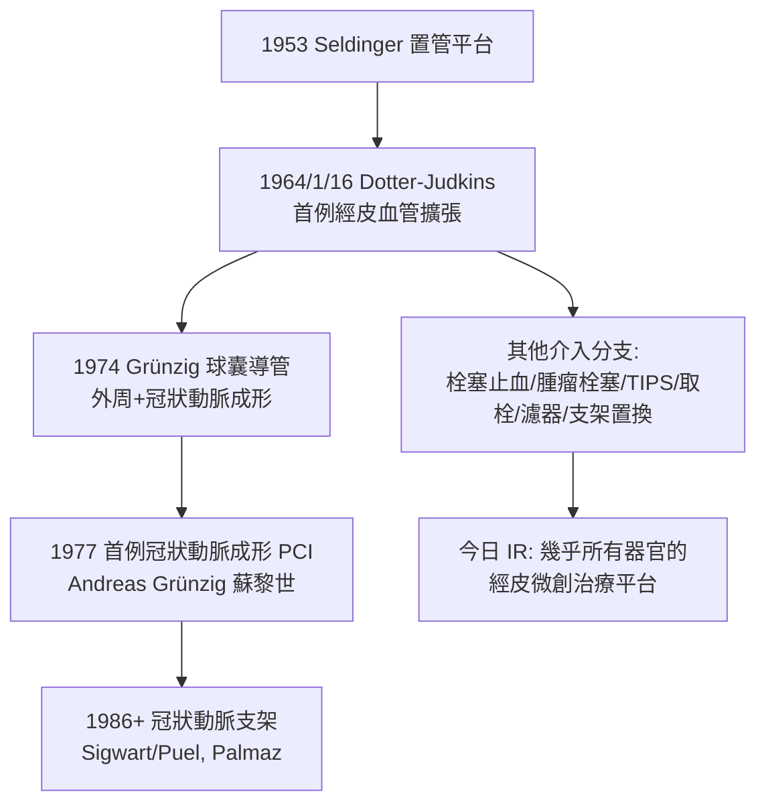

## 1964 - 多特與介入性放射線的誕生（診斷者拿起治療的刀）

## 案件摘要

**本案偵破的是：血管造影顯示了阻塞，然後呢？——難道只能轉外科開刀嗎？**

1963 年，波特蘭奧勒岡大學的 Charles Dotter 在捷克斯洛伐克放射學會演講時提出驚世駭俗的構想：既然導管可以進入血管，**能不能順手把血管裡的阻塞推開？** 1964 年 1 月 16 日，他與 Melvin Judkins 為一位 83 歲、左腳壞疽被建議截肢、卻拒絕截肢的婦女 Laura Shaw，以同軸逐步擴張導管（Teflon 套管逐級撐開）打通其膕動脈阻塞——腳趾傷口癒合、疼痛消失、病人保住雙腿並再活了數年。「Dottering」一詞進入了放射學詞典；**介入性放射學（Interventional Radiology）**就此誕生：放射科醫師第一次從「看片的人」變成「動手的人」。

## 前因

- **平台已備**。Seldinger 經皮置管（見 `1953-塞丁格技術與血管造影.md`）＋影像增強器透視，使「導管到位於目標血管」成為常規操作。
- **外周血管病的外科困境**。1960s 動脈阻塞的治療是動脈內膜切除術或旁路手術：創傷大、併發症多、老人與糖尿病人常不適合——Dotter 的病人正是「外科說：只能截肢」的絕境組。
- **Dotter 的性格**。他自稱「煤油博士」（Dr. Kerosene，因少年時代以煤油疏通堵塞油管），直言喜歡「以導管取代手術刀」的類比——疏通管線的工程師想像力貫穿其生涯。
- **診斷與治療的鴻溝**。當時放射科的文化規範是「只看不做」；Dotter 的提案被同事視為越界，其論文一度被拒。

## 線索與推理

**線索一：機械疏通的物理合理性。** 粥樣斑塊並非岩石而是可塑形物質——Dotter 的洞見是「斑塊可以被壓縮、重塑、沿管壁重新分佈」：

$$ r_{\text{術後}} > r_{\text{術前}} \;\Rightarrow\; \dot{Q} \propto r^4 \quad (\text{Poiseuille 定律}) $$

半徑的線性增加帶來**四次方**的血流改善——「撐開一點點，血流翻好幾倍」，這個 $ r^4 $ 是本案最有力的說服數字。

**線索二：同軸導管序列的工程設計。** Dotter–Judkins 的原始技法：

```text
8F 導管穿過病變 → 撤出內芯 → 沿原路送入 12F Teflon 套管擴張
→ 再以 14F 套管逐級擴張 → 拔管、按壓止血
「逐級而進、以舊管為軌道」— Seldinger 鋼絲思想的直系後裔
```

**線索三：第一例的證據效力。** Laura Shaw 術前腳已發黑、劇痛難眠；術後當晚疼痛緩解、兩天後壞疽趾自行乾癟脫落、傷口癒合——**單一病例的對比強度**（術前外科共識「必須截肢」vs 術後免截肢）使 N=1 的說服力足以啟動整個領域。這與 1929 年 Forssmann 在自己身上做心導管（見 `1953-塞丁格技術與血管造影.md`）構成介入醫學史的兩個 N=1 傳奇。

**線索四：領域的爆炸式擴張。**



## 結案

- **一個專科的身分革命**。介入放射學成為放射科內的治療亞專科：栓塞止消化道出血、子宮肌瘤栓塞、肝癌 TACE、經頸靜脈肝內門體分流（TIPS）、腦動脈瘤彈簧圈栓塞、機械取栓（2015 年起成為缺血性腦中風的標準治療）——「放射科醫師拿導管開刀」已從異端變成救命常規。
- **外科的反應與和解**。Dotter 的方法在美國最初被外科主流抵制（「不懂手術的人在血管裡搗亂」），歐洲（尤其 Gruntzig 的球囊導管）先接受並發揚；三十年後，心臟科搶走了冠狀動脈介入的主導權——「診斷者與治療者」的邊界戰至今仍在各器官上演。
- **冠心病的歷史改道**。1977 年 Gruntzig 首例冠狀動脈成形術、1986 年支架、2000s 藥物洗脫支架——全球每年逾數百萬例 PCI 的源頭是 1964 年那根 14F 的 Teflon 套管。
- **一句話結案**：Dotter 的推理只有兩步——「血管是我進來的，那它也該是我疏通的」；$ r^4 $ 的物理加上一位拒絕截肢的病人，造就了整個微創介入時代。

## 關鍵人物與文獻

- **Charles Theodore Dotter（1920–1985）**——奧勒岡健康與科學大學（OHSU）放射學教授，「介入放射學之父」；1980s 曾獲諾獎提名；去世後 OHSU 設立 Dotter 介入放射研究所。
- **Melvin Judkins（1922–1985）**——合作發表同軸擴張術；後在 Alabama 主持冠狀動脈造影計畫（CASS 試驗造影核心）。
- **Laura Shaw**——83 歲拒絕截肢的病人；她的雙腿是介入放射學的出生證明（其病例照片成為醫學史經典）。
- **Andreas Grünzig（1939–1985）**——瑞士德語區醫師，自製球囊導管並完成首例冠狀動脈成形（1977/9/16）；1985 年駕機失事早逝。
- 原始文獻——C. T. Dotter & M. P. Judkins, *Transluminal Treatment of Arteriosclerotic Obstruction: Description of a New Technic and a Preliminary Report of Its Application*, Circulation, 1964。
- 現代註腳——2015 年 HERMES 試驗確立機械取栓為中風標準治療後，「時間就是大腦」的院前分诊系統全面改寫——神經介入醫師在導管室隨時待命的模式，正是 1964 年那晚波特蘭手術室的無限放大版。
