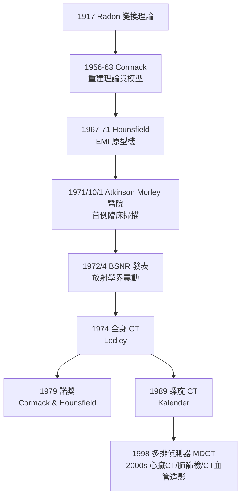

## 1971 - 洪斯菲德與 CT 的誕生（用數學把身體切成薄片）

## 案件摘要

**本案偵破的是：X 光片是所有組織重疊成的「影子總和」——顱骨裡的腫瘤、腦出血全部糊成一團。如何「拆開」重疊？**

1960s，EMI 公司工程師 Godfrey Hounsfield（二戰雷達技師出身、無博士學位）與 Tufts 大學物理學家 Allan Cormack 各自獨立解出同一道數學題：從多角度的 X 光衰減投影，**反算出斷層面上每個像素的衰減係數**。1971 年 10 月，第一台臨床 CT（EMI Mark I）在倫敦 Atkinson Morley 醫院掃描了第一位病人；1972 年發表時，顱內腫瘤與出血第一次在活人身上「切片」現形。Cormack–Hounsfield 共獲 1979 年諾貝爾生理學或醫學獎——兩位都不是醫生。

## 前因

- **常規放射學的死角**。顱骨內部在普通 X 光片上幾乎不可見（腦與血液對比差 <1%）；氣腦造影（往腦室打氣，痛苦且危險）與血管造影是僅有的間接手段。
- **數學工具已備**。Radon 變換（1917，奧地利數學家 Johann Radon）早已給出「由所有投影重建函數」的理論；1950s–60s 天文學（射電太陽重建，Bracewell）、電子顯微鏡三維重建已有實作。
- **Cormack 的先手（1956–63）**。南非開普敦的物理學家 Cormack 為放射腫瘤做劑量計算，發表了兩篇反投影—傅立葉法重建的理論與模型實驗——幾乎無人引用。
- **EMI 的資本**。EMI 靠披頭四唱片大賺，Hounsfield 的計算機影像專案獲得公司內部預算——「搖滾樂資助 CT」是本案著名的資本插曲。

## 線索與推理

**線索一：把重建問題形式化。** 平行束投影的數學骨架：

$$ p(\theta, t) = \int_{-\infty}^{\infty} \mu(x, y)\, \mathrm{d}s \quad (\text{Radon 變換}), \qquad \hat{\mu}(\nu_x, \nu_y) = P_\theta(\nu) \quad (\text{中心切片定理}) $$

即：某角度的投影之傅立葉變換，等於影像二維傅立葉譜過原點的同一條線。收集全部角度 → 拼出完整頻譜 → 反傅立葉變換得 $ \mu(x, y) $。工程上最常用的實作是**濾波反投影（FBP）**：

$$ \mu(x,y) = \int_0^\pi \left( p(\theta, \cdot) * h \right)(t)\, \mathrm{d}\theta, \qquad H(\nu) = |\nu| $$

其中 Ramp 濾波器 $ |\nu| $ 抵消直接反投影的 1/r 模糊。CT 的核心貢獻不是硬體而是**這套重建數學的工程化**。

**線索二：Hounsfield 的兩條關鍵簡化。** (1) 首選代數迭代法（ART）而非傅立葉法，適合電腦記憶體；(2) 極薄準直的近單能束，避開射束硬化問題。第一台機器：鎘鎢酸鹽探測器、180 度內 160 個採樣、水浴包圍頭部、一次掃描約 4.5–5 分鐘、重建一幅 80×80 像素影像需數分鐘——以今天標準慢如蝸牛，但臨床上已是奇蹟。

**線索三：CT 值的標準化。** Hounsfield 定義：

$$ \text{CT number (HU)} = 1000 \times \frac{\mu_{\text{組織}} - \mu_{\text{水}}}{\mu_{\text{水}}} $$

水 = 0、空氣 = −1000、骨 ≈ +1000——**讓全身影像有了統一的數值語言**，放射科報告自此可以定量比較。腦灰白質 1% 的 $ \mu $ 差被放大為可辨識的對比——「1% 的差異 × 1000 倍顯示增益 = 診斷」是 CT 的偵探算術。

**線索四：時間軸與擴散。**

## 結案

- **診斷版圖的洗牌**。氣腦造影消失、腦出血與腫瘤診斷重寫、外傷與急診流程重構（「先 CT 再說」成為急診文化）——CT 也是第一個把「劑量焦慮」帶回大眾視野的技術（兒童 CT 劑量、肺癌 LDCT 篩檢的風險效益辯論，見 `1925-國際放射防護的誕生.md`）。
- **數學成為醫療器械**。CT 證明「演算法本身就是機器」；SPECT/PET 重建（見 `1950-閃爍掃描儀與Anger伽瑪相機.md`、`1974-PET正子斷層掃描.md`）直接借用此數學，MRI 的 $ k $-space 重建是它的近親。
- **科學史的兩個教訓**：(1) Cormack 的無人引用與 Hounsfield 的無學位——正統學術體制兩次錯過同一發現；(2) EMI 靠唱片利潤養出諾貝爾級醫療設備——醫療創新的資金來源從不可預測。
- **一句話結案**：影子是加法，CT 是減法——**Hounsfield 與 Cormack 把 Radon 1917 年的純數學，變成了 1971 年切片活體的刀**。

## 關鍵人物與文獻

- **Godfrey Newbold Hounsfield（1919–2004）**——英國電氣工程師、二戰雷達軍官；EMI 中央研究實驗室；CT 值單位 HU 以他命名；自述靈感部分來自「想在鄉間度假時不開車也能拼出視野全貌」的圖形思考。
- **Allan MacLeod Cormack（1924–1998）**——南非出生的物理學家，Tufts 大學；1956–63 年發表重建理論，1972 年讀到 EMI 消息後自嘲「我的兩篇論文終於被引用了」。
- **James Ambrose**——Atkinson Morley 醫院神經放射科醫師，執行首例與早期臨床驗證，是「臨床偵探」端的主角。
- **Robert Ledley（1926–2012）**——1974 年推出第一台全身 CT（ACTA）。
- **Willi Kalender**——1989 年螺旋 CT（連續旋轉＋床移動）發明人，把 CT 從「切片機」變成「容積掃描機」。
- 原始文獻——G. N. Hounsfield, *Computerised Transverse Axial Scanning (Tomography): Part I*, British Journal of Radiology, 1973（與 Ambrose 合著的 Part II 為臨床驗證）；A. M. Cormack, *Representation of a Function by Its Line Integrals*, J. Appl. Phys., 1963。
- 現代註腳——2010s 的疊代重建與 AI 低劑量降噪把胸部 CT 劑量壓到 <1 mSv；「低劑量肺癌篩檢」的普及證明：CT 的下一章仍是 1971 年那個問題——**如何在最小代價下拆開重疊**。
