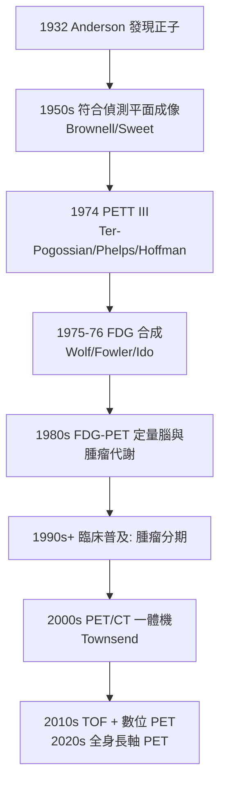

## 1974 - PET 正子斷層掃描（看見身體的化學，而不只是結構）

## 案件摘要

**本案偵破的是：CT 看「長什麼樣」，核醫學看「在幹什麼」——能不能兩者兼得，做出化學活動的三維地圖？**

1950s，放射性同位素碳 11、氧 15、氮 13 被製出——它們是人體有機分子的天然組成元素，衰變時放出**正子**；正子與電子相遇湮滅，產生方向相反（180°）的兩顆 511 keV 光子。物理學家意識到：**湮滅光子的「反向成對」特性本身就是天然的準直器**——用環形探測器兩兩符合偵測（coincidence detection），可以電子學定位衰變點，不需鉛準直器。1974 年，聖路易華盛頓大學的 Ter-Pogossian、Phelps 與 Hoffman 製成 PETT III，第一台臨床可用正子斷層儀；1980 年代氟 18 FDG（氟代脫氧葡萄糖）合成法確立，「代謝成像」成為 PET 的殺手級應用——今天它是腫瘤分期、癲癇灶定位、失智症診斷與心臟存活評估的核心工具。

## 前因

- **正子的理論與發現**。1928 年 Dirac 方程預言正電子；1932 年 Anderson 在宇宙線中發現；1934 年 Joliot-Curies 的 $ \beta^+ $ 衰變（見 `1934-費米與人工放射性.md`）使正子核種可被人製造。
- **符合偵測的構想**。1950s–60s，Brownell、Sweet、Aronow 等在 MGH 以雙探頭符合法做腦腫瘤正子定位（「正子頭盔」），但仍是平面投影。
- **短半衰期核種的供應難題**。$ t_{1/2} $：氧 15（2 分鐘）、氮 13（10 分鐘）、碳 11（20 分鐘）——**必須現場生產、現場合成、立即注射**，催生了「醫院內迴旋加速器＋放射藥房」的全新基礎設施（見 `1931-勞倫斯迴旋加速器.md`）。
- **斷層數學已共享**。CT（見 `1971-洪斯菲德與CT的誕生.md`）驗證了反投影重建的可行性——PET 只需把「X 光投影」換成「符合事件直方圖」。

## 線索與推理

**線索一：湮滅符合的幾何魔法。** 正子湮滅的反應與偵測：

$$ e^+ + e^- \rightarrow \gamma + \gamma \quad (2 \times 511\ \text{keV},\ \theta = 180^\circ) $$

兩探頭「同時」（時間窗 $ \sim $ ns）收到光子 → 衰變點必在兩探頭連線（line of response, LOR）上。**電子學準直**取代物理準直，靈敏度提升約兩個數量級——這是 PET 相對 SPECT（見 `1950-閃爍掃描儀與Anger伽瑪相機.md`）的物理優勢。時間窗的數學：

$$ |\Delta t| < \frac{\Delta x}{2c} \;\Rightarrow\; \text{TOF-PET 可直接定位沿 LOR 的位置} $$

2010s 的飛行時間（TOF）技術把 300 ps 時間差化為約 4.5 cm 的位置不確定度，影像信噪比再躍升。

**線索二：FDG 的生化陷阱。** 1970s 後期，賓大/ORNL 的 Wolf 與 Brookhaven 的 Fowler、Ido 合成氟 18 標記的脫氧葡萄糖 FDG。其偵探邏輯是**代謝陷阱（metabolic trapping）**：

```text
FDG 進入細胞（葡萄糖轉運體 GLUT）→ 被己糖激酶磷酸化 → FDG-6-PO4
→ 無法繼續進入糖解路徑，也無法出細胞 → 積留
→ 積留量 ∝ 該組織的葡萄糖代謝率
→ Sokoloff 1977 年的脫氧葡萄糖自顯影理論給出定量模型
```

腫瘤（Warburg 效應：糖解亢進）、發炎、大腦活躍區攝取高——**化學活動自己發光**。這是「追蹤劑原理」（見 `1941-碘131與核子醫學誕生.md`）在分子層次的最高表達。

**線索三：從 PETT III 到全身 PET。**



**線索四：定量模型的霸權。** PET 是唯一能輸出「每分鐘每組織代謝了多少微摩爾」的活體成像：動態掃描 + 動脈輸入函數 + 房室模型：

$$ C_T(t) = K_1 C_p(t) + \int_0^t C_p(\tau) \cdot \Psi(t-\tau)\, d\tau $$

$ K_1 $（攝取率）、$ k_3 $（磷酸化率）等速率常數使 PET 成為**定量分子影像**——這是它與「形態學影像」的本質分野。

## 結案

- **腫瘤醫學的分水嶺**。FDG-PET/CT 改寫了肺癌、淋巴瘤、大腸癌等的分期與療效評估；「療程中間 PET 評效」成為淋巴瘤治療的標準節點——治療決策直接依賴代謝影像。
- **神經科學的眼睛**。腦葡萄糖代謝圖、多巴胺受體顯影（帕金森病）、類澱粉蛋白 PET（阿茲海默症確診輔助）——PET 讓「心理活動的化學基礎」首次可視化。
- **基礎設施的代價**。醫院迴旋加速器＋放射化學合成模組＋昂貴探測器使 PET 長期是最貴的影像檢查；FDG 的 110 分鐘半衰期造就「衛星藥廠配送圈」的物流學（見 `1931-勞倫斯迴旋加速器.md`）。
- **診療一體的樞紐**。同一載體換核種即可從診斷（鎵 68 PSMA-PET）轉為治療（鎦 177 PSMA 治療）——theranostics 把 PET 從相機升級為處方系統。
- **一句話結案**：CT 回答「哪裡有東西」，PET 回答「那東西在做什麼」——**湮滅光子的 180° 擁抱，把身體的化學寫成了地圖**。

## 關鍵人物與文獻

- **Michel Ter-Pogossian（1925–1996）**——華盛頓大學聖路易物理學家，PETT 系列原型機主持人，公認「PET 之父」。
- **Michael Phelps 與 Edward Hoffman**——PETT III 的共同工程師；Phelps 後創立 UCLA 分子藥理與治療影像系，主導 FDG-PET 臨床化。
- **Abass Alavi**——1976 年完成首例人體 FDG 腦與全身研究，PET 臨床應用的推手。
- **Joanna Fowler 與 Alfred Wolf**——放射化學家，FDG 與多種正子標記物的合成者。
- **David Townsend**——1998–2000 年 PET/CT 一體機的關鍵工程師，把功能與解剖影像焊在同一張報告上。
- 原始文獻——M. M. Ter-Pogossian et al., *A Positron-Emission Transaxial Tomograph for Nuclear Imaging (PETT)*, Radiology, 1975；T. Ido et al., *Fast Synthesis of [18F]FDG*, J. Nucl. Med., 1978；L. Sokoloff et al., *The [14C]Deoxyglucose Method*, J. Neurochem., 1977。
- 現代註腳——2020s 全身長軸 PET（uEXPLORER 等）一次掃描覆蓋全身、靈敏度提升 40 倍，劑量可降至常規 1/40——「藥物在全身的旅程」第一次能以電影速率播放。
