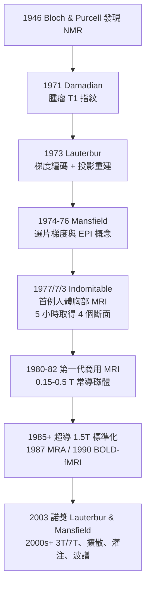

## 1977 - 人體第一張 MRI（把核磁共振變成醫學之眼）

## 案件摘要

**本案偵破的是：核磁共振（NMR）本是化學家的光譜技術——怎麼變成能拍出身體斷層照片的機器？**

1946 年 Bloch 與 Purcell 各自發現核磁共振：氫原子核（質子）有自旋與磁矩，放入強磁場後沿場排列，以特定射頻（RF）激發會「翻轉」，隨後以特徵頻率釋放訊號並慢慢弛豫——共振頻率 $ \nu = \gamma B_0/2\pi $，弛豫時間 $ T_1, T_2 $ 隨組織化學環境而異。1971 年 Raymond Damadian 發現腫瘤組織的 $ T_1/T_2 $ 與正常組織顯著不同；1973 年 Paul Lauterbur 用磁場梯度給訊號「編碼空間位置」，以投影重建拍出兩支裝水試管的影像；1977 年，Damadian 的「Indomitable」機器掃描出人體胸部第一張 MRI。1970s–80sMRI 商用化，成為不具游離輻射、對比無與倫比的軟組織之眼。Lauterbur 與 Mansfield 獲 2003 年諾貝爾生理學或醫學獎。

## 前因

- **NMR 的化學根基**。1938 年 Rabi 在分子束中測得核磁矩（1944 諾獎）；1946 年 Bloch（史丹佛）與 Purcell（哈佛）在固/液態中獨立觀測到 NMR 吸收（1952 共享諾獎）；1950s 質譜級 NMR 成為有機化學標配。
- **弛豫時間的醫學線索**。1950s–60s 已知水的 $ T_1, T_2 $ 隨環境（結合水 vs 自由水）劇變；1971 年 Damadian 在《Science》發表大鼠腫瘤 $ T_1 $ 延長——「組織的磁指紋」假說成立。
- **空間編碼的瓶頸**。NMR 訊號來自整個樣品的全體質子——「訊號有了，但不知道從哪來」，就像沒有準直器的伽瑪相機（見 `1950-閃爍掃描儀與Anger伽瑪相機.md`）。
- **Damadian vs Lauterbur 的路線之爭**。Damadian 主攻點測法（FONAR，逐點掃描、極慢）；Lauterbur 主攻梯度編碼＋投影重建（借鑑 CT 數學，見 `1971-洪斯菲德與CT的誕生.md`）——後者成為主流。

## 線索與推理

**線索一：共振條件與弛豫指紋。** 質子共振頻率與組織對比的核心量：

$$ \nu = \frac{\gamma}{2\pi} B_0 \quad (\gamma_{\mathrm{H}} \approx 42.58\ \text{MHz/T}), \qquad S(t) \propto e^{-t/T_2}\,(1 - e^{-t/T_1}) $$

$ T_1 $（縱向恢復）與 $ T_2 $（橫向失相）由水分子與大分子的相互作用決定——腫瘤（自由水多）$ T_1, T_2 $ 皆延長。MRI 的對比是**化學與微環境**，不是密度：這是它與 X 光/CT 的根本分岔（見 `1912-勞厄與X光繞射.md` 的波長哲學：此處用的「波」是射頻，尺度和機制完全不同）。

**線索二：梯度編碼——Lauterbur 的關鍵一躍。** 在 $ B_0 $ 上疊加線性梯度場 $ G_x $，各位置質子共振頻率隨位置線性變化：

$$ \nu(x) = \frac{\gamma}{2\pi}\left( B_0 + G_x \, x \right) $$

頻譜因此變成「一維投影」；轉動梯度方向採多個投影 → 用 CT 式反投影重建出二維像。 Mansfield 則發展回波平面成像（EPI）與選片梯度，使「一次激發拍一整層」成為可能——現代 MRI 序列（GRE、SE、EPI）全部建立在梯度編碼語法上。

**線索三：$ k $-空間的數學（把本案補全）。** 1970s 後期確立的 $ k $-空間形式：採集到的訊號是影像 $ \rho(\mathbf{r}) $ 的傅立葉採樣，

$$ S(k_x, k_y) = \int \rho(\mathbf{r})\, e^{-i 2\pi \mathbf{k} \cdot \mathbf{r}}\, \mathrm{d}\mathbf{r}, \qquad \mathbf{k}(t) = \frac{\gamma}{2\pi} \int_0^t \mathbf{G}(t')\, \mathrm{d}t' $$

梯度波形 $ \mathbf{G}(t) $ 在 $ k $-空間畫軌跡——**MRI 編程 = 設計 $ k $-空間路徑**。本案從「試管光譜」到「可編程相機」的最後一步由此完成。

**線索四：第一張人體影像的賽跑。**

## 結案

- **軟組織診斷的全面重寫**。腦與脊髓（多發性硬化、椎間盤、腫瘤）、關節半月板、心肌存活、前列腺與直腸癌分期——MRI 對「水與軟組織」的敏感度使 CT 相形見絀的領域成片讓出；fMRI（1990 BOLD）更把人腦認知研究推進活體時代。
- **無輻射的典範意義**。MRI 首次證明「醫學斷層影像可以完全非電離」——孕婦與兒童成像的長期選項（見 `1925-國際放射防護的誕生.md` 的劑量哲學在非游離領域的延伸）。
- **科學爭議的餘波**。Damadian 被 2003 年諾獎排除（僅 Lauterbur 與 Mansfield 獲獎），引發公開抗議與廣告行動；FONAR 路線敗給梯度編碼是技術決策，但其 1971 年「組織弛豫指紋」論文是整條鏈的起點——諾獎的「單一功勞」框架與醫學發明的群體性再次衝突。
- **安全文化的新科目**。強磁場的投射效應（氧氣瓶、輪椅成為致命炮彈）、植入物（心臟節律器）、RF 灼傷——MRI 催生了全新的 MR 安全檢查制度與「Zone 分區」規範。
- **一句話結案**：NMR 本是化學家的耳朵，Lauterbur 給它裝上梯度編碼的眼睛——**身體裡的每一滴水，從此都能自己報出地址與身分**。

## 關鍵人物與文獻

- **Raymond Damadian（1936–2022）**——紐約州立大學下城醫學中心醫師；1971 年腫瘤弛豫論文、1977 年 Indomitable 首張人體 MRI；創立 FONAR 公司；2003 年諾獎遺珠爭議當事人。
- **Paul Lauterbur（1929–2007）**——石溪紐約州立大學化學家；1973 年《Nature》論文標題自嘲式地寫著「image formation by induced local interaction: examples employing magnetic resonance」——被審稿人一度建議「不值得一發表」。
- **Peter Mansfield（1933–2017）**——諾丁漢大學物理學家，梯度與 EPI 的工程化者；工人家庭出身的諾獎得主。
- **Richard Ernst（1933–2021）**——ETH 蘇黎世化學家，二維 NMR 與傅立葉成像（1975），1991 年諾貝爾化學獎；今日 MRI 序列的數學骨架多出自其手。
- 原始文獻——F. Bloch et al., *The Nuclear Induction Experiment*, Phys. Rev., 1946；R. Damadian, *Tumor Detection by Nuclear Magnetic Resonance*, Science, 1971；P. C. Lauterbur, *Image Formation by Induced Local Interactions*, Nature, 1973。
- 現代註腳——2020s 的影像壓縮感知與深度學習重建把掃描時間從 30 分鐘壓到 5 分鐘以下；「磁振造影的下一章」仍是 1977 年的方程——**在 $ k $-空間走得越聰明，病人躺得越短**。
