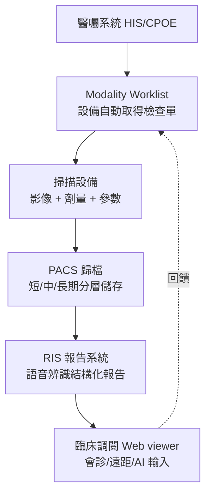

## 1992 - DICOM 與 PACS：放射科走向全數位（膠片時代的終結）

## 案件摘要

**本案偵破的是：影像終於能「切」出來了，可是它們仍印在塑膠膠片上、鎖在地下室檔案櫃裡——如何讓影像像資料一樣流動？**

1970s–80s 的放射科是「膠片工廠」：沖片機、洗片藥水、實體檔案室、借片跑腿。CT/MRI/超音波各自使用廠商私有格式，影像無法跨機器傳輸。1983 年起，美國放射學會（ACR）與國家電氣製造商協會（NEMA）合作制定影像交換標準；1993 年（本案以普及化的 1992–1993 為案卷主年）發布**DICOM 3.0**（Digital Imaging and Communications in Medicine），同時**PACS**（Picture Archiving and Communication System）在美國與歐洲軍醫系統（尤其 1990s 馬里蘭醫療系統）率先全面部署。此後十年，放射科完成「無膠片化」：影像在網路上產生、傳輸、存檔、調閱——放射科成為醫院裡第一個全面數位化的臨床科。

## 前因

- **數位影像源的湧現**。CT（1971）、MRI（1977）、數位血管造影（DSA, 1980）、超音波、核醫學的輸出天生就是數位矩陣——膠片只是它們的「列印機」，且列印品質常常低於原生資料（窗寬窗位資訊丟失）。
- **私有格式的巴別塔**。各廠影像格式互不相容，醫院需為每對設備寫轉換器——「N×N 問題」；ACR–NEMA 標準的目標就是把它降為「N+1」。
- **膠片物流的財務與臨床成本**。膠片丟失率高達 10–20%、沖片耗材昂貴、會診需實體借片；遠距會診（teleradiology）在技術上已可行，缺的只是標準。
- **軍方的先行**。美國國防部醫療系統與屏東線/戰地遠距醫療需求，使 PACS 在軍醫院獲得最早的大規模驗證（1990s 初，MAMSI/DIN-PACS 計畫）。

## 線索與推理

**線索一：DICOM 的資料模型設計。** DICOM 的關鍵洞見是：醫學影像不是「一張圖」，而是**一個結構化物件**——影像矩陣＋病人/檢查/序列階層＋設備參數＋劑量資訊＋顯示狀態。其物件與服務（SOP Class）設計：

```text
DICOM 檔案 = 檔頭(病歷號/檢查/序列/影像四層階層) + 像素資料
服務面: C-STORE(傳輸) / C-FIND(查詢) / C-MOVE(調取)
        Modality Worklist(檢查單自動化) / Storage Commitment
```

「影像自帶病歷」使每一次傳輸都攜帶完整臨床語境——這是 DICOM 與普通圖檔（JPEG）的本質差別，也是後來劑量監測、AI 輸入管線的資料基礎。

**線索二：放射科工作流的重建。** PACS 不只是儲存，而是**工作流再造**：



「醫囑→檢查→歸檔→報告→調閱」的閉環使放射科的產能瓶頸從「沖片與送片」轉為「讀片與報告」——偵探的時間全部還給推理。

**線索三：數位化的三階段擴散。**

- **1980s–1992 試點期**：少數學術中心自建 PACS，失敗率高（網路頻寬、儲存昂貴、標準未定）。
- **1993–2005 標準化擴散期**：DICOM 3.0 穩定、千兆網路與 RAID 降價、IHE 整合框架（1998）規範互操作性——歐美大醫院陸續無膠片化。
- **2005–今 雲與行動期**：雲端 PACS、平板讀片、跨院遠距診斷、跨國夜間報告（nighthawk）服務——放射科成為最早「全球化外包」的醫療專科。

**線索四：對比劑劑量與輻射劑量的數位監管。** DICOM 的 Secondary Capture 與 RDSR（Radiation Dose Structured Report）使每次 CT 的劑量（DLP、CTDIvol）可自動上傳彙總——1925 年誕生的劑量哲學（見 `1925-國際放射防護的誕生.md`）獲得全院級的自動化稽核工具。

## 結案

- **放射科成為醫院數位化的先鋒與模板**。電子病歷（EMR）、檢驗系統（LIS）、行動查房——所有「醫院資訊化」的經驗多數先在放射科 PACS 上踩過坑；「影像科走過的路」成為全院的資訊化藍圖。
- **放射科醫師角色的改變**。讀片從「燈箱前一格一格」變成「多屏工作站+後處理軟體（MPR、3D、融合影像）」；報告產能與「影像數量爆炸」的矛盾成為 2000s 以後放射科的核心焦慮——直接引出 AI 判讀（見 `2017-AI判讀醫學影像的時代.md`）。
- **互操作性的社會價值**。跨院調閱、疫情期間的遠距會診、跨國研究的影像共享（如 TCIA 影像資料庫）皆以 DICOM 為語言——標準本身成為公共財。
- **陰影面**。PACS 的單點故障與資安風險（勒索軟體攻擊醫院影像系統的案例自 2017 年起激增）——數位化把膠片丟失的風險換成了系統性停擺風險。
- **一句話結案**：DICOM 的發明者做的事，是給每一張影像配上「自我介紹」——**當影像學會說「我是誰、我從哪來」，放射科才真正離開了地下室檔案櫃**。

## 關鍵人物與文獻

- **ACR–NEMA 聯合委員會**——1983 年起歷次會議制定 ACR-NEMA 300（1985）、DICOM 3.0（1993）；工程界與醫學界的多邊談判，堪稱醫療資訊標準化的範本。
- **Osman Ratib 與 Henri Leclet 等早期 PACS 建設者**——UCLA（Ratib，OsiriX 開源閱片軟體作者）與歐洲多中心推動 PACS 普及。
- **Dr. Eliot Siegel 與馬里蘭 VA 醫療系統**——1990s 後期率先全面無膠片化，發表產能與成本研究，成為 PACS 經濟學的標誌性證據。
- 文獻——ACR-NEMA, *Digital Imaging and Communications in Medicine (DICOM)*, PS3.x 系列（1993 起）；Huang, *PACS: Basic Principles and Applications*, 1996/2010。
- 現代註腳——2020s 的 DICOMweb（RESTful API）與 FHIR 影像整合使「手機上開 DICOM」成為日常；從 1971 年第一台 CT 的紙質照片，到今天滑動縮放的全域雲端影像——膠片時代只維持了約 25 年，數位時代已延續 30 年且仍在加速。
