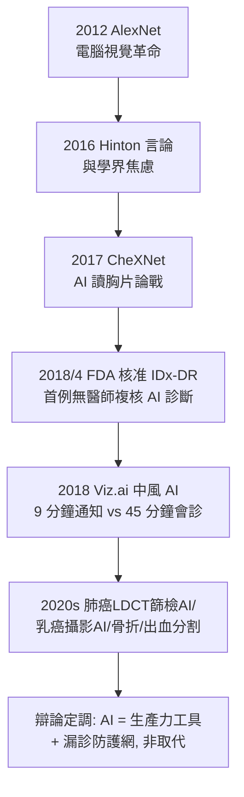

## 2017 - AI 判讀醫學影像的時代（放射科醫師會被取代嗎？）

## 案件摘要

**本案偵破的是：每日數百張 CT、上千張切片的讀片洪流——機器能不能成為放射科的「第二雙眼睛」？**

2012 年 AlexNet 在 ImageNet 影像辨識競賽中以深度摺積神經網路（CNN）大幅勝出，把電腦視覺推入深度學習時代。醫學影像是深度學習最豐沃的應用場：資料天生數位化（拜 DICOM/PACS 之賜，見 `1992-DICOM與PACS數位放射科.md`）、標籤明確（病理/報告）、任務清晰（有無病灶）。2017 年，史丹佛研究團隊發表 **CheXNet**：121 層 CNN 在胸部 X 光肺炎偵測上表現與放射科醫師相當；同年起 AI 影像產品（糖尿病視網膜病變 IDx-DR 2018 年獲 FDA 首例核准、腦中風大血管阻塞偵測 Viz.ai 2018 獲准）陸續進入臨床。放射科進入「人機共讀」時代，同時引爆「放射科醫師將在十年內被取代」的世紀辯論（Hinton 2016 年名言）。

## 前因

- **符號時代 AI 的失敗史**。1960s 起即有「電腦讀 X 光」嘗試（Ledley 的早期工作、1980s 電腦輔助偵測 CAD），以手工特徵＋規則為主，性能長期不足——60 年的「狼來了」使放射學界對 AI 極度審慎。
- **深度學習的三個前提在 2012 年前後同時成熟**：(1) GPU 平行運算；(2) 大規模標註資料（ImageNet 1400 萬張）；(3) ReLU/_dropout_ 等訓練技巧。醫學版影像網（如 MIMIC-CXR、CheXpert）稍後跟上。
- **放射科的能量危機**。CT/MRI 檢查量每年成長 8–10%，放射科醫師人數不成比例；讀片疲勞與漏診成為系統性風險——「AI 的需求側」早已存在。
- **監管與法律的空白**。AI 判讀的責任歸屬、驗證方法（回溯 vs 前瞻）、偏見（訓練資料的人群代表性）在 2017 年前幾乎無制度框架。

## 線索與推理

**線索一：CNN 為什麼適合醫學影像。** 摺積層的數學本質是**平移不變的局部濾波器組**：

$$ y(x, y) = \sum_{i,j} w(i, j)\, x(x+i, y+j) + b $$

逐層堆疊後，淺層學到邊緣/紋理（與放射科住院醫師先學看「密度、邊緣」同構）、深層學到語義概念（結節、實變、骨折線）。遷移學習使 ImageNet 預訓練模型在小樣本醫學資料上快速收斂——**視覺認知的層級性被證明是跨域的**。

**線索二：CheXNet 的實驗設計與爭議。** 2017 年 11 月 arXiv 論文：DenseNet-121 在 ChestX-ray14 資料集（14 種病理標籤、112,120 張片）上以 FROC 曲線比較——肺炎偵測上「超過」4 位放射科醫師。偵探式的批判隨即而來（這正是本案的方法論核心）：

```text
批評 1: 影像層級標籤來自 NLP 挖掘報告，與醫師讀片的「病人層級」任務不同構
批評 2: 比較對象僅 4 位醫師、單中心、無臨床語境（無病歷）
批評 3: 資料洩漏（同一病人影像分散於訓練/測試集）使效能高估
結論: 「AI 勝過醫師」的敘事遠早於方法學的成熟 — 宣傳與證據的時間差
```

**線索三：臨床落地的真實路徑。** 早期成功的 AI 應用有共同特徵——**任務窄、答案二元、時間敏感**：



**線索四：放射科醫師的反偵探——把 AI 變成工具。** 學界的回應不是否認而是**重新定義任務**：AI 擅長「掃描全部、抓出可疑」，人擅長「整合臨床語境、責任判斷、與病人溝通」。2020s 的共識架構：AI 為「triage/初篩/第二讀者」，最終診斷與簽名仍在醫師——與 1958 年超音波「醫師＋工程師」組合（見 `1958-唐納超音波看見胎兒.md`）一樣，本質仍是人機協作分工的設計問題。

## 結案

- **放射科的第三次工具革命**。第一次是 Coolidge 管（物理可重複，見 `1913-庫利吉管與現代X光機.md`），第二次是 CT/MRI（數學重建，見 `1971-洪斯菲德與CT的誕生.md`、`1977-人體第一張MRI.md`），第三次是 AI（認知自動化）——每片革命都改變「醫師的核心技能」清單。
- **真正的結案**：「取代論」被證偽，但「角色重構論」被證實——讀片初篩逐步自動化，放射科醫師的價值上移至：介入治療（見 `1964-多特與介入性放射線的誕生.md`）、多模態整合、腫瘤療效評估、臨床會診與質控。
- **演算法的偏見與公平**。訓練資料以歐美成人為主，使 AI 在兒童、深色皮膚影像、低資源設備影像上效能下降——「資料的代表性 = 醫療公平」，這是本卷宗未結的章節。
- **監管與倫理的成長痛**。FDA 的 SaMD 框架、歐盟 AI 法案（2024）把醫療 AI 列高風險、可解釋性（XAI）要求——AI 判讀正在重走 1925 年放射防護的路：**先有技術，再有事故，最後有制度**。
- **一句話結案**：AI 沒有取代放射科醫師，它取代了「不使用 AI 的放射科醫師」——與 1896 年以來的每一代工具一樣，問題從來不是機器多強，而是誰學會了與機器合作推理。

## 關鍵人物與文獻

- **Geoffrey Hinton（1947–2024/在世）**——深度學習之父、2018 年圖靈獎；2016 年「應停止訓練放射科醫師」言論是本辯論的導火線；其本人亦承認時間表過於樂觀。
- **Andrew Ng 與吳恩達團隊**——史丹佛機器學習組；CheXNet 論文（Pranav Rajpurkar 等執筆）發表者，掀開醫學影像 AI 的競賽時代。
- **Michael Abramoff**——眼科醫師兼 AI 學者，IDx-DR 首例自主 AI 診斷的 FDA 核准（2018）背後的臨床設計者，AI 醫療監管科學的先驅。
- ** datasets 生態**——MIMIC-CXR（MIT，2019）、CheXpert（史丹佛，2019）、RSNA 肺出血挑戰賽（2018）使方法學可重複比較，成為本案「糾錯機制」的基礎設施。
- 原始文獻——A. Krizhevsky et al., *ImageNet Classification with Deep Convolutional Neural Networks*, NeurIPS, 2012；P. Rajpurkar et al., *CheXNet: Radiologist-Level Pneumonia Detection on Chest X-Rays with Deep Learning*, arXiv, 2017；FDA De Novo authorization DEN180020（IDx-DR, 2018）。
- 現代註腳——2020s 的基礎模型（如 MedSAM、放射學大模型）把 AI 從「單病種偵測器」推向「多任務通用助手」；而 2025 年的多中心驗證仍在提醒本案的原始教訓：**醫學影像 AI 的敵人不是病灶，是資料分佈的偏移**。
