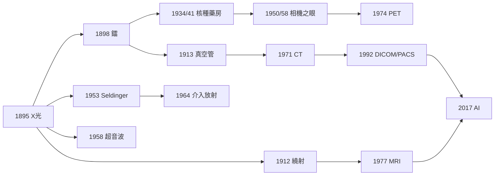

# 放射科的歷史：從 X 光的暗室、鐳的幽光、斷層的數學，到 AI 的第二雙眼睛

> 本書以「推理探案」的體例，為人類放射醫學（Radiology）史上的每個關鍵事件寫一篇 wiki：
> 謎題是什麼（如何不開刀看見身體內部？如何看見身體的化學？）？偵探是誰（物理學家、工程師、醫師、病人）？
> 線索與推理是什麼（電磁學、繞射、反投影、核磁共振、湮滅符合、深度學習）？
> 每篇檔名以年份開頭（4 位數，負年以 `-` 開頭）。

## 三條主線

| 線 | 演變 |
|---|---|
| **物理與工程線** | 陰極射線 → X 光/放射性 → 繞射與波長哲學 → 真空管工程 → 加速器與反應爐 → CT 重建數學 → MRI 梯度編碼 → 數位標準 → 深度學習 |
| **診斷能力線** | 看骨骼 → 對比劑看空腔與血管 → 斷層切片 → 看功能與代謝（核醫學/PET）→ 看化學與水（MRI）→ 看全身容積與分子 | 
| **制度與社會線** | 狂熱採納 → 職業災害 → 劑量學與 ICRP → 職業病審判 → 技師/物理師職業化 → PACS 數位化 → AI 監管與醫療公平 |

---

## 年表（非常詳細版）

### 第一篇：暗室裡的光——X 光與放射性的發現

| 年份 | 事件 | 意義 | wiki |
|---|---|---|---|
| 1895/11/8 | Röntgen 發現 X 光；12/28 發表論文；12/22 拍下安娜的手 | 人類第一次不開刀看見身體內部；1901 首屆諾貝爾物理獎 | [1895-侖琴發現X光](1895-侖琴發現X光.md) |
| 1896 | 全球 X 光狂熱；2/3 首例臨床診斷片（Eddie McCarthy）；Freund/Grubbe 早期放射治療；醫院設立 X 光部門 | 發現→商品化→制度化的第一圈；「診斷＋治療」同源 | [1896-X光狂熱與第一批放射線科](1896-X光狂熱與第一批放射線科.md) |
| 1896/3/1 | Becquerel 陰雨天抽屜意外：鈾鹽自發輻射 | 天然放射性現身；1903 諾獎 | [1896-貝克勒爾發現天然放射性](1896-貝克勒爾發現天然放射性.md) |
| 1897 | Cannon 以鋇/鉍鹽餵食，X 光透視觀察胃的運動 | 對比劑概念誕生；消化道影像學起點 | [1897-坎農鋇餐追蹤消化道](1897-坎農鋇餐追蹤消化道.md) |
| 1898 | 居禮夫婦以壓電靜電計定量「放射性」；從礦渣煉出釙與鐳 | 放射性是原子性質；放射化學與追蹤劑思想的源頭 | [1898-居禮夫婦發現鐳](1898-居禮夫婦發現鐳.md) |
| 1912/4 | Friedrich–Knipping 依 Laue 構想以晶體繞射 X 光；1913 Bragg 定律；Moseley 定律 | X 光本質結案（電磁波）；結構生物學出生證明 | [1912-勞厄與X光繞射](1912-勞厄與X光繞射.md) |

### 第二篇：工程化——把閃電裝進旋鈕，把放射科搬上前線

| 年份 | 事件 | 意義 | wiki |
|---|---|---|---|
| 1913 | Coolidge 熱陰極高真空 X 光管 | 電流（劑量）與電壓（穿透）解耦；劑量學與深部治療的前提 | [1913-庫利吉管與現代X光機](1913-庫利吉管與現代X光機.md) |
| 1914–1918 | 一戰；居禮夫人改裝 20 輛「小居禮」輻射車赴前線，訓練 150 名女性技師，百萬人次檢查 | 流動影像系統；放射技師職業誕生；戰爭加速放射科制度化 | [1914-一戰戰場X光與居禮輻射車](1914-一戰戰場X光與居禮輻射車.md) |
| 1925–1928 | 第一屆國際放射學大會；1928 IXRPC 成立，採納倫琴單位與首部防護建議 | 殉職者換來的制度：劑量單位→限值→ALARA；醫學物理師職業確立 | [1925-國際放射防護的誕生](1925-國際放射防護的誕生.md) |
| 1925–1932 | 鐳女孩事件：錶盤女工舔筆攝入鐳，radium jaw、骨肉瘤；1927 勝訴和解；1932 Radithor 名流之死 | 內照射傷害與放射毒理誕生；職業病法改革；核種生物動力學起點 | [1927-鐳女孩與輻射傷害審判](1927-鐳女孩與輻射傷害審判.md) |

### 第三篇：核子時代——把放射性搬進工廠與藥房

| 年份 | 事件 | 意義 | wiki |
|---|---|---|---|
| 1931 | Lawrence 與 Livingston 建成迴旋加速器（1.22 MeV 質子） | 醫用同位素工廠誕生；核子醫學與質子治療的供應鏈起點；1939 諾獎 | [1931-勞倫斯迴旋加速器](1931-勞倫斯迴旋加速器.md) |
| 1934 | Fermi 羅馬小組以中子轟擊週期表；10 月發現慢中子效應 | 中子捕獲＋β 衰變「登階」配方；減速劑＝反應爐鑰匙；核種藥房開張 | [1934-費米與人工放射性](1934-費米與人工放射性.md) |
| 1941/3/31 | Hertz 在 MGH 以碘 131 首次治療甲狀腺亢進 | 追蹤劑原理的臨床首演；診斷與治療同一顆原子；核子醫學誕生 | [1941-碘131與核子醫學誕生](1941-碘131與核子醫學誕生.md) |
| 1946+ | 戰後橡樹嶺反應爐量產碘 131、鈷 60、鉬 99 | 核醫學藥房廉價化；鈷 60 治療機普及 | [1934-費米與人工放射性](1934-費米與人工放射性.md)、[1941-碘131與核子醫學誕生](1941-碘131與核子醫學誕生.md) |
| 1950–1958 | Cassen 直線掃描儀（1950）→ Anger 伽瑪相機（1957–58，PMT 陣列＋重心法） | 核醫學從「計數」變「影像」；Kuhl 1963 斷層概念孕育 SPECT | [1950-閃爍掃描儀與Anger伽瑪相機](1950-閃爍掃描儀與Anger伽瑪相機.md) |
| 1974–1978 | PETT III（Ter-Pogossian/Phelps/Hoffman）；FDG 合成 | 湮滅符合＝電子學準直；代謝陷阱使「化學活動自己發光」 | [1974-PET正子斷層掃描](1974-PET正子斷層掃描.md) |

### 第四篇：切開身體的數學——斷層與非電離影像

| 年份 | 事件 | 意義 | wiki |
|---|---|---|---|
| 1971/10/1 | EMI Mark I 在倫敦掃描第一位病人；1972 發表 | Radon 1917 的數學變成切片之眼；顱內病變首度活體可見；1979 諾獎 | [1971-洪斯菲德與CT的誕生](1971-洪斯菲德與CT的誕生.md) |
| 1958/《Lancet》 | Donald–Brown–McVicar 接觸式複合掃描超音波 | 非電離、可攜、即時；產科與胎兒醫學革命；聲學（而非密度）對比 | [1958-唐納超音波看見胎兒](1958-唐納超音波看見胎兒.md) |
| 1977/7/3 | Damadian 的 Indomitable 掃出人體首張胸部 MRI；1973 Lauterbur 梯度編碼；Mansfield EPI | NMR 光譜學變成可編程相機；k-空間語法；軟組織診斷重寫；2003 諾獎 | [1977-人體第一張MRI](1977-人體第一張MRI.md) |

### 第五篇：診斷者拿起導管——血管造影與介入放射

| 年份 | 事件 | 意義 | wiki |
|---|---|---|---|
| 1953 | Seldinger 發表經皮置管五步法（針→鋼絲→管） | 幾乎所有血管內操作的單一入口；醫學史上執行次數最多的術式之一 | [1953-塞丁格技術與血管造影](1953-塞丁格技術與血管造影.md) |
| 1964/1/16 | Dotter–Judkins 為拒絕截肢的 Laura Shaw 同軸擴張膕動脈 | Poiseuille 的 $ r^4 $ 物理＋一個 N=1 病例＝介入放射學誕生；放射科的身分革命 | [1964-多特與介入性放射線的誕生](1964-多特與介入性放射線的誕生.md) |
| 1974–1986 | Gruntzig 球囊導管→首例冠狀動脈成形（1977）→支架（1986） | PCI 譜系確立；後續栓塞、TIPS、取栓、支架置換全面開花 | [1964-多特與介入性放射線的誕生](1964-多特與介入性放射線的誕生.md) |

### 第六篇：無膠片的科與會思考的機器

| 年份 | 事件 | 意義 | wiki |
|---|---|---|---|
| 1983–1993 | ACR–NEMA 制定標準；1993 DICOM 3.0；PACS 大規模部署 | 影像自帶病歷的結構化物件；放射科成為醫院數位化先鋒；膠片時代終結 | [1992-DICOM與PACS數位放射科](1992-DICOM與PACS數位放射科.md) |
| 2012 | AlexNet 勝出 ImageNet | 深度學習革命；醫學影像 AI 的技術前提 | [2017-AI判讀醫學影像的時代](2017-AI判讀醫學影像的時代.md) |
| 2017–2018 | CheXNet 發表；FDA 核准 IDx-DR（首例自主 AI 診斷）與 Viz.ai 中風 AI | 「AI 勝過醫師」敘事與方法學批判並行；人機共讀時代開始 | [2017-AI判讀醫學影像的時代](2017-AI判讀醫學影像的時代.md) |

---

## 貫穿全書的偵探方法論（六條定律）

1. **排除法與意外**：Röntgen 排除已知解釋、Becquerel 讓假設死於陰雨——異常＋嚴謹控制變因＝發現（1895、1896 案）。
2. **收支不平衡**：居禮的礦渣活性帳、Dotter 的 $ r^4 $ 流量帳——數字對不上，必有未知因子（1898、1964 案）。
3. **把問題反轉**：Laue 找不到光柵就用晶體、Lauterbur 沒有準直器就用梯度——兩難時換座標系（1912、1977 案）。
4. **量化的道德**：看不見的傷害必須翻譯成數字（倫琴→Gy→Sv），制度跟著單位走（1925、1927 案）。
5. **追蹤劑原理**：讓分子自己報告行蹤，順手讓它執行治療——從碘 131 到 theranostics（1941、1974 案）。
6. **技術的第一批使用者中，先驅與騙子同在**：X 光狂熱、鐳保健品、AI 宣傳——社會消化奇觀平均需要半世紀（1896、1927、2017 案）。

## 延伸閱讀的地圖

- 想看「物理怎麼來的」：`1912-勞厄與X光繞射` → `1971-洪斯菲德與CT的誕生` → `1977-人體第一張MRI`
- 想看「傷害與制度」：`1925-國際放射防護的誕生` → `1927-鐳女孩與輻射傷害審判` → `2017-AI判讀醫學影像的時代`（監管段）
- 想看「核」的譜系：`1896-貝克勒爾` → `1898-居禮` → `1931-迴旋加速器` → `1934-費米` → `1941-碘131` → `1950-伽瑪相機` → `1974-PET`
- 想看「動手的科」：`1953-塞丁格` → `1964-多特`

## 同系列書籍

- [性病的歷史](../性病的歷史/README.md)
- （本書為醫學史系列的放射科分卷）
