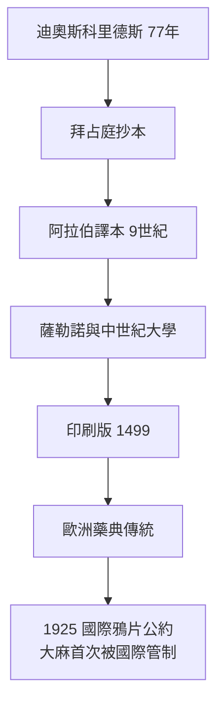

## 0077 - 迪奧斯科里德斯《藥物論》（大麻與毒物學的第一次系統化）

## 案件摘要

**本案的兇手，是一冊被抄寫了一千五百年的植物圖鑑。**

西元 77 年，尼祿軍團的希臘軍醫 Pedanius Dioscorides 寫成五卷本 *De Materia Medica*（《藥物論》），收錄約 600 種藥物，其中明確記載鴉片、大麻（kannabis）的鎮痛用途、曼陀羅（mandragora）的麻醉用途、以及毒藥與解藥的劑量關係。此書成為拜占庭、阿拉伯、中世紀歐洲的藥學聖經——直到 16 世紀仍被翻印。它首次把「藥、毒、劑量」放在同一個系統裡處理，是毒理學與藥理學的共同祖先。

## 前因 -- 為什麼會有這個案子

- **羅馬軍醫的實地調查**。迪奧斯科里德斯隨軍隊走遍地中海與近東，能直接觀察各地草藥的來源植物、採收時節與臨床效果——這是「以實物為準」而非「以傳說為準」的罕見方法論。
- **大麻的醫療正名**。希羅多德（前 5 世紀）記載的大麻是蒸氣娛樂；迪奧斯科里德斯則記載其汁液可緩解耳痛、種子可「抑制性慾」——大麻進入正規藥典，這個地位將維持到 20 世紀（見 `1967-愛之夏與迷藥文化.md` 的反向逆轉）。
- **麻醉的萌芽**。書中記載曼陀羅酒可使病人「切膚如無覺」——這是全身麻醉概念的最早文獻之一，比乙醚麻醉早 1750 年。
- **毒與藥的統一帳本**。迪奧斯科里德斯區分「治療量、中毒量、致死量」，這個三分法來自 Paracelsus 之前最清晰的劑量意識。

## 線索與推理 -- 理論

大麻的活性成分要到 1964 年才被 Raphael Mechoulam 分離出（Δ9-THC），而其受體（CB1）1990 年才被克隆。但迪奧斯科里德斯靠臨床觀察就抓住了關鍵效應：鎮痛、抗炎、影響情緒與食慾——這些正是內生大麻素系統（anandamide、2-AG）調控的生理功能：

$ \Delta^9\text{-THC} + CB1 \text{ 受體} \rightarrow \text{抑制突觸前 } \mathrm{Ca}^{2+} \rightarrow \text{神經傳導物質釋放↓} \rightarrow \text{痛覺與噁心↓} $

本案的推理重點是**方法論的跳躍**：迪奧斯科里德斯的條目格式（植物名、產地、形態、藥效、劑量、禁忌）就是現代藥典的格式。他記載鴉片「多量致眠、過量致死」，記載曼陀羅需「以酒稀釋、由醫者定量」——這是把薩滿的口傳劑量知識，第一次寫成可傳承、可檢驗的文字系統。

## 結案 -- 後果與影響

- **藥學作為獨立學科誕生**。藥劑師（pharmacopeia）與醫師的分家、《藥物論》為本的藥典傳統、植物學插圖的科學化——全部可以回溯到這本書。
- **大麻的醫療黃金時代**。從 77 年到 1937 年美國《大麻稅法》之前，大麻一直是西方藥典的正式成員（19 世紀 O'Shaughnessy 從印度帶回大麻醫學用法只是重新引入）。這段「合法醫療 1800 年」的歷史，是今天大麻醫療合法化運動（`2012-大麻合法化.md`）的核心論據。
- **麻醉學的遠祖**。曼陀羅、顛茄、天仙子等莨菪鹼植物在《藥物論》中的麻醉記載，為中世紀「睡眠海綿」（spongia somnifera）外科麻醉提供了配方原型（見 `1486-巫術藥膏與顛茄.md` 的另一面）。
- **一句話結案**：迪奧斯科里德斯沒有發現任何新藥，他發現的是「如何把藥寫下來」——而文字一旦系統化，藥與毒的知識就再也無法被薩滿壟斷。

## 關鍵人物與文獻

- Pedanius Dioscorides, *De Materia Medica*（77 年）。
- John M. Riddle, *Dioscorides on Pharmacy and Medicine*（1985）——該書歷史影響的權威研究。
- Raphael Mechoulam——THC 分離（1964）與內生大麻素系統研究之父。
- Ethan B. Russo——大麻醫療史與「entourage effect」的現代梳理。
